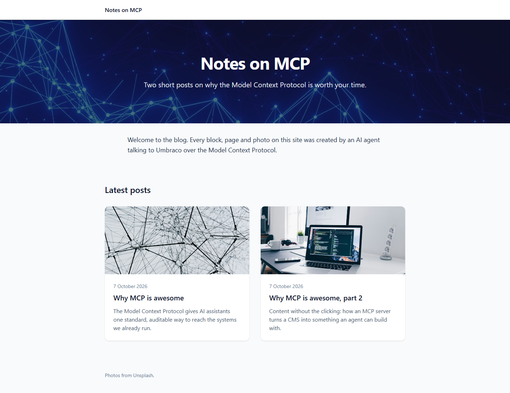
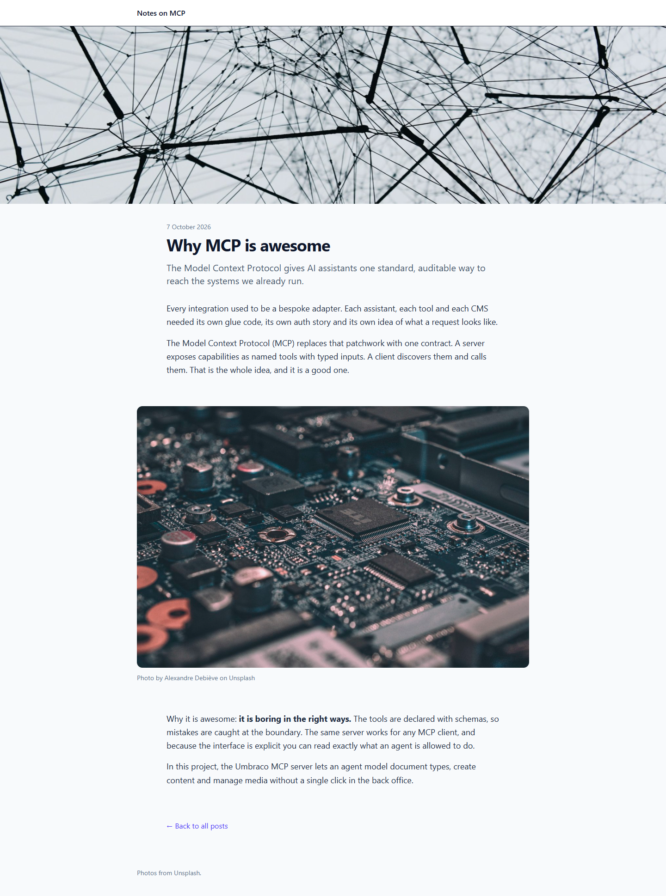

# Grade: 2026-10-07_2011_mcp_haiku-5.5-high

**Test:** MCP · **Model:** Haiku 5.5 (high) · **Grader:** Opus 5.5 (high) · **Total: 96 / 100**

| Category | Score | Max |
|---|---|---|
| It works | 35 | 35 |
| Content modeling | 23 | 25 |
| Code architecture & conventions | 25 | 25 |
| Content & presentation | 8 | 10 |
| Process & honesty | 5 | 5 |
| **Total** | **96** | **100** |

## Summary

A clean, fully working MCP-built blog: a front page with a hero and card listing, plus two posts built from a shared hero/rich-text/image block grid. The rendering pipeline follows the scaffold's conventions exactly. The main weakness is that the two posts are short (about 4 brief paragraphs each).

All 43 automated checks pass, and the build has 0 warnings. The run took 5:55 in total.

## Issues

- **minor:** The posts are thin, about 4 short paragraphs (~150 words) each: `/why-mcp-is-awesome/`, `/why-mcp-is-awesome-part-2/`.
- **minor:** `blogPost` has a `title` property that duplicates the node name.
- **minor:** `imageBlock` has no alt-text property. The caption ("Photo by … on Unsplash") is used as `alt` (`Views/Shared/Components/Image/Default.cshtml`).
- **minor:** The post hero images have no photographer credit, only a generic "Photos from Unsplash." footer. The final report disclosed this.

## What it built

**Document types** (all via MCP):
- Blocks (elements):
  - `heroBlock`: heading, subheading, backgroundImage
  - `richTextBlock`: body (Tiptap)
  - `imageBlock`: image, caption
- Pages:
  - `blogFrontPage`: `blocks` block grid. Allows `blogPost`.
  - `blogPost`: title, summary, publishDate, heroImage, `body` block grid
- `siteRoot` now allows `blogFrontPage`.

**Data type:** "Page Blocks" (`Custom/Umbraco.BlockGrid`), a 12-column grid that allows the three blocks.

**Templates:** `blogFrontPage`, `blogPost`

**Content:**
- `WWW / Blog` has the `/` domain. Its grid holds a hero block and an intro rich-text block.
- Two posts sit under the Blog page. Each has a rich text → image (credited caption) → rich text body.
- Five Unsplash photos are imported into the `Blog` media folder.

**Code:**
- Three adapters in `Views/Partials/blockgrid/Components/`.
- Hero, RichText, Image and PostList ViewComponents, with records in `Models/Blog/`.
- `_Layout.cshtml`, plus page views that use `GetBlockGridHtmlAsync`.
- The front page builds `PostCardModel`s from `Children<BlogPost>()` and passes them to the PostList component.

**Look:**
- **Front page:** a dark hero over the network photo, a short intro, and "Latest posts" as two white cards. Each card shows an image, date, title and excerpt.
- **Post pages:** a full-width header photo, then the date, title and lead, followed by the body blocks with a rounded, captioned inline image and a back link.

