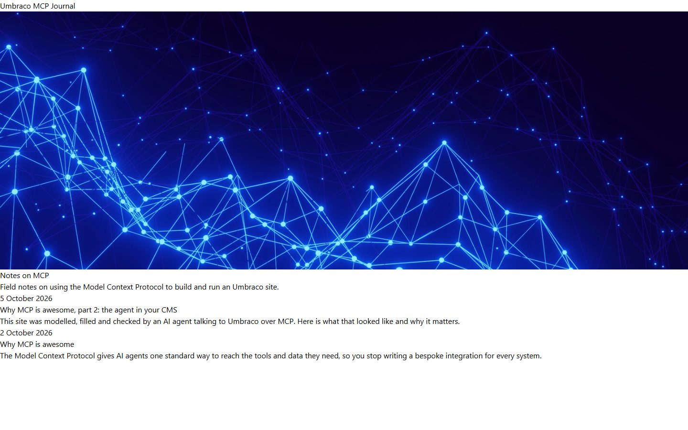

# Grade: 2026-10-07_2021_mcp_haiku-5.5-high

**Test:** MCP · **Model:** Haiku 5.5 (high) · **Grader:** Opus 5.5 (high) · **Total: 90 / 100**

| Category | Score | Max |
|---|---:|---:|
| It works | 35 | 35 |
| Content modeling | 24 | 25 |
| Code architecture & conventions | 23 | 25 |
| Content & presentation | 4 | 10 |
| Process & honesty | 4 | 5 |
| **Total** | **90** | **100** |

## Summary

A complete MCP-built blog: three blocks (hero, rich text, image) in one shared block grid, a front page and two posts. It has textbook adapter → ViewComponent architecture, and all 43 automated checks pass. It is let down by an unstyled site (Tailwind was compiled before the views existed) and by short posts.

## Issues

- **Major:** The site is unstyled. `npm run build` ran at 18:24:44, before any Razor view was written (18:25:10 onward), and was never re-run. `Umbraco.Bench.Umbraco/wwwroot/dist/site.css` (6 KB) has only preflight and none of the utility classes the views use (`mx-auto`, `max-w-3xl`, `text-4xl`, …).
- **Major:** The posts are thin, about 4 short paragraphs each: `/why-mcp-is-awesome/`, `/why-mcp-is-awesome-part-2-the-agent-in-your-cms/`.
- **Minor:** The final report says the Tailwind bundle is built but doesn't notice that the pages render unstyled.
- **Minor:** `blogHome` and `blogPost` have a `title` property that duplicates the node name. The layout `<title>` uses the node name (`Views/Shared/_Layout.cshtml`).
- **Minor:** The front-page post cards show no image even though posts have a `heroImage` (`Views/blogHome.cshtml`).

## Strengths

- Clean schema via MCP: correct folders, one shared block grid in `Custom/`, a siteRoot → blogHome → blogPost structure, and a domain on the front page.
- Textbook rendering pipeline: `GetBlockGridHtmlAsync`, markup-free adapters, plain models in `Models/Blocks/`, one ViewComponent per block.
- The provided Unsplash photos are imported into the media library, with photographer credits in captions, and served via `GetCropUrl`.
- Real post metadata (`publishDate`, `summary`, `heroImage`) drives the front-page listing.

## What it built

- **Document types:** `heroBlock` (heading, intro, image), `textBlock` (rich text) and `imageBlock` (image, caption) are elements in `Blocks/`. `blogHome` (title, blocks) and `blogPost` (title, summary, publishDate, heroImage, body) are documents in `Pages/`. `siteRoot` now allows `blogHome`.
- **Data type:** "Blog Block Grid" (`Custom/Umbraco.BlockGrid`), with all three blocks, 12 columns.
- **Pages:** WWW → Blog (`/`, domain `/`) → "Why MCP is awesome" and "Why MCP is awesome, part 2: the agent in your CMS".
- **Code:** `_Layout.cshtml`, `blogHome.cshtml` (block grid plus a Razor listing of child posts), `blogPost.cshtml` (header, hero image, block grid), 3 adapters, 3 ViewComponents and 3 plain models.
- **Look:** Both pages render with browser defaults. The front page is a small "Umbraco MCP Journal" line, a full-width hero photo with its heading below it, then a plain list of date, title and summary. Posts are a back link, title, date and summary, then full-bleed photos and plain paragraphs. The headings are at body text size because the Tailwind utilities were never compiled.

