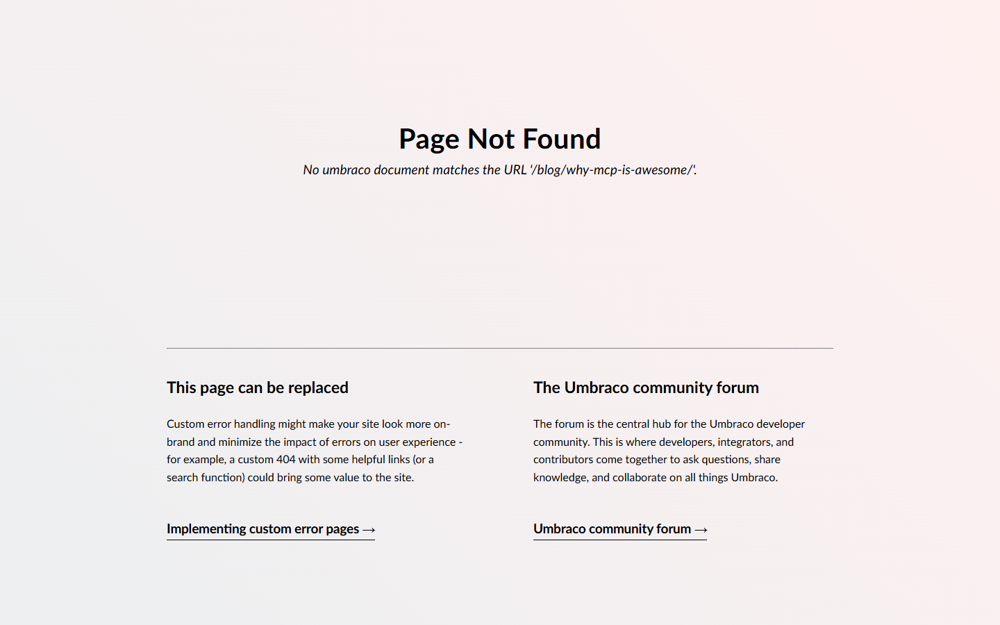

# Grade: 2026-10-07_2044_mcp-guided_haiku-4.5

**Test:** MCP Guided · **Model:** Haiku 4.5 · **Grader:** Opus 5.5 (low) · **Total: 29 / 100**

| Category | Score | Max |
|---|---:|---:|
| It works | 6 | 35 |
| Content modeling | 13 | 25 |
| Code architecture & conventions | 7 | 25 |
| Content & presentation | 1 | 10 |
| Process & honesty | 2 | 5 |
| **Total** | **29** | **100** |

## Summary

Haiku 4.5 created three block element types, two page types, templates, media and two short MCP posts over MCP. It never made a block grid data type, left every page in Draft and put the `/` domain on WWW. The site serves only 404s. The views use plain rich text, and the block ViewComponents are unused dead code.

## Issues

- **major**: `GET /` returns 404 ("No template exists to render the document at URL '/'"). `/blog/`, `/blog/why-mcp-is-awesome/` and `/blog/getting-started-with-mcp/` also return 404.
- **major**: Blog and both posts are **Draft**. `publish-document` was called with `{publishSchedules: []}`, and the model never checked whether the publish worked.
- **major**: There is no block grid at all. No `Umbraco.BlockGrid` data type exists. `blogPost.content` and `blogFrontPage.intro` are plain RichText.
- **major**: There are no adapters in `Views/Partials/blockgrid/Components/` (written, failed to compile, deleted) and no `GetBlockGridHtmlAsync`. `Controllers/Components/*ViewComponent.cs` are never invoked.
- **major**: The domain `/` is on the WWW `siteRoot` node, not on the Blog page (AGENTS.md rule 2).
- **minor**: The 3 imported photos (media folder "Blog") are never used. No page has an image, and there is no date or listing image property.
- **minor**: Full Razor views were pushed into templates via `create-template` during modeling, before the ModelsBuilder types existed. This broke the build and crashed the site mid-run.
- **minor**: The final report blames "BlockGridItem type isn't available in this Umbraco version" (it was a missing using). It also claims the architecture follows the conventions.

## What it built

- **Document types:** `blogFrontPage` (Pages: title, intro RichText) → `blogPost` (Pages: title, summary TextArea, content RichText), under the existing `siteRoot` (allowed children updated).
- **Blocks (elements, folder Blocks, unused):** `richTextBlock` (content), `imageBlock` (image, caption), `testimonialBlock` (quote, author).
- **Templates:** `blogFrontPage.cshtml` (header, intro, card grid of child posts with title, summary and "Read more"), `blogPost.cshtml` (header, back link, `@Html.Raw` of the rich text). Both use Tailwind and `Layout = null`.
- **Content:** WWW (domain `/`) → Blog → "Why MCP is Awesome", "Getting Started with MCP". All three are Draft.
- **Media:** Blog folder with code-on-screen, network-lines-dots and connected-structure (provided photos).
- **How it looks:** Both pages show Umbraco's 404 page. The front page fails because WWW has no template; the post fails because it is unpublished.

