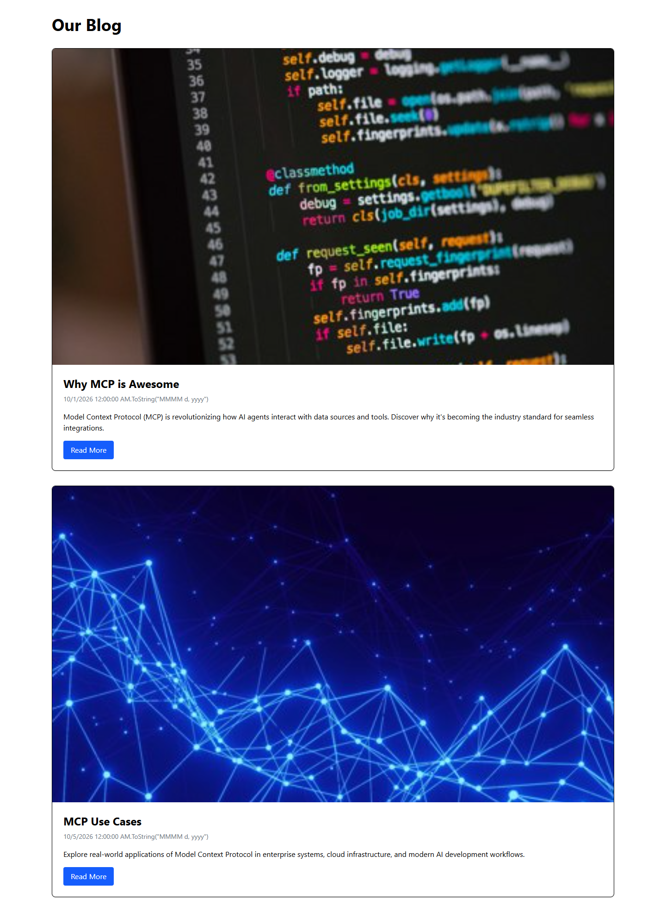
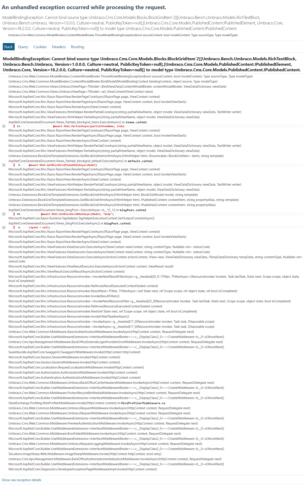

# Grade: 2026-10-07_2127_mcp-guided_haiku-4.5

**Test:** MCP Guided · **Model:** Haiku 4.5 · **Grader:** Opus 5.5 (high) · **Total: 65 / 100**

| Category | Score | Max |
|---|---:|---:|
| It works | 22 | 35 |
| Content modeling | 20 | 25 |
| Code architecture & conventions | 18 | 25 |
| Content & presentation | 2 | 10 |
| Process & honesty | 3 | 5 |
| **Total** | **65** | **100** |

## Summary

Haiku 4.5 built a correctly filed schema (3 blocks, a front page and post types, a block grid data type), 2 published posts with imported Unsplash photos and a working domain, all through MCP. The front page works apart from a garbled date, but both post pages crash with a 500 because the block adapters do not take `BlockGridItem<T>`, and the post content is very thin.

## Issues

- **major**: Both posts return 500 `ModelBindingException`. The adapters in `Views/Partials/blockgrid/Components/{richTextBlock,imageBlock,calloutBlock}.cshtml` inherit non-generic `UmbracoViewPage` (which expects `IPublishedContent`) instead of `UmbracoViewPage<BlockGridItem<T>>`. Affected URLs: `/why-mcp-is-awesome-1/`, `/mcp-use-cases/`.
- **major**: Post content is very thin. Each post has one short rich text block and a one-line callout, and neither uses an image block.
- **major**: `blogFrontPage` has no block grid body, only a `title` property.
- **minor**: The date renders literally as `10/1/2026 12:00:00 AM.ToString("MMMM d, yyyy")`, because `@((DateTime)date).ToString(...)` ends the Razor expression early (`Views/blogFrontPage.cshtml`, `Views/blogPost.cshtml`).
- **minor**: A duplicate draft post "Why MCP is Awesome" is left over from failed `create-page` retries, so the live post sits at `/why-mcp-is-awesome-1/`.
- **minor**: Templates and adapters read values with untyped `Value("alias")` and `dynamic` instead of the ModelsBuilder models. The view models in `Models/ViewModels/` use namespace `Umbraco.Bench.Umbraco.Models`, and the ViewComponent classes have no namespace.
- **minor**: The final report overclaims. It says all content is published and the views follow AGENTS.md, and it says it would stop rendering blocks on posts but never did. It does disclose the 500s on the post pages.

## Strengths

- All schema, media, content and the domain were built through the `umbraco` and `umbraco-editor` MCP servers, in the prescribed order.
- Document types are correctly filed (Blocks, Pages) with the right allowed children: siteRoot → blogFrontPage → blogPost.
- The provided Unsplash photos were imported into a `Blog` media folder and are served through `GetCropUrl`.
- Each block has the full adapter → ViewComponent → plain model → `Default.cshtml` chain, and the component views have no Umbraco dependencies.

## What it built

- **Document types:** `richTextBlock` (content: RTE), `imageBlock` (image: media picker, caption), `calloutBlock` (message: RTE), all elements in *Blocks*. `blogFrontPage` (title) and `blogPost` (title, publishDate, excerpt, featuredImage, body: block grid), both in *Pages*, each with its own template.
- **Data type:** `Blog Blocks` (Block Grid) in `/Custom`, allowing the 3 blocks.
- **Content:** WWW → Blog (domain `/`) → "Why MCP is Awesome" (`/why-mcp-is-awesome-1/`) and "MCP Use Cases" (`/mcp-use-cases/`), plus an unpublished duplicate draft. Each post body has 1 rich text block and 1 callout block.
- **Media:** "Code on Screen" and "Network Lines" from `unsplash/`.
- **Code:** 2 page templates, 3 block adapters, 3 ViewComponents with `Default.cshtml` views, 3 view models in `Models/ViewModels/`, and a Tailwind build.

**Front page:** the "Our Blog" heading above two full-width cards. Each card has a large photo, the title, a garbled date line, the excerpt and a blue "Read More" button. It is plain but readable.

**Blog post:** an ASP.NET developer exception page (`ModelBindingException: Cannot bind source type BlockGridItem<RichTextBlock, IPublishedElement> to IPublishedContent`). Neither post renders.

