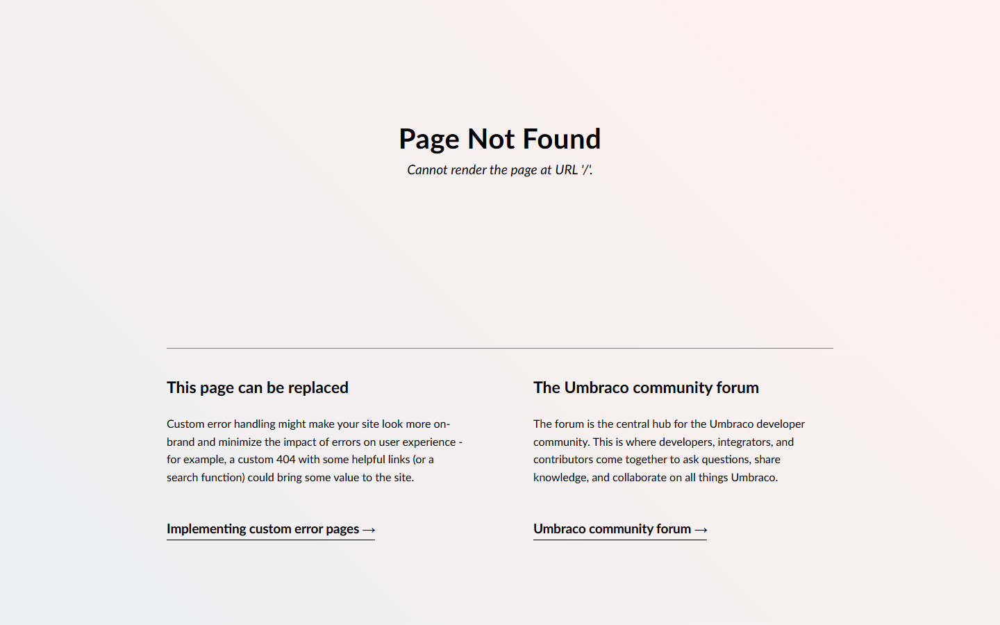
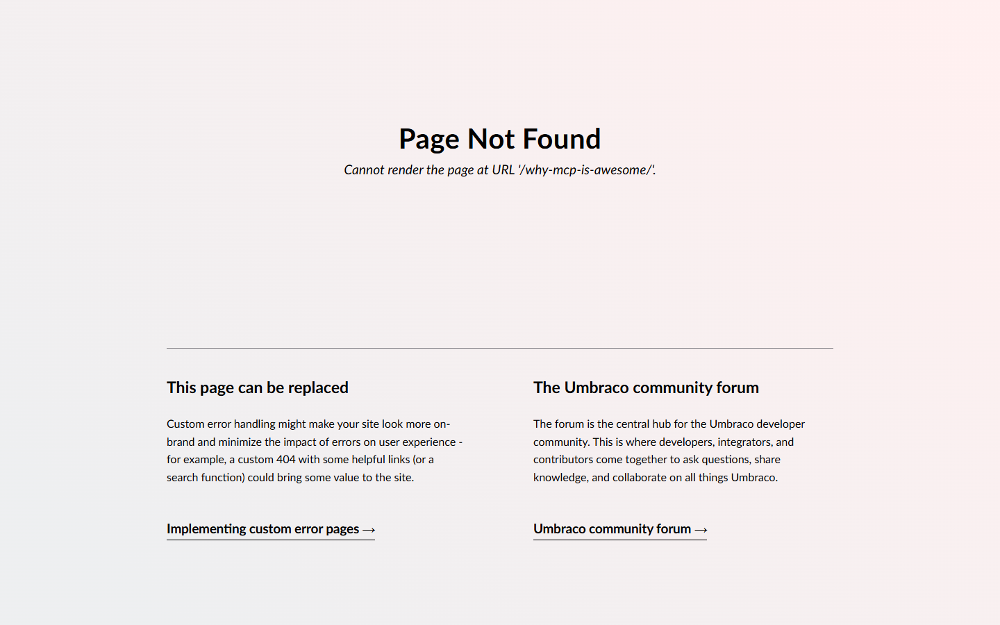

# Grade: 2026-10-07_2147_mcp-guided_haiku-4.5

**Test:** MCP Guided · **Model:** Haiku 4.5 · **Grader:** Opus 5.5 (low) · **Total: 57 / 100**

| Category | Score | Max |
|---|---:|---:|
| It works | 10 | 35 |
| Content modeling | 19 | 25 |
| Code architecture & conventions | 23 | 25 |
| Content & presentation | 2 | 10 |
| Process & honesty | 3 | 5 |
| **Total** | **57** | **100** |

## Summary

Haiku 4.5 modeled a reasonable 3-block schema over MCP and wrote a convention-following block adapter/ViewComponent pipeline, but nothing renders. It deleted the MCP-created template files and rewrote them under `Views/Templates/`, so `/` and both posts return Umbraco's 404. The front page template has no post listing, and the posts are thin, two-paragraph pieces.

## Issues

- **major**: Every page returns 404 "Cannot render the page at URL …". The templates are in `Views/Templates/blogFrontPage.cshtml` and `Views/Templates/blogPost.cshtml`, but Umbraco looks for `Views/blogFrontPage.cshtml` and `Views/blogPost.cshtml`, which the model deleted (`/`, `/why-mcp-is-awesome/`, `/mcp-powers-your-workflow/`).
- **major**: The front page template doesn't list the blog posts at all. It only renders the Blog page's block grid, which is empty (`Views/Templates/blogFrontPage.cshtml`).
- **major**: Post content is thin: two short, generic paragraphs plus an image and a quote per post.
- **minor**: `blogFrontPage` was set `allowedAsRoot = true` as a workaround for a create-page error, so `siteRoot` is no longer the only root type.
- **minor**: The `blogPost.date` property uses the Richtext editor and is output with `Model.Value("date")` (`Views/Templates/blogPost.cshtml`).
- **minor**: The ViewComponent classes are in `Services/` without the `*Service` suffix (`Services/ImageBlockViewComponent.cs`, `QuoteBlockViewComponent.cs`, `RichTextBlockViewComponent.cs`).
- **minor**: The final report blames routing/domain configuration and claims the schema and views are fully correct.

## Strengths

- Schema and content were built only through the two MCP servers, in the guided order.
- Block types are in Blocks, page types in Pages, and the Block Grid data type is in `/Custom`.
- The adapter → plain model → ViewComponent → `Default.cshtml` pipeline is clean, using `GetBlockGridHtmlAsync` and `GetCropUrl`.
- The provided Unsplash photos were imported into a media folder, domain `/` is on the Blog page, and everything is published.
- The final report admits the pages return 404.

## What it built

- **Document types:** `blogFrontPage` (Pages: title, blocks) and `blogPost` (Pages: title, date [Richtext], excerpt, listingImage, blocks). The scaffold's `siteRoot` now allows `blogFrontPage` as a child.
- **Blocks** (Blocks folder, in "Blog Block Grid"): `richTextBlock` (text), `imageBlock` (image, caption), `quoteBlock` (quote, author).
- **Pages:** WWW → Blog (domain `/`, no blocks) → "Why MCP is Awesome" and "MCP Powers Your Workflow". Each post has 4 blocks: rich text, image, rich text, quote.
- **Media:** a "Blog Images" folder with 2 provided photos (network-lines-dots, code-on-screen).
- **Code:** 3 adapters, 3 plain models in `Models/Blocks/`, 3 ViewComponents (placed in `Services/`), 3 Tailwind component views, and 2 templates in the wrong folder.
- **Look:** neither page renders. Both screenshots show Umbraco's default "Page Not Found" page.

