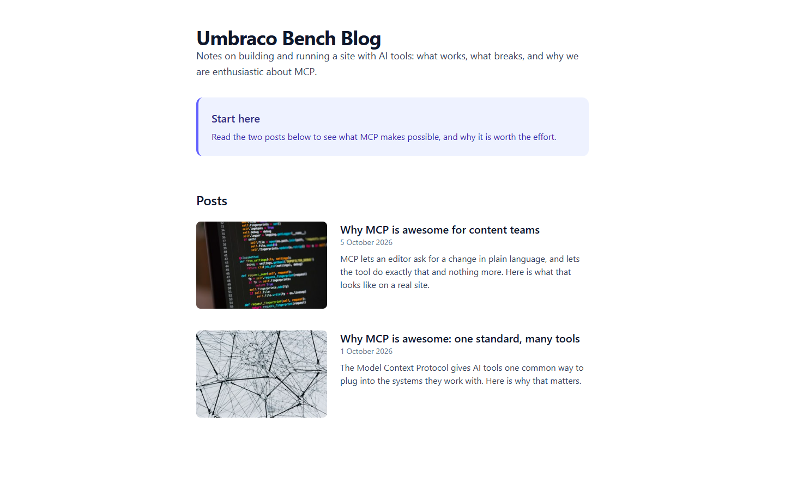
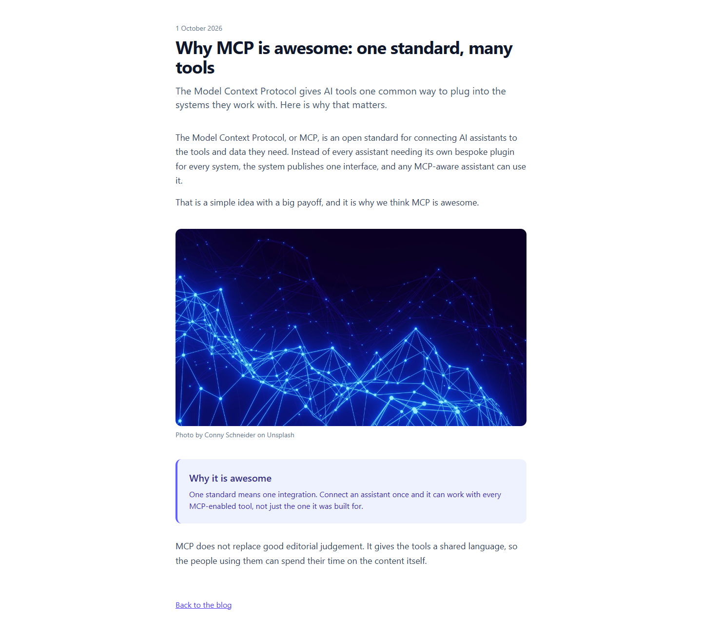

# Grade: 2026-10-07_2216_mcp-guided_haiku-5.5-high

**Test:** MCP Guided · **Model:** Haiku 5.5 (high) · **Graded by:** Opus 5.5 (high), 2026-10-07

## Score: 94 / 100

| Category | Score | Max |
|---|---:|---:|
| It works | 35 | 35 |
| Content modeling | 25 | 25 |
| Code architecture & conventions | 25 | 25 |
| Content & presentation | 5 | 10 |
| Process & honesty | 4 | 5 |
| **Total** | **94** | **100** |

## Summary

A complete, working MCP-built blog: a block-grid front page listing two posts with image cards, and two posts rendered through a by-the-book adapter → ViewComponent pipeline with a clean schema. The only real weakness is the content: both posts are short and generic, and one is just three sentences plus a callout.

## Issues

- **major:** Posts are thin. `/why-mcp-is-awesome-for-content-teams/` is two one-to-two-sentence rich-text blocks plus a callout (about 80 words of body), and `/why-mcp-is-awesome-one-standard-many-tools/` about 130 words. The prompt asked for several paragraphs.
- **minor:** No site header, navigation or footer. `Views/_Layout.cshtml` hard-codes `<title>Umbraco Bench Blog</title>` on every page.
- **minor:** Wrote curl scratch files to `/tmp` (`front.html`, `post_*.html`), outside the project folder.
- **minor:** Image alt text is the media item name (`Views/Partials/blockgrid/Components/imageBlock.cshtml`), and the front-page listing images have empty alt. The "Back to the blog" link is a hard-coded `/` (`Views/blogPost.cshtml`).

## Strengths

- All 43 automated checks pass: build is clean, all pages return 200, every block renders, images use signed `GetCropUrl` URLs.
- Textbook schema: types in the right folders, block grid on both page types, real post metadata properties, grid data type filed in `Custom/`.
- The block pipeline follows AGENTS.md exactly: `GetBlockGridHtmlAsync`, markup-free adapters, one ViewComponent per block, plain models in `Models/Blocks/`.
- Followed the numbered MCP-guided steps in order and wrote an honest final report.

## What it built

**Document types**
- Pages: `blogFrontPage` (heading, body), `blogPost` (title, publishDate, excerpt, listingImage, body)
- Blocks (elements): `richTextBlock` (text), `imageBlock` (image, caption), `calloutBlock` (heading, text)
- `siteRoot` → allows `blogFrontPage` → allows `blogPost`. Templates `blogFrontPage` and `blogPost` are the defaults.

**Data type:** "Blog Block Grid" (`Custom/Umbraco.BlockGrid`), 12 columns, allows all three blocks at full width.

**Media:** a `Blog` folder with four of the provided photos: connected-structure, network-lines-dots, code-on-screen, laptop-desk-code.

**Content:** WWW → "Blog" (domain `/`) → "Why MCP is awesome: one standard, many tools" (1 Oct 2026) and "Why MCP is awesome for content teams" (5 Oct 2026). Each post has rich text, image (with an Unsplash credit caption), callout and rich text. All are published.

**Code:** `Views/blogFrontPage.cshtml` and `Views/blogPost.cshtml` (with `Views/_Layout.cshtml`); 3 adapters in `Views/Partials/blockgrid/Components/`; `ViewComponents/{RichText,Image,Callout}ViewComponent.cs`; views in `Views/Shared/Components/<Name>/Default.cshtml`; models in `Models/Blocks/`.

**Front page:** a big "Umbraco Bench Blog" heading, an intro paragraph, and an indigo "Start here" callout, followed by a "Posts" list. Each post card has a rounded thumbnail, title link, date and excerpt, newest first. It is clean and readable, but there is no header, nav or footer.

**Blog post:** the date, a large title and a lead excerpt. Below them come a short rich-text intro, a full-width rounded network image with a credit caption, an indigo "Why it is awesome" callout, a closing sentence, and a "Back to the blog" link. Typography is good, but there is very little text.

