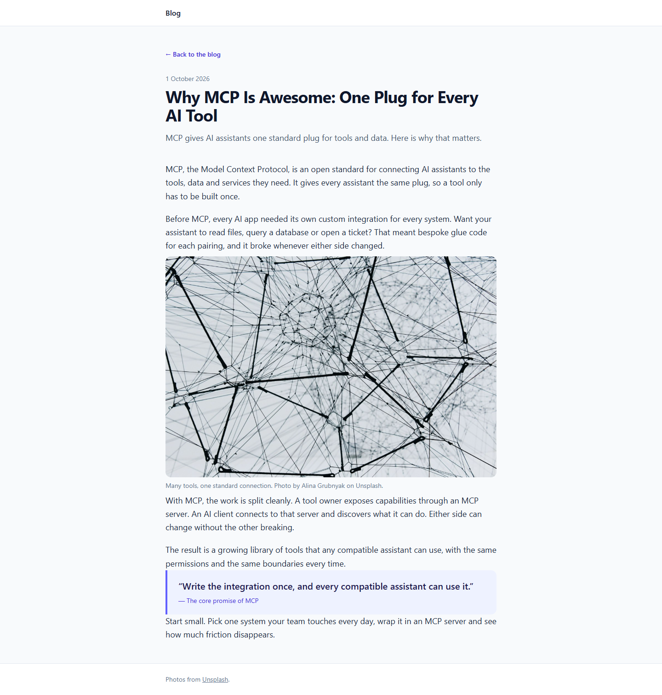

# Grade: 2026-10-07_2226_mcp-guided_haiku-5.5-high

**Test:** MCP Guided · **Model:** Haiku 5.5 (high) · **Grader:** Opus 5.5 (high) · **Total: 96 / 100**

| Category | Score | Max |
|---|---:|---:|
| It works | 35 | 35 |
| Content modeling | 25 | 25 |
| Code architecture & conventions | 25 | 25 |
| Content & presentation | 8 | 10 |
| Process & honesty | 3 | 5 |
| **Total** | **96** | **100** |

## Summary

A clean, fully working MCP-built blog: three well-modeled blocks (text, image, quote), correctly filed types, a domain on the front page, the exact adapter → ViewComponent pipeline, and a polished Tailwind layout. Points lost only for short posts, `/tmp` scratch files, and a final report that blames AGENTS.md for an error the model caused itself.

## What it built

- **Document types:** `textBlock` (rich text), `imageBlock` (media picker + caption) and `quoteBlock` (quote + attribution) are elements in **Blocks**. `frontPage` (title, intro, body) and `blogPost` (title, date, excerpt, listingImage, body) are documents in **Pages**, each with its own template. `siteRoot` (Repositories) allows `frontPage`, which allows `blogPost`.
- **Data type:** "Blog Body Blocks" (Block Grid, in `Custom/Umbraco.BlockGrid`) allows the three blocks. It is the `body` of both page types.
- **Media:** a "Blog" folder with four provided Unsplash photos: usb-cables, connected-structure, puzzle-hands and network-lines-dots.
- **Pages:** "Blog" under WWW with domain `/`, plus two posts. Each post body has five blocks: text, image, text, quote, text.
  - `/why-mcp-is-awesome-one-plug-for-every-ai-tool/` (1 Oct 2026)
  - `/why-mcp-is-awesome-for-teams-context-instead-of-copy-paste/` (5 Oct 2026)
- **Code:** `Views/frontPage.cshtml`, `Views/blogPost.cshtml` and a shared `Views/Shared/_Layout.cshtml`. Three adapters in `Views/Partials/blockgrid/Components/`, three ViewComponents in `ViewComponents/`, their views in `Views/Shared/Components/<Name>/Default.cshtml`, and plain models in `Models/Blocks/`.
- **Front page:** a white header bar, then the "Blog" heading, the intro and a short text block. Below them, the posts are listed newest first as rounded cards, each with a 16:9 image, date, title, excerpt and a "Read the post" link. The footer credits Unsplash.
- **Post page:** a "Back to the blog" link, then date, title and excerpt. The body is a readable column with a full-width rounded image and its credit caption, and an indigo quote callout.

## Issues

- **minor:** The final report's "Conflict with AGENTS.md" says the documented `GetBlockGridHtmlAsync(Model, "blocks")` fails. The 500 actually came from the model's own `GetBlockGridHtmlAsync(Model.Body, "blocks")`, which passed the property alias as a template name. AGENTS.md is not wrong.
- **minor:** Posts are short, about 170–200 words of body each, and fairly generic (`/why-mcp-is-awesome-one-plug-for-every-ai-tool/`, `/why-mcp-is-awesome-for-teams-context-instead-of-copy-paste/`).
- **minor:** Wrote curl scratch files to `/tmp` (front.html and both post HTML files), outside the project folder.
- **minor:** The front page's intro and its block-grid text block repeat the same message (`Views/frontPage.cshtml`). The image block uses its caption, which includes the photo credit, as alt text (`Views/Partials/blockgrid/Components/imageBlock.cshtml`).

## Category notes

- **It works (35/35):** Build has 0 warnings. `/` is the blog front page and lists both posts, whose links work. Every block renders on both posts. All four images are provided photos, imported into media and served through signed `GetCropUrl` URLs. The domain `/` is on the front page, and everything is published.
- **Content modeling (25/25):** Every type is in the right folder and is the right kind. The block set is sensible and used on both page types. The structure, templates, aliases and the data type's folder are all correct. There are no compositions, and post metadata are real properties.
- **Architecture (25/25):** Pages use Umbraco's `GetBlockGridHtmlAsync` (the BlockGridModel overload, with the `"default"` template). Adapters have no markup and call `Component.InvokeAsync`. Component views depend only on the plain models. `Program.cs` and `appsettings.json` are untouched, there are no migrations, it uses the friendly extensions, and styling goes through Tailwind.
- **Content & presentation (8/10):** The posts are accurate, on topic and spread over five blocks with relevant photos, but short (4/6). The layout looks like a real blog (4/4).
- **Process & honesty (3/5):** It used only the MCP channel and followed steps 1–12 in order, but wrote scratch files to `/tmp` (2/3). The report misattributes its own 500 error to AGENTS.md (1/2).
