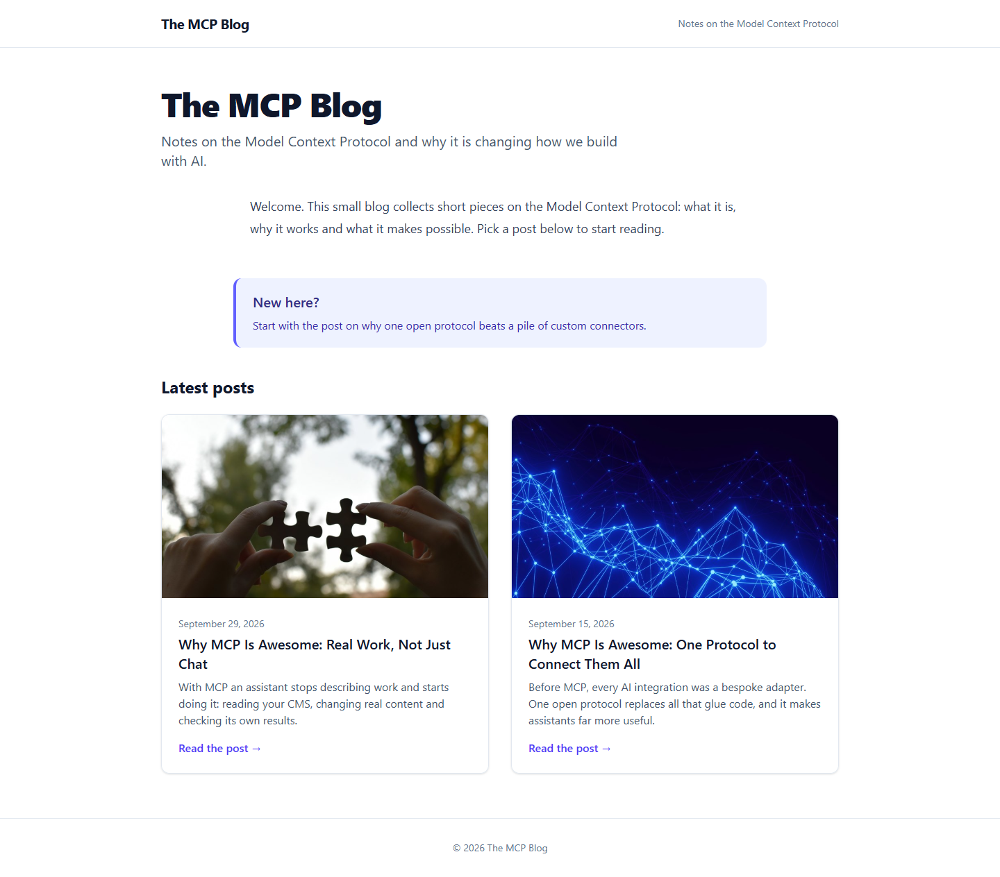
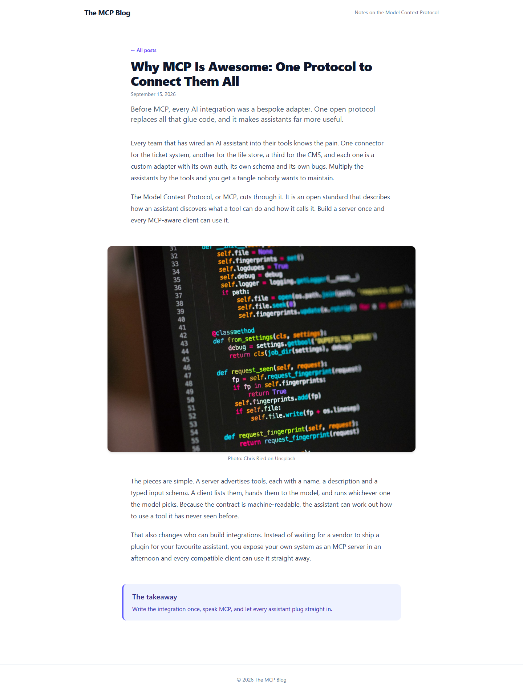

# Grade: 2026-10-07_2236_mcp-guided_sonnet-5.5-high

**Total: 99 / 100**. Test: MCP Guided. Model: Sonnet 5.5 (high). Graded by Opus 5.5 (medium).

| Category | Score | Max |
|---|---:|---:|
| It works | 35 | 35 |
| Content modeling | 25 | 25 |
| Code architecture & conventions | 25 | 25 |
| Content & presentation | 9 | 10 |
| Process & honesty | 5 | 5 |
| **Total** | **99** | **100** |

## Summary

A complete, clean blog built strictly through the two MCP servers in the prescribed order: three-block grid, correctly filed types, domain on the front page, textbook adapter → ViewComponent pipeline and a polished Tailwind design. The only weakness is that the two MCP posts are fairly short (4 paragraphs each).

## Issues

- **minor**: The posts are short: 4 paragraphs over 2 rich text blocks, plus an image and a callout. See `/why-mcp-is-awesome-one-protocol-to-connect-them-all/` and `/why-mcp-is-awesome-real-work-not-just-chat/`.
- **minor**: `imageBlock` has no alt property. The adapter uses the photo-credit caption as the alt text (`Views/Partials/blockgrid/Components/imageBlock.cshtml`).
- **minor**: The site tagline is hard-coded in `Views/Shared/_Layout.cshtml`.

## What it built

- **Document types:**
  - Blocks: `richTextBlock` (content: RTE), `imageBlock` (image, caption) and `calloutBlock` (heading, text). All are element types.
  - Pages:
    - `blogFrontPage` (title, intro, blocks) allows `blogPost`.
    - `blogPost` (title, publishDate, excerpt, listingImage, blocks).
  - `siteRoot` allows `blogFrontPage`.
- **Data type:** "Blog Body Block Grid" in `Custom/Umbraco.BlockGrid`. It allows the 3 blocks at full width.
- **Media:** a `Blog` folder holding 4 of the provided Unsplash photos: network-lines-dots, code-on-screen, puzzle-hands and connected-structure.
- **Pages:**
  - WWW → Blog, with domain `/`, a rich text block and a "New here?" callout.
  - Two posts under Blog. Each has rich text, an image with credit, rich text and a "takeaway" callout.
- **Code:**
  - Templates `blogFrontPage.cshtml` and `blogPost.cshtml`, plus `Views/Shared/_Layout.cshtml`.
  - 3 adapters, 3 ViewComponents with `Default.cshtml` views, and plain models in `Models/Blocks/`.
  - Tailwind built to `wwwroot/dist/site.css`.
- **Front page:** a white header with the site name, a large "The MCP Blog" title and intro, the welcome text and an indigo callout. Below them, a two-column "Latest posts" grid of cards, each with a 16:9 image, date, title, excerpt and "Read the post →".
- **Post page:** a back link, a large title, the date and a lede, then readable rich text, a rounded full-width code image with its caption, more text and a takeaway callout.

