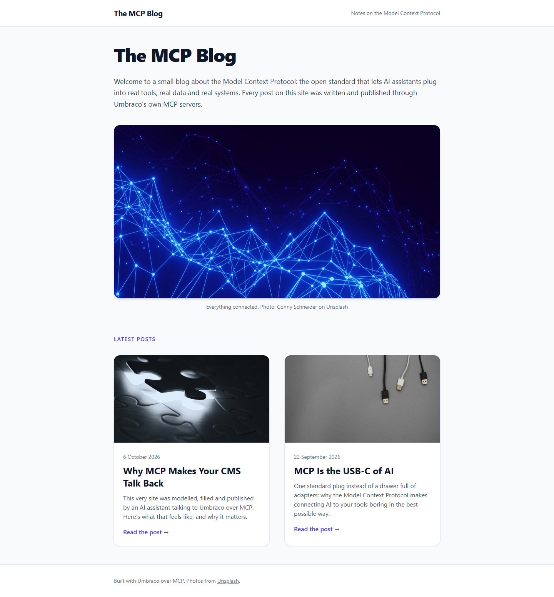
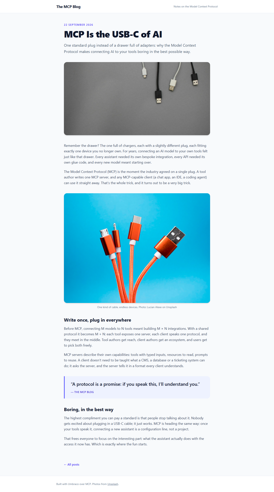

# Grade: 2026-10-07_2246_mcp-guided_opus-5.5-high

**Total: 99 / 100**. Test: MCP Guided. Model: Opus 5.5 (high). Graded by Opus 5.5 (high).

| Category | Score | Max |
|---|---:|---:|
| It works | 35 | 35 |
| Content modeling | 25 | 25 |
| Code architecture & conventions | 25 | 25 |
| Content & presentation | 10 | 10 |
| Process & honesty | 4 | 5 |
| **Total** | **99** | **100** |

## Summary

A clean, complete MCP-built blog. It has 3 blocks (rich text, image, quote) on one block grid used by both page types, a front page with a card listing and two substantive posts of 5 blocks each. The Razor follows the adapter → ViewComponent pipeline exactly, and all 43 automated checks pass.

## Issues

- **minor:** `imageBlock` has no alt-text property, so the caption ("… Photo: X on Unsplash") is used as alt (`Views/Partials/blockgrid/Components/imageBlock.cshtml`).
- **minor:** The post hero (`listingImage`) has no photographer credit, unlike the inline image blocks (`Views/blogPost.cshtml`).
- **minor:** Scratch curl output was written to `/tmp`, outside the project folder (in the verification step of the transcript). −1 in Process, the same as earlier runs.

## Strengths

- Schema, media and content built entirely over the two MCP servers (64 calls, 37 writes), following the 12 steps in order.
- Textbook rendering pipeline: `GetBlockGridHtmlAsync`, markup-free adapters, plain models in `Models/Blocks/`, one ViewComponent per block.
- Correct folders, allowed children, templates on a shared `layout` master, and the domain `/` on the front page.
- Substantive, accurate posts (about 450 words each) with subheads, pull quotes and correctly credited Unsplash photos.
- Honest final report: it discloses the "Publish cancelled" on the descendant publish, the empty `publishedUrls` and the unchecked uSync export.

## What it built

- **Document types:** `blogFrontPage` (title, blocks) and `blogPost` (title, publishDate, excerpt, listingImage, blocks) in Pages; `richTextBlock`, `imageBlock` (image, caption) and `quoteBlock` (quote, attribution) in Blocks. `siteRoot` → `blogFrontPage` → `blogPost`.
- **Data type:** "Blog Body Grid" (`Custom/Umbraco.BlockGrid`), allowing the 3 blocks at full width.
- **Templates:** `layout` (header, main, footer), `blogFrontPage` and `blogPost`.
- **Media:** a "Blog" folder with 5 of the provided Unsplash photos.
- **Pages:** WWW / Blog (`/`, with the domain `/`), "MCP Is the USB-C of AI" (`/mcp-is-the-usb-c-of-ai/`) and "Why MCP Makes Your CMS Talk Back" (`/why-mcp-makes-your-cms-talk-back/`). Each post is text → image/quote → text → quote/image → text.
- **Code:** 3 adapters, 3 ViewComponents with `Default.cshtml` views, 3 plain models in `Models/Blocks/`, and Tailwind built to `wwwroot/dist/site.css`.

**Front page:** a white header bar, a large "The MCP Blog" title, an intro paragraph, a rounded hero photo (blue network) with a credit, and a "Latest posts" label above a 2-column grid of cards. Each card has a photo, date, title, excerpt and a "Read the post →" link.

**Blog post:** an indigo date, a big title, a lede and a hero image, then the body blocks: readable prose with h2 subheads, a captioned image and an indigo pull quote, followed by a "← All posts" link.

