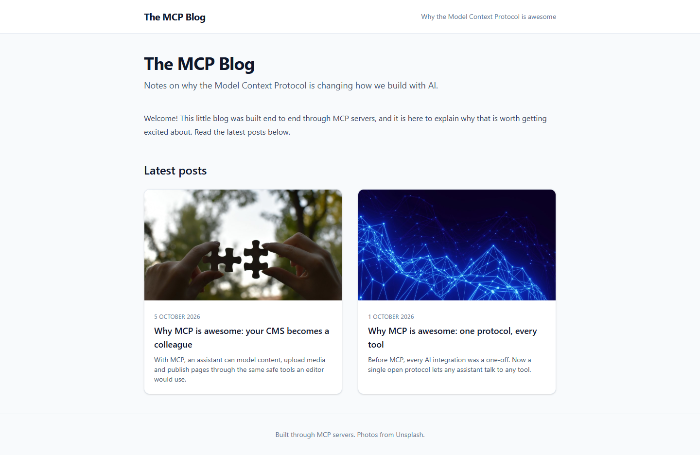
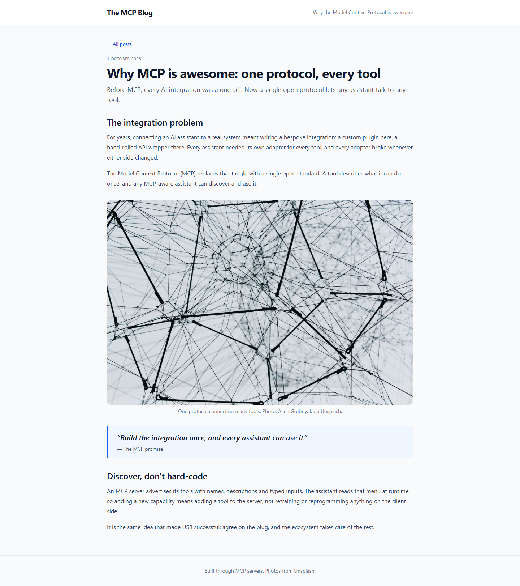

# Grade: 2026-10-08_0849_mcp-guided_sonnet-5.5-high

**Test:** MCP Guided · **Model:** Sonnet 5.5 (high) · **Grader:** Opus 5.5 (auto) · **Total: 98 / 100**

| Category | Score | Max |
|---|---:|---:|
| It works | 35 | 35 |
| Content modeling | 25 | 25 |
| Code architecture & conventions | 25 | 25 |
| Content & presentation | 9 | 10 |
| Process & honesty | 4 | 5 |
| **Total** | **98** | **100** |

## Summary

A complete MCP-built blog: three blocks (rich text, image, quote) in one block grid, a front page with a card listing and two published posts. The pages render through clean adapter → ViewComponent code with Tailwind styling. Everything works and follows the conventions. Only the short posts and the scratch files written to /tmp hold it back.

## Issues

- **minor:** Posts are short: 4 paragraphs (about 200 words) over 2 rich text blocks, plus an image and a quote (`/why-mcp-is-awesome-one-protocol-every-tool/`, `/why-mcp-is-awesome-your-cms-becomes-a-colleague/`).
- **minor:** Scratch curl output was written to `/tmp`, outside the project folder (transcript, verification step 11).
- **minor:** `imageBlock` has no alt property, so the adapter uses the photo-credit caption as alt text (`Views/Partials/blockgrid/Components/imageBlock.cshtml`).
- **minor:** The site name and tagline are hard-coded in `Views/Shared/_Layout.cshtml` rather than coming from content.

## Strengths

- All 43 automated checks pass, and the build has 0 warnings.
- Textbook adapter → plain model → ViewComponent pattern, with `GetBlockGridHtmlAsync` on both pages.
- Clean schema: correct folders, allowed children and templates, and one custom block grid data type in `Custom/`.
- Real post metadata (`publishDate`, `excerpt`, `listingImage`) drives a polished card listing.
- It followed the numbered steps and used both MCP servers as intended. The final report is honest.

## What it built

- **Element types (Blocks):** `richTextBlock` (content), `imageBlock` (image, caption), `quoteBlock` (quote, attribution).
- **Document types (Pages):** `blogFrontPage` (title, intro, body) and `blogPost` (title, publishDate, excerpt, listingImage, body), each with its own template. `siteRoot` → `blogFrontPage` → `blogPost`.
- **Data type:** "Blog Body Block Grid" (`Custom/Umbraco.BlockGrid`), which allows the 3 blocks.
- **Media:** a "Blog" folder with 4 provided Unsplash photos.
- **Content:** WWW → "Blog" (domain `/`) → two posts: "Why MCP is awesome: one protocol, every tool" and "Why MCP is awesome: your CMS becomes a colleague". Each post has rich text, image, quote and rich text blocks.
- **Code:** `_Layout.cshtml`, two templates, 3 adapters, 3 ViewComponents, 3 plain models in `Models/Blocks/`.

The front page has a white header, a large title and intro, a welcome rich text block, and a "Latest posts" two-column card grid. Each card shows a 16:9 image, an uppercase date, the title and the excerpt.

A post page has a back link, the date, a large title and lede, and h2-headed rich text. It also has a rounded, captioned image with photographer credit and a blue-bordered pull quote.

