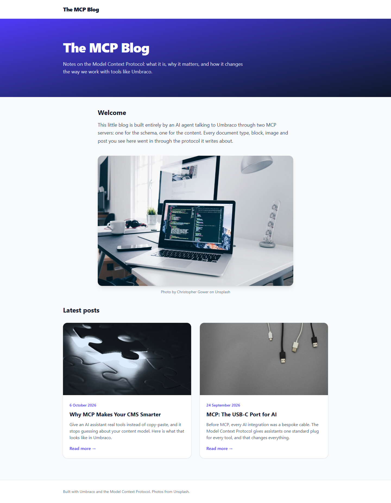
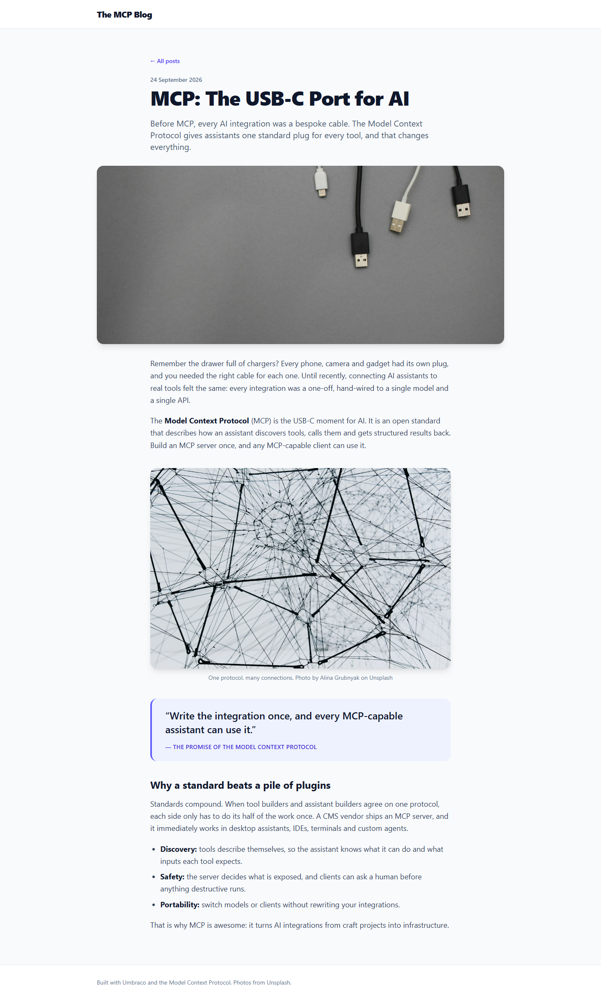

# Grade: 2026-10-08_0857_mcp-guided_opus-5.5-high

**Test:** MCP Guided · **Model:** Opus 5.5 (high) · **Grader:** Opus 5.5 (auto) · **Total: 98 / 100**

| Category | Score | Max |
|---|---:|---:|
| It works | 35 | 35 |
| Content modeling | 25 | 25 |
| Code architecture & conventions | 25 | 25 |
| Content & presentation | 9 | 10 |
| Process & honesty | 4 | 5 |
| **Total** | **98** | **100** |

## Summary

A complete, convention-perfect MCP-built blog: 3 reusable blocks, clean page and post types, 2 substantive posts with provided photos, and a polished Tailwind layout, all rendered through the adapter-to-ViewComponent pattern. The only blemish is a disclosed write to `/tmp` outside the project folder.

## Issues

- **minor:** During step 11 it wrote curl output to `/tmp/page*.html`, outside the project folder, then deleted it. The final report discloses this. The `process.stayedInFolder` check did not catch it.
- **minor:** The posts are on the short side (4 blocks, about 5–6 paragraphs each), though they meet the brief.

## What it built

- **Blocks** (element types, `Blocks` folder):
  - `richTextBlock` (text)
  - `imageBlock` (image, caption)
  - `quoteBlock` (quote, attribution)
- **Data type:** `Blog Body Grid` (Umbraco.BlockGrid, in `Custom/Umbraco.BlockGrid`). It allows all 3 blocks at full width.
- **Pages** (`Pages` folder):
  - `blogFrontPage`: title, intro, body. Allowed under `siteRoot`.
  - `blogPost`: title, publishDate, excerpt, listingImage, body. Allowed under the front page.
- **Templates:** `layout`, `blogFrontPage` and `blogPost`. Both page templates render the body with `Html.GetBlockGridHtmlAsync(Model, "body")`.
- **Code:**
  - Adapters: `Views/Partials/blockgrid/Components/{richTextBlock,imageBlock,quoteBlock}.cshtml`
  - Plain models: `Models/Blocks/`
  - ViewComponents: `ViewComponents/`
  - Component views: `Views/Shared/Components/{RichText,Image,Quote}/Default.cshtml`
- **Content:**
  - WWW → Blog (domain `/`) → "MCP: The USB-C Port for AI" and "Why MCP Makes Your CMS Smarter"
  - Each post has 4 blocks: rich text, image, quote, rich text.
  - 5 Unsplash photos are in the `Blog` media folder.
- **Front page:**
  - an indigo gradient hero with the title and intro
  - a welcome rich text block and an image block
  - a "Latest posts" grid of 2 cards (image, date, title, excerpt, read more)
- **Post page:** a back link, date, big title, excerpt lede, a wide hero image, and then the blocks, including a styled pull quote and a bulleted list.

