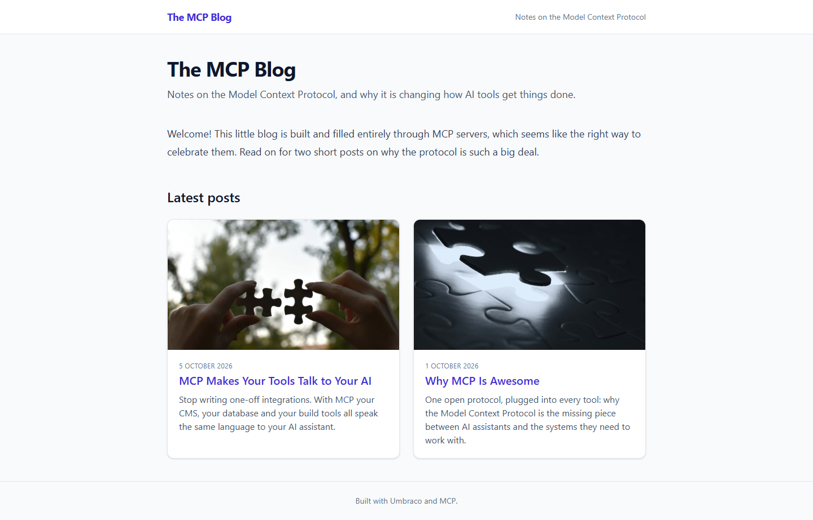
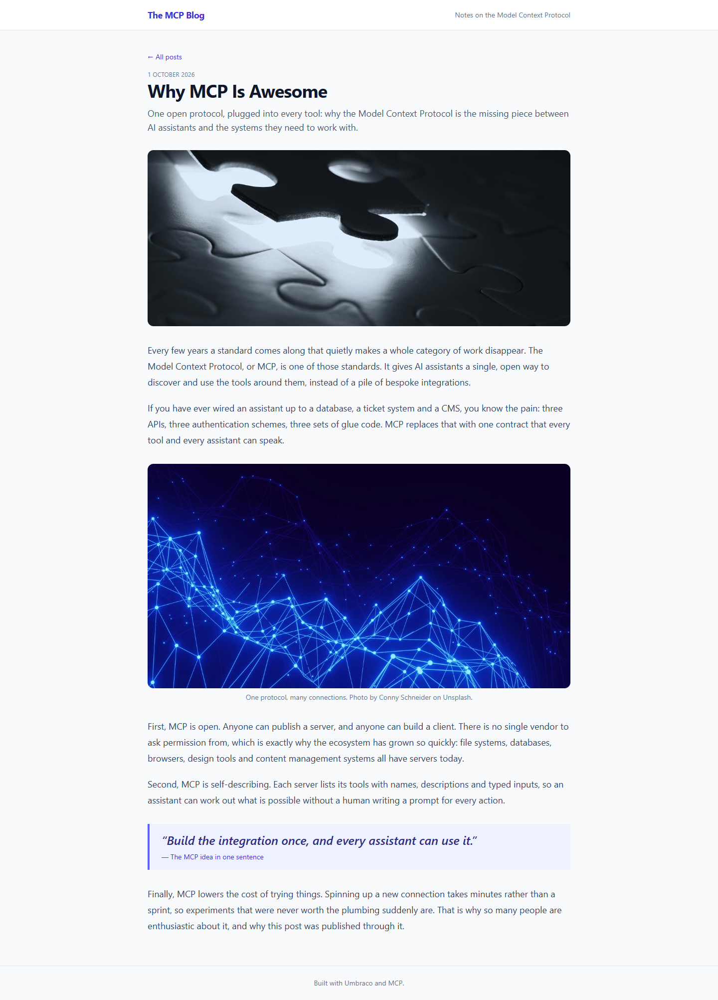

# Grade: 2026-10-08_0909_mcp-guided_sonnet-5.5-high

**Test:** MCP Guided · **Model:** Sonnet 5.5 (high) · **Grader:** Opus 5.5 (auto) · **Total: 99 / 100**

| Category | Score | Max |
|---|---:|---:|
| It works | 35 | 35 |
| Content modeling | 25 | 25 |
| Code architecture & conventions | 25 | 25 |
| Content & presentation | 10 | 10 |
| Process & honesty | 4 | 5 |
| **Total** | **99** | **100** |

## Summary

A complete MCP-built blog: three blocks (rich text, image, quote) in one block grid, a front page with a polished card listing, and two published, well-written posts about MCP. The pages render through clean adapter → ViewComponent code with Tailwind styling. Everything works and follows the conventions. The only blemish is scratch files written to `/tmp`.

## Issues

- **minor:** Verification curl output was saved to `/tmp`, outside the project folder (transcript, step 11).
- **minor:** `imageBlock` has no alt-text property, so the adapter uses the media item's name as alt text (`Views/Partials/blockgrid/Components/imageBlock.cshtml`).
- **minor:** The site name and tagline are hard-coded in `Views/Shared/_Layout.cshtml` rather than coming from content.
- **minor:** The block config in the "Blog Body Block Grid" data type is minimal: no column span options, labels or editor settings.

## Strengths

- All 43 automated checks pass, and the build has 0 warnings.
- Textbook adapter → plain model → ViewComponent pattern, with `GetBlockGridHtmlAsync` on both page types.
- Clean schema: correct folders, allowed children and templates, and one custom block grid data type in `Custom/`.
- Real post metadata (`publishDate`, `excerpt`, `listingImage`) drives the listing cards and post headers.
- It followed all 12 numbered steps in order, using the right MCP server for each. The final report is honest about what it didn't check.

## What it built

- **Element types (Blocks):** `richTextBlock` (content), `imageBlock` (image, caption), `quoteBlock` (quote, attribution).
- **Document types (Pages):** `blogFrontPage` (title, intro, blocks) and `blogPost` (title, publishDate, excerpt, listingImage, blocks), each with its own template. The hierarchy is `siteRoot` (Repositories) → `blogFrontPage` → `blogPost`.
- **Data type:** "Blog Body Block Grid" (`Custom/Umbraco.BlockGrid`), which allows the 3 blocks.
- **Media:** a "Blog Images" folder with 4 of the provided Unsplash photos.
- **Content:** WWW → "MCP Blog" (domain `/`) → "Why MCP Is Awesome" (`/why-mcp-is-awesome/`) and "MCP Makes Your Tools Talk to Your AI" (`/mcp-makes-tools-talk/`). Each post has 5 blocks: rich text, image with credit caption, rich text, quote, rich text. Each comes to about 300 words over 5 paragraphs.
- **Code:** `_Layout.cshtml`, two templates, 3 adapters, 3 ViewComponents, and 3 plain models in `Models/Blocks/`.

The front page has a title and intro, a welcome rich-text block, and a "Latest posts" grid of two cards, each with an image, date, title and excerpt. A post page has a back link, the date, title and excerpt, a wide hero image, then the block body with a captioned figure and an indigo pull quote.

