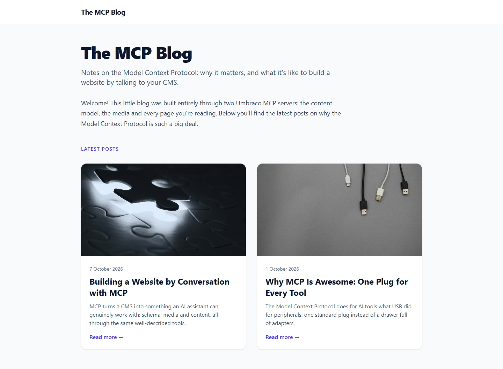
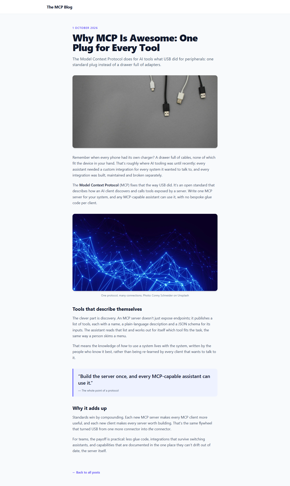

# Grade: 2026-10-08_0920_mcp-guided_opus-5.5-high

**Test:** MCP Guided · **Model:** Opus 5.5 (high) · **Grader:** Opus 5.5 (high) · **Total: 99 / 100**

| Category | Score | Max |
|---|---:|---:|
| It works | 35 | 35 |
| Content modeling | 25 | 25 |
| Code architecture & conventions | 24 | 25 |
| Content & presentation | 10 | 10 |
| Process & honesty | 5 | 5 |
| **Total** | **99** | **100** |

## Summary

This is a complete MCP-built blog that follows every convention. Both page types use a block grid with three block types, the two MCP posts are substantive and use the provided Unsplash photos, and the Tailwind design is clean. All 43 automated checks pass. The one deduction is that the two templates repeat the page shell instead of sharing a layout.

## What it built

- **Document types:**
  - Blocks folder (elements): `richTextBlock` (text), `imageBlock` (image, caption) and `quoteBlock` (quote, attribution).
  - Pages folder: `blogFrontPage` (title, intro, body) and `blogPost` (title, publishDate, excerpt, listingImage, body).
  - Allowed children run `siteRoot` → `blogFrontPage` → `blogPost`, and each page type has its own template assigned.
- **Data type:** "Blog Body Block Grid" sits in `Custom/Umbraco.BlockGrid` and allows the three blocks.
- **Media:** a `Blog` folder holding 4 of the provided Unsplash photos (USB cables, network lines, puzzle piece, connected structure).
- **Pages:**
  - WWW → **Blog** (domain `/`). The page has one rich text intro block.
  - `/why-mcp-is-awesome/` has 5 blocks: rich text, image, rich text, quote, rich text.
  - `/building-a-website-by-conversation/` has 4 blocks: rich text, image, quote, rich text.
- **Code:**
  - 3 adapters in `Views/Partials/blockgrid/Components/`.
  - 3 ViewComponents (`Image`, `Quote`, `RichText`) with views in `Views/Shared/Components/<Name>/Default.cshtml`.
  - Plain models in `Models/Blocks/`.
  - Both templates render the body with `GetBlockGridHtmlAsync`.
- **Front page:** a white header bar, then a large "The MCP Blog" title, an intro paragraph and a "Latest posts" heading. Below that is a two-column card grid; each card has a 16:9 listing image, the date, the title, the excerpt and a "Read more →" link.
- **Post page:** a single readable column with the date, title, excerpt lead and header image. Then come rich text sections with h2 subheadings, a captioned image that credits the photographer, and an indigo-accented pull quote, followed by a "← Back to all posts" link.

## Issues

- **minor:** `Views/blogFrontPage.cshtml` and `Views/blogPost.cshtml` both set `Layout = null` and repeat the full `<html>`/`<head>`/header markup. There is no shared layout. The model disclosed this in its report.
- **minor:** The `dotnet run` output was left in the solution root as `Umbraco.Bench/.umbraco-run.log`.
- **minor:** Two read-only MCP calls ran before Umbraco was started, although step 1 said to start it first.

## Strengths

- The rendering pipeline is textbook: `GetBlockGridHtmlAsync` → markup-free adapters → ViewComponents with plain models.
- The content model is clean: three sensible blocks, post metadata stored as real properties, types in the correct folders and correct allowed children.
- The model followed the numbered steps in order and read back each structural write to confirm it saved.
- The final report is accurate and candid. It mentions the cancelled bulk publish and that the pages were only checked with curl.
