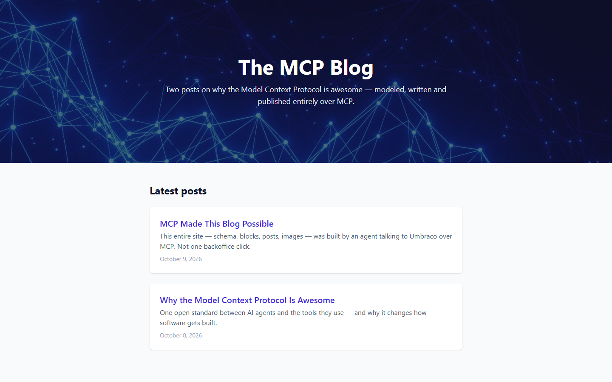
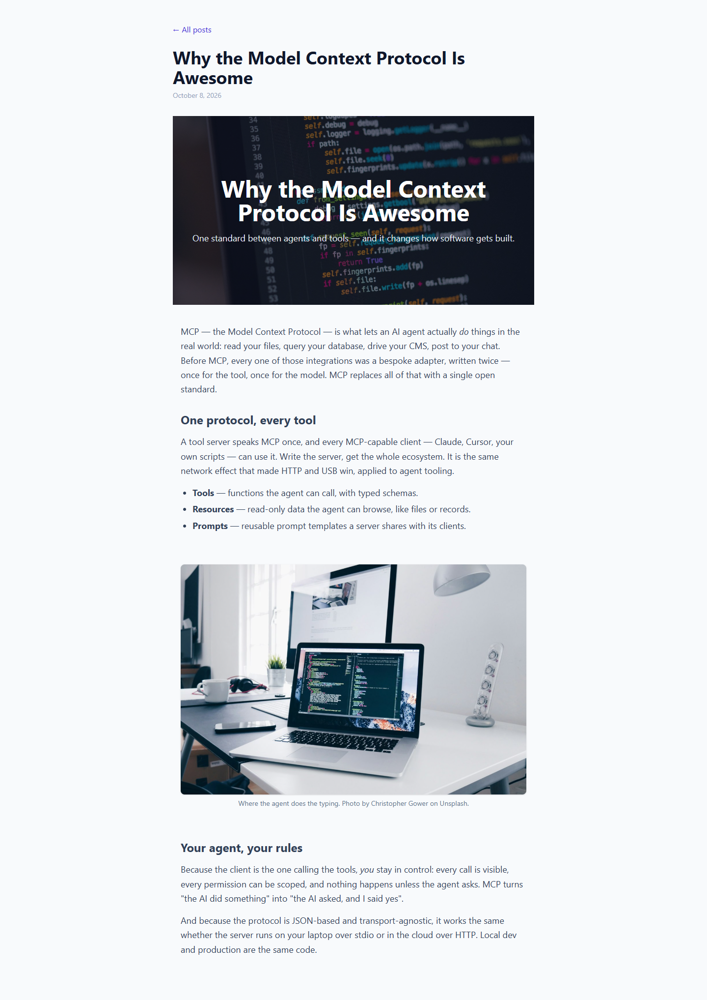

# Grade: 2026-10-09_2055_mcp_mistral-large-4-high

**Test:** MCP · **Model:** Mistral Large 4 (high) · **Grader:** Opus 5.5 (high) · **Total: 98 / 100**

| Category | Score | Max |
|---|---:|---:|
| It works | 35 | 35 |
| Content modeling | 25 | 25 |
| Code architecture & conventions | 25 | 25 |
| Content & presentation | 8 | 10 |
| Process & honesty | 5 | 5 |
| **Total** | **98** | **100** |

## Summary

A complete, clean blog built through MCP. Both page types use a three-block block grid (hero, rich text, image). The code follows the adapter → ViewComponent pattern exactly, the provided photos are served through signed crop URLs, and all 43 automated checks pass. The only flaws are presentational: post pages show the title twice, and the second post is thin and mostly about how this site was built.

## Issues

- **minor:** Post pages show the title twice. `Views/BlogPost.cshtml` renders an `<h1>` title, and right below it a hero block renders another `<h1>` with the same text, e.g. `/why-the-model-context-protocol-is-awesome/`.
- **minor:** The second post, `/mcp-made-this-blog-possible/`, is short and mostly describes how this site was built rather than why MCP is awesome.
- **minor:** Front-page cards have no listing image (`blogPost` has no thumbnail property). They show title, summary and date only.

## What it built

- **Document types:** `blogFrontPage` and `blogPost` in `Pages/`. `blogPost` has `summary` (Textstring), `publishDate` (Date Picker) and `blocks`. The scaffold's `siteRoot` now allows `blogFrontPage`, and `blogFrontPage` allows `blogPost`. Templates `BlogFrontPage` and `BlogPost` are assigned.
- **Blocks** (element types in `Blocks/`, data type `Blog Blocks` in `Custom/Umbraco.BlockGrid`): `heroBlock` (heading, subheading, background image), `richTextBlock` (body), `imageBlock` (image, caption).
- **Code:** adapters at `Views/Partials/blockgrid/Components/{heroBlock,richTextBlock,imageBlock}.cshtml` call the `Hero`, `RichText` and `Image` ViewComponents. Plain models are in `Models/Blocks/`. Richtext typography was added to `Umbraco.Bench.Frontend/src/site.css`.
- **Pages:** WWW (siteRoot) → *The MCP Blog* (domain `/`) → *Why the Model Context Protocol Is Awesome* and *MCP Made This Blog Possible*. Each post is a block grid of hero → rich text → image → rich text. The 5 provided Unsplash photos are in a `Blog` media folder.
- **Look:** the front page has a dark network-photo hero with the blog title, then "Latest posts" as white cards showing title, summary and date. Post pages have a back link, the title and date, a hero banner (which repeats the title), and readable prose with h2s, lists and captioned photos.

