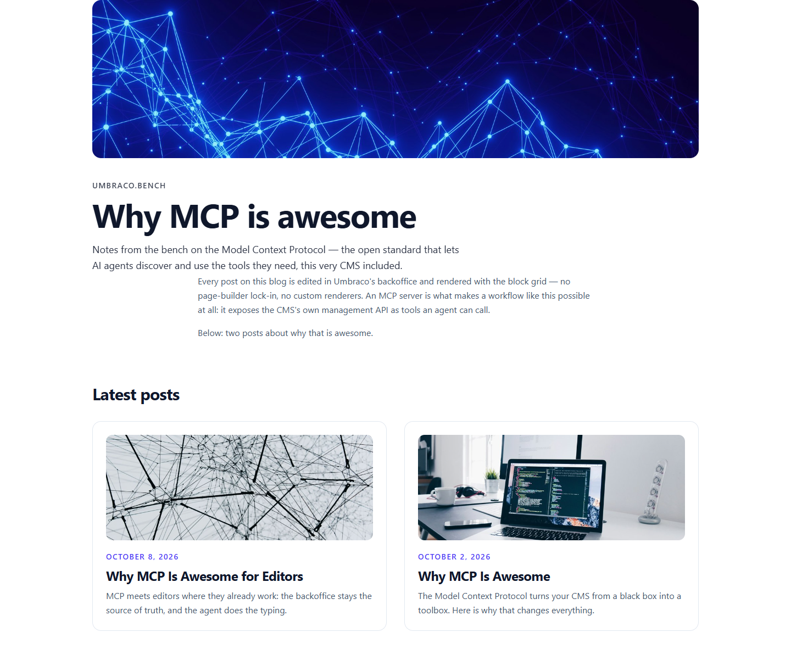
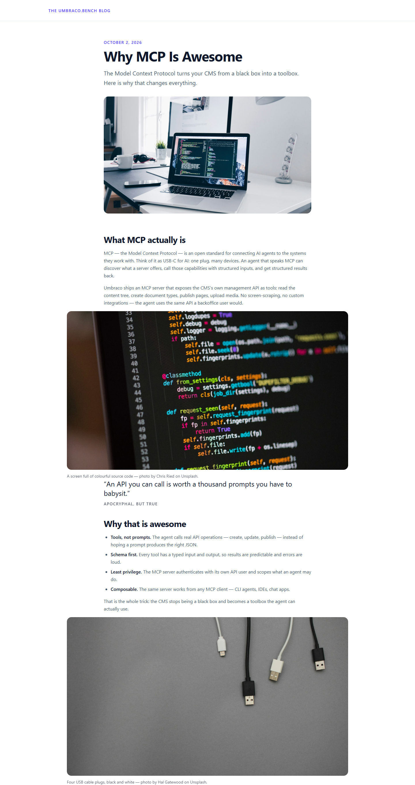

# Grade: 2026-10-09_2317_mcp_mistral-large-4-high

**Model:** Mistral Large 4 (high) · **Test:** MCP · **Grader:** Opus 5.5 (high) · **Total: 95 / 100**

| Category | Score | Max |
|---|---:|---:|
| It works | 35 | 35 |
| Content modeling | 25 | 25 |
| Code architecture & conventions | 25 | 25 |
| Content & presentation | 7 | 10 |
| Process & honesty | 3 | 5 |
| **Total** | **95** | **100** |

## Summary

A complete, cleanly built MCP blog: a four-block block grid (hero, text, image, quote) with a shared settings element, textbook adapter -> plain model -> ViewComponent rendering, the provided photos served through signed crop URLs, and every functional check passing. Points are lost for thin post content (especially the meta second post), some rough edges in the layout, and a stray file written outside the project that the final report misexplains.

## What it built

- **Document types:** `blogFrontPage` and `blogPost` (Pages), `heroBlock`, `textBlock`, `imageBlock` and `quoteBlock` (Blocks), `blockSettings` (Data: spacing, background, anchor), and the scaffold's `siteRoot` (Repositories). `blogPost` has `title`, `summary`, `publishDate`, `heroImage` and `body`.
- **Data types:** `Body blocks` (block grid, used on both page types, every block wired to `blockSettings`), plus `Block spacing` and `Block background` dropdowns, all in `/Custom/…`.
- **Pages:** WWW → Blog (`/`, domain `/`) → *Why MCP Is Awesome* (`/why-mcp-is-awesome/`) and *Why MCP Is Awesome for Editors* (`/why-mcp-is-awesome-for-editors/`). Each post has 5 blocks: text, image, quote, text, image.
- **Media:** 7 provided Unsplash photos in a `Blog` media folder, credited in the captions.
- **Code:** 4 adapters in `Views/Partials/blockgrid/Components/`, plain models in `Models/Blocks/` (with a `BlockModel` base that maps settings to Tailwind classes), 4 ViewComponents in `Components/`, views in `Views/Shared/Components/<Name>/Default.cshtml`, and richtext typography in `Umbraco.Bench.Frontend/src/site.css`.

**Front page:** a hero image, eyebrow, big title and intro, then a "Latest posts" grid of two cards. Each card has an image, date, title and excerpt. There is no site header or nav, and the intro text block sits offset from the hero column.

**Blog post:** a small header linking back to the blog, then the date, title, summary and hero image, then the block grid body. The typography is readable. The image blocks are wider than the text column, and spacing between blocks is tight.

## Strengths

- 42/43 automated checks pass; clean build with no warnings introduced
- Correct schema: blocks in Blocks/, a `blockSettings` element in Data/ wired as block settings, pages in Pages/, the block grid data type in Custom/
- Exact adapter -> plain model -> ViewComponent pattern; component views have no Umbraco dependencies
- Real post metadata (title, summary, publishDate, heroImage) drives a proper card listing
- The provided Unsplash photos are imported into a media folder, with credits in the captions

## Issues

- **minor:** Stray file written outside the project: `C:/code/benchmark/Umbraco.Bench.Umbraco/Views/Shared/Components/Quote/Default.cshtml`, from a mangled path in one Write. It is still on disk. The final report says the Quote view "went missing from disk" instead of disclosing the wrong path.
- **minor:** The posts are short. `/why-mcp-is-awesome-for-editors/` has about 4 short paragraphs, half of them meta about how this site was built.
- **minor:** The front page `/` has no site header or nav, and its intro text block is misaligned with the hero column. On posts, the image blocks are wider than the text column and blocks sit close together.
- **minor:** The run read outside the project (the NuGet package cache) and used WebSearch/WebFetch to reverse-engineer the block grid config.
