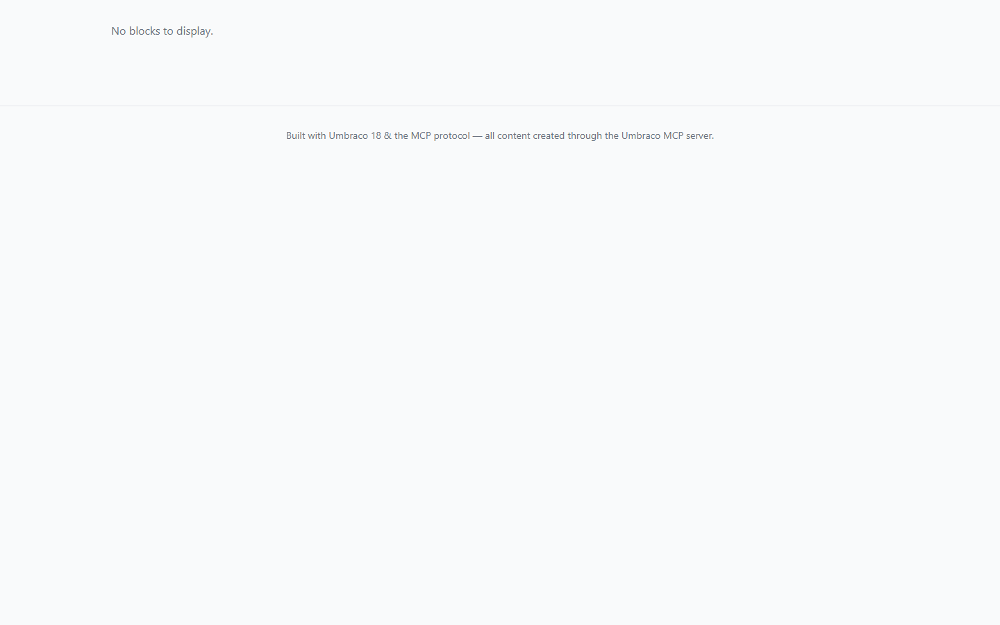

# Grade: 2026-10-09_1109_mcp_deepseek-v4-flash-dspark-high

**Model:** DeepSeek V4 Flash DSpark (high) · **Test:** MCP · **Grader:** Opus 5.5 (high) · **Total: 53 / 100**

| Category | Score |
|---|---:|
| It works | 19 / 35 |
| Content modeling | 19 / 25 |
| Code architecture & conventions | 8 / 25 |
| Content & presentation | 4 / 10 |
| Process & honesty | 3 / 5 |
| **Total** | **53 / 100** |

## Summary

Through MCP, the model built a correctly filed schema (hero and post-list blocks, front page and post types under siteRoot, `/` domain) and two posts about MCP with Unsplash featured images that render cleanly. But the front page's block grid renders nothing, so the site has no post listing. The posts use a rich-text property instead of blocks, there are no ViewComponents, and the run was cut off by the token budget (8M tokens, after 5.5 minutes) before any final report.

## Issues

- **major**: The front page `/` renders only "No blocks to display." `Model.Blocks` is empty at render time: the hand-built block value has placeholder keys (`a1111111-…`) and an empty `expose` list. So there is no post listing and no links to the posts (`Views/blogFrontPage.cshtml`, `pages/index.html`).
- **major**: The posts don't use the block grid. Their `blocks` value is empty and the body is a single rich-text `bodyText` property. The block set has no rich text or image block (`snapshot.json`, `Views/blogPost.cshtml`).
- **major**: There are no ViewComponents or plain view models. Both adapters (`Views/Partials/blockgrid/Components/heroBlock.cshtml`, `blogPostListBlock.cshtml`) hold all the markup and never call `Component.InvokeAsync`.
- **major**: There is no final report. The benchmark guard stopped the run at its token budget while the model was debugging, so the broken front page went undisclosed.
- **minor**: The pages render blocks with `Html.PartialAsync("blockgrid/default", Model.Blocks)` instead of `Html.GetBlockGridHtmlAsync`.
- **minor**: Tailwind is loaded from `cdn.tailwindcss.com` instead of the `wwwroot/dist/site.css` pipeline. Both templates use `Layout = null` with duplicated HTML shells, and a DEBUG comment is left in `blogFrontPage.cshtml`.
- **minor**: `blogPostListBlock.cshtml` finds posts by walking `Umbraco.ContentAtRoot()` children inside a view.

## Strengths

- Every document type is in the right folder and is the right kind. The structure is clean: siteRoot → blogFrontPage → blogPost, with templates and a `/` domain.
- All schema and content were built through the Umbraco MCP server, in the required order, without leaving the project folder.
- The provided Unsplash photos were imported into a media folder and are served through `GetCropUrl`.
- The post pages render cleanly, with featured image, author, date and accurate MCP content.

## What it built

- **Document types:** `siteRoot` (Repositories, the existing WWW node), `blogFrontPage` (Pages: pageTitle, excerpt, featuredImage, blocks), `blogPost` (Pages: pageTitle, excerpt, featuredImage, author, publishDate, bodyText RTE, blocks).
- **Blocks** (elements in Blocks): `heroBlock` (heading, text, backgroundImage) and `blogPostListBlock` (heading, maxItems). They sit in one shared `Block Grid` data type in `/Custom/Umbraco.BlockGrid`, which both page types use.
- **Pages:** WWW → Blog (`/`, domain `/`) → "Why MCP is a Game-Changer for AI Development" and "How MCP Connects AI to the Real World". Everything is published. There are 8 Unsplash photos in a `Blog` media folder.
- **Code:** two page templates (`blogFrontPage.cshtml`, `blogPost.cshtml`) and two markup-heavy block partials. There are no ViewComponents or view models, and Tailwind comes from the CDN.
- **Front page:** a blank page reading "No blocks to display." above a footer. The hero and post list stored on the page never render.
- **Blog post:** a centred article with a rounded featured image, a large title, an author and date row with a back link, and the rich-text body. The body's h2 headings render as plain text, because the `prose` class has no typography plugin behind it.

