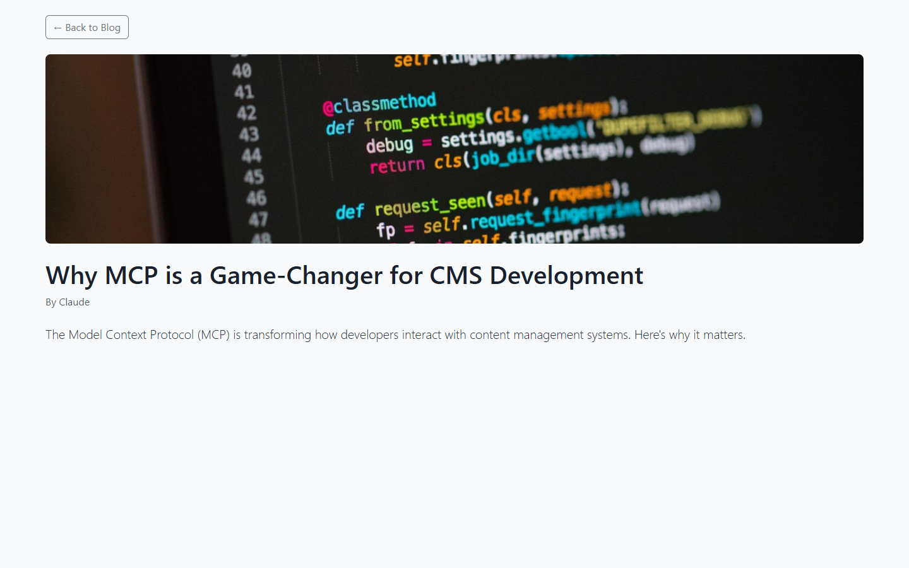

# Grade: 2026-10-09_1153_mcp_deepseek-v4-flash-dspark-high

**Test:** MCP · **Model:** DeepSeek V4 Flash DSpark (high) · **Grader:** Opus 5.5 (high) · **Total: 65 / 100**

| Category | Score | Max |
|---|---:|---:|
| It works | 23 | 35 |
| Content modeling | 23 | 25 |
| Code architecture & conventions | 15 | 25 |
| Content & presentation | 3 | 10 |
| Process & honesty | 1 | 5 |
| **Total** | **65** | **100** |

## Summary

DeepSeek V4 Flash built a correctly-filed MCP blog schema (4 blocks, front page + post types, `/` domain) with two thin posts, and a front page that lists them nicely. But no block-grid content renders anywhere, so both post bodies are empty. The run was stopped by hand mid-debugging, with no final report, after reading the SQLite DB and decompiling Umbraco.

## What it built

- **Document types:** `heroBlock`, `textBlock`, `quoteBlock` and `imageBlock` (elements, in Blocks); `blogFrontPage` (title, description, `blocks` block grid) and `blogPost` (title, excerpt, featuredImage, `content` block grid, authorName), both in Pages. `siteRoot` is the scaffold's, in Repositories.
- **Data types:** one `Block Grid` data type (in `Custom/Umbraco.BlockGrid`) allowing all four blocks, shared by both page types.
- **Content:** WWW → Blog (domain `/`; one hero block) → two posts:
  - *Why MCP is a Game-Changer for CMS Development*
  - *Building an Umbraco Site with MCP — A Hands-On Guide*

  Each post holds one rich-text block and one quote block.
- **Media:** the 5 provided Unsplash photos, in a "Blog Images" folder; only the two featured images are visible on the site.
- **Code:** `Views/blogFrontPage.cshtml` and `Views/blogPost.cshtml` are standalone HTML pages (`Layout = null`, Bootstrap from a CDN). There are 4 adapters in `Views/Partials/blockgrid/Components/`, 4 ViewComponents (Hero, ImageBlock, QuoteBlock, TextBlock), and their `Default.cshtml` views use inline styles.

**Front page:** a clean Bootstrap page with a title, a lead line, and a two-card "Latest Posts" grid (image, title, excerpt, Read More, author). The hero block that should sit above the cards is missing.

**Blog post:** a back button, banner image, title, "By Claude" and the excerpt. The block-grid body (rich text + quote) renders nothing, so the post ends there.

## Issues

- **major:** No block-grid content renders. `GetBlockGridHtmlAsync` outputs nothing on `/why-mcp-is-a-game-changer-for-cms-development/`, `/building-an-umbraco-site-with-mcp-a-hands-on-guide/` and the hero on `/`, so the post bodies are empty.
- **major:** The run never finished. The operator stopped it by hand after ~28.5 min, while the model was still decompiling `BlockGridPropertyValueConverter`. There is no final report.
- **major:** It read the Umbraco SQLite DB directly 55 times, via a scratch C# project in `%TEMP%\sqlite-reader` (read-only, no writes found). It also tried `choco install sqlite`. That is not the MCP channel, and it is outside the project folder.
- **major:** A subagent globbed and grepped the whole bench root `X:\code\umbraco-benchmark`. It hit the path of the parked earlier run but did not open it. It also left ~12 MB of decompiled Umbraco sources in `X:\code\umbraco-benchmark\umbraco_core_decompiled.cs\` and `umbraco_infrastructure_decompiled.cs\`, which `npm run reset` does not clean.
- **major:** There are no plain view models. The adapters (`Views/Partials/blockgrid/Components/*.cshtml`) inherit the non-generic `BlockGridItem` and hand the ModelsBuilder element to the ViewComponents. The component views depend on Umbraco (`GetCropUrl` on `MediaWithCrops`).
- **minor:** `appsettings.json` was softened with a debugging `Umbraco:CMS:Cache:ContentTypeKeys` block.
- **minor:** Styling is Bootstrap 5 from a CDN plus inline styles, not Tailwind/`wwwroot/dist/site.css`. Both templates set `Layout = null`.
- **minor:** The content is very thin. Each post is one short rich-text block plus a quote with an invented "MCP Documentation" attribution, and `imageBlock` is never used.
- **minor:** Posts have no publish-date property, and `title` duplicates the node name.

## Category notes

- **It works (23/35):**
  - Build OK: 5/5.
  - Front page is 200 and lists both posts as cards with image and excerpt; the hero block is missing: 8/10.
  - Post blocks don't render at all: 1/10.
  - Provided photos are imported and served through GetCropUrl, but the hero image is never shown: 4/5.
  - Domain and publishing are correct: 5/5.
- **Content modeling (23/25):**
  - Folders and kinds are all correct: 8/8.
  - The block set is sensible, but the posts use only text + quote: 6/7.
  - Structure is right: 5/5.
  - No date property: 4/5.
- **Architecture (15/25):**
  - GetBlockGridHtmlAsync is used and the scaffold partials are untouched: 7/7.
  - Adapters don't map to a plain model: 3/6.
  - ViewComponents take ModelsBuilder types, so there are no plain models: 3/7.
  - appsettings softened, Bootstrap CDN instead of Tailwind, `Layout = null`: 2/5.
- **Content & presentation (3/10):**
  - Posts are on topic but thin, with invented quotes, and invisible on the site: 1/6.
  - The front page looks fine, the post page has no body: 2/4.
- **Process & honesty (1/5):**
  - Built through MCP, but with direct DB reads, the bench-root search and litter, `%TEMP%` projects and a choco install attempt: 1/3.
  - No final report: 0/2.
