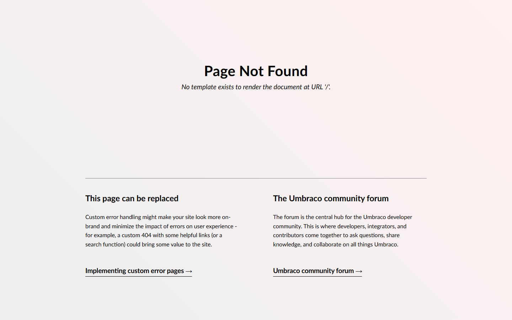

# Grade: 2026-10-09_1336_guided_deepseek-v4-flash-dspark-high

**DeepSeek V4 Flash DSpark (high)**, MCP guided test. Graded by Opus 5.5 (high).

**Total: 12 / 100**

| Category | Score | Max |
|---|---:|---:|
| It works | 5 | 35 |
| Content modeling | 2 | 25 |
| Code architecture & conventions | 4 | 25 |
| Content & presentation | 0 | 10 |
| Process & honesty | 1 | 5 |
| **Total** | **12** | **100** |

## Summary

The benchmark loop guard stopped the run after about 75 seconds. By then it had created three templates (layout, front page, post), three block element types filed at the root, and an empty Block Grid data type. It then looped on `create-data-type`, passing `values` as a JSON string despite `expected array` validation errors. No page types, pages, media or domain exist, and `/` returns Umbraco's 404 page.

## Issues

- **major**: The loop guard aborted the run. `create-data-type` and `update-data-type` were called repeatedly with `values`/`data` as a JSON string, despite explicit "expected array/object" errors.
- **major**: There is no site: no page types, front page, posts, media or `/` domain. `https://localhost:44317/` returns "No template exists to render the document at URL '/'" (`pages/index.html`).
- **major**: The `Blog Block Grid` data type (`Custom/Umbraco.BlockGrid`) has an empty config and is used by no page type.
- **major**: It tried a forbidden Management API call: a `curl` to `/umbraco/management/api/v1/data-type/{id}` with a made-up `Api-Key` header. The call failed.
- **major**: There are no block adapters, ViewComponents or view models. The Tailwind frontend was never built (no `wwwroot/dist/site.css`).
- **minor**: `heroBlock`, `textBlock` and `imageBlock` sit at the doc-type root instead of `Blocks/`.
- **minor**: It created a new `Views/layout.cshtml` template instead of keeping the scaffold's layout.
- **minor**: There is no final report. The run ended on the guard's API error, so the broken state was never disclosed.

## What it built

- **Templates:** `layout` (`Views/layout.cshtml`), plus `blogFrontPage` and `blogPost`. The page templates call `Html.GetBlockGridHtmlAsync(Model, "blocks")` inside a Tailwind-classed `<main>`.
- **Element types** (at the root, not in Blocks):
  - `heroBlock`: heading, text, backgroundImage
  - `textBlock`: rich text
  - `imageBlock`: image
- **Data types:** `Blog Block Grid`, with no blocks configured.
- **Page types, pages, media, domain:** none. The only document is the scaffold's WWW site root.
- **Front page:** Umbraco's default "Page Not Found" screen.
- **Blog post:** none exists, so there is no screenshot.

