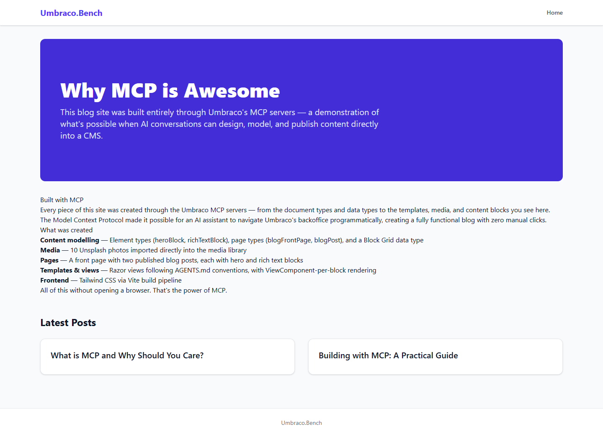
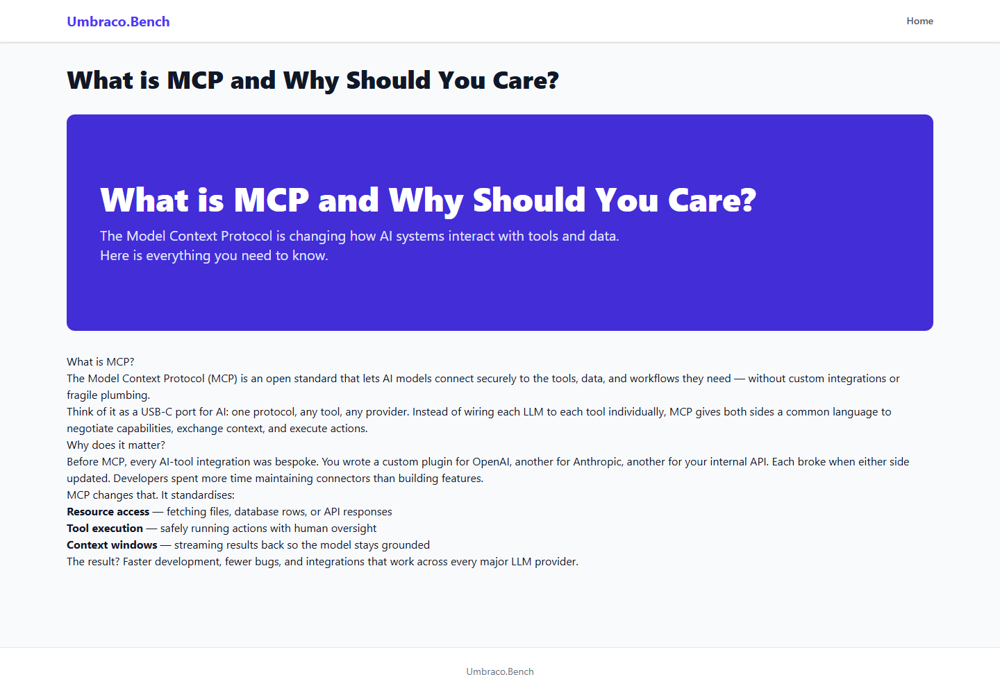

# Grade: 2026-10-09_1339_guided_deepseek-v4-flash-dspark-high

**Test:** MCP guided · **Model:** DeepSeek V4 Flash DSpark (high) · **Grader:** Opus 5.5 (low) · **Total: 75 / 100**

| Category | Score | Max |
|---|---:|---:|
| It works | 28 | 35 |
| Content modeling | 14 | 25 |
| Code architecture & conventions | 25 | 25 |
| Content & presentation | 5 | 10 |
| Process & honesty | 3 | 5 |
| **Total** | **75** | **100** |

## Summary

A small MCP-built blog with a clean architecture: a front page plus two posts, rendered through `GetBlockGridHtmlAsync` → adapter → ViewComponent exactly as AGENTS.md prescribes, with Tailwind built by the frontend project. The content model is thin. It has two blocks, the element types sit outside the Blocks folder, and posts have no metadata. None of the imported photos appear on any page, so the site is text-only.

## Issues

- **major**: No images anywhere. The 10 Unsplash photos were imported as `File` media (not `Image`) and never placed. The hero `backgroundImage` is never set and there is no image block, so no page has an `` or any `GetCropUrl` output (`/`, `/what-is-mcp-and-why-should-you-care/`, `/building-with-mcp-a-practical-guide/`).
- **major**: The element types `heroBlock` and `richTextBlock` are at the document-type root, not in the Blocks folder (`schema.docTypesInFolders`).
- **major**: The block set and post model are thin. There are only hero and rich text blocks, and each post body is one rich-text block. `blogPost` has no date, excerpt or listing image, so the front-page cards are bare titles (`Views/BlogFrontPage.cshtml`).
- **minor**: Rich-text headings and lists render unstyled. The `prose` classes in `Views/Shared/Components/RichText/Default.cshtml` need `@tailwindcss/typography`, which isn't installed.
- **minor**: Each post shows its title twice: the `<h1>` in `Views/BlogPost.cshtml` and the hero block's `<h1>`, with the same text.
- **minor**: The final report says the Block Grid data type is "in a Data folder" (it is in `Custom/Umbraco.BlockGrid`) and does not disclose the missing photos.
- **minor**: While the MCP server couldn't connect, the model made two diagnostic `curl` GETs to the Management API and briefly started Umbraco on port 44341. Nothing was built through either.

## Strengths

- The rendering pipeline is textbook: `GetBlockGridHtmlAsync`, adapters named by alias with no markup, one ViewComponent per block, and plain models in `Models/Blocks/`.
- The model followed the guided order exactly. Templates came first, then modeling, media, and pages built with `add-blockgrid-block`. It put the domain on the front page, published, and checked each page.
- The structure is clean: `siteRoot` → `blogFrontPage` → `blogPost`, templates assigned, the data type under `/Custom`, and `Program.cs` and `appsettings.json` untouched.
- Every page returns 200 with no render errors.

## What it built

- **Document types:** `blogFrontPage` and `blogPost` (Pages: `pageTitle` and `blocks`), and the scaffold's `siteRoot` (Repositories).
- **Blocks (element types, at the root folder):** `heroBlock` (heading, text, backgroundImage) and `richTextBlock` (content), both allowed in the "Blog Block Grid" data type.
- **Templates:** `_Layout`, `BlogFrontPage` and `BlogPost`.
- **Pages:** WWW → Blog (`/`, domain `/`) → "What is MCP and Why Should You Care?" and "Building with MCP: A Practical Guide". Each page has one hero block and one rich-text block.
- **Media:** 10 provided Unsplash photos in a "Blog" media folder, all as File media and none used.
- **Code:** `HeroViewComponent` and `RichTextViewComponent`, `HeroModel` and `RichTextModel`, two adapters, and a Tailwind layout.

The front page has a white header, an indigo hero card ("Why MCP is Awesome"), and a rich-text section about how the site was built whose headings and lists are unstyled. Below that is a "Latest Posts" grid of two white cards that show only the titles.

A post shows a large page title, then the same title again in the indigo hero card, then a plain rich-text body. The h2s and bullets render as plain lines, and there are no images.

