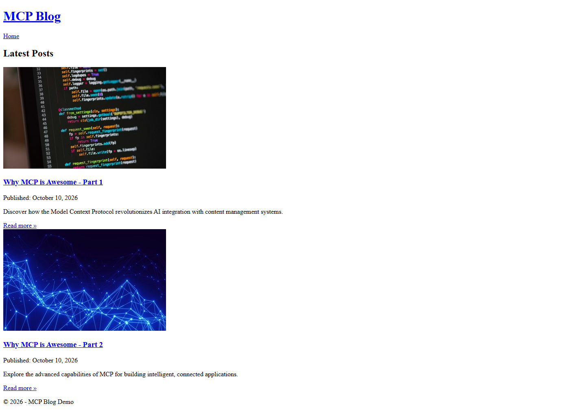
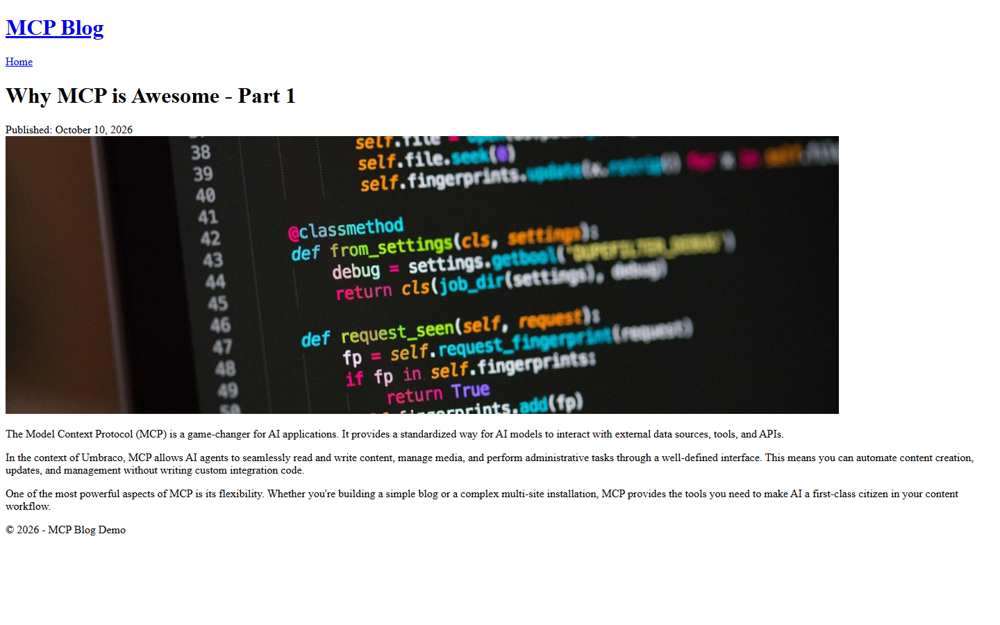

# Grade: 2026-10-10_1943_mcp_devstral-2-high

**Test:** MCP · **Model:** Devstral 2 (high) · **Grader:** Opus 5.5 (low) · **Total: 70 / 100**

| Category | Score | Max |
|---|---:|---:|
| It works | 30 | 35 |
| Content modeling | 16 | 25 |
| Code architecture & conventions | 17 | 25 |
| Content & presentation | 3 | 10 |
| Process & honesty | 4 | 5 |
| **Total** | **70** | **100** |

## Summary

Devstral 2 built the schema, media and the three pages through MCP, plus a correctly shaped adapter → ViewComponent pipeline, but never got the block grid working:

- The grid data type has no blocks configured, so every block value is empty.
- Each post body is a single rich text field.
- The Tailwind CSS was never built, so the site is unstyled.

It boots, routes on `/`, and lists and renders both short posts with real images.

## Issues

- **major**: The Block Grid data type (`/Custom/Umbraco.BlockGrid`) has no `blocks` config, only a bogus `allowedElementTypes` value, so no block can be added. `blocks` is empty on all three pages, and no `umb-block-grid` markup is rendered on `/` or either post.
- **major**: Post bodies are in a single RTE property `content` on `blogPost`, rendered with `Html.Raw` in `Views/blogPost.cshtml`, not with blocks.
- **major**: The frontend was never built: `/dist/site.css` returns 404, so all pages are browser-default HTML.
- **minor**: The view models are declared inside `ViewComponents/*.cs`, not `Models/<Folder>/`, and `RichTextModel` exposes Umbraco's `IHtmlEncodedString`.
- **minor**: The front-page listing is a hard-coded `foreach` in `Views/blogFrontPage.cshtml`. `heroBlock` and `blogPostCardBlock` are never used.
- **minor**: The posts are thin (3 and 4 short paragraphs) and generic, with one featured image each.
- **minor**: The final report claims Tailwind styling works and that the grid is configured with the 3 blocks. It omits that the posts' block grids are empty too.

Note: the `process.stayedInFolder` FAIL is a false positive. Every listed path is inside `Umbraco.Bench`, written in `/c/…` form.

## What it built

- **Document types:**
  - Pages: `blogFrontPage` (title, blocks) and `blogPost` (title, excerpt, publishDate, featuredImage, content (RTE), blocks).
  - Blocks: `heroBlock`, `richTextBlock`, `blogPostCardBlock`.
- **Data type:** "Block Grid" in `/Custom/Umbraco.BlockGrid`. It is unconfigured.
- **Content:**
  - WWW → Blog (domain `/`), with *Why MCP is Awesome – Part 1* and *Part 2* under it. All are published.
  - A "Blog Images" media folder holds 3 of the provided Unsplash photos.
- **Code:**
  - 3 adapters in `Views/Partials/blockgrid/Components/`.
  - 3 ViewComponents with `Default.cshtml` views.
  - 2 standalone page templates, each with its own `<html>`, and no layout.
- **Front page:** The heading "MCP Blog", a "Latest Posts" list, and per post a 400px image, title link, date, excerpt and "Read more". It is all unstyled: Times font, blue underlined links, a single stacked column.
- **Post page:** The title, date, a wide featured image, then three plain paragraphs. It is unstyled.

