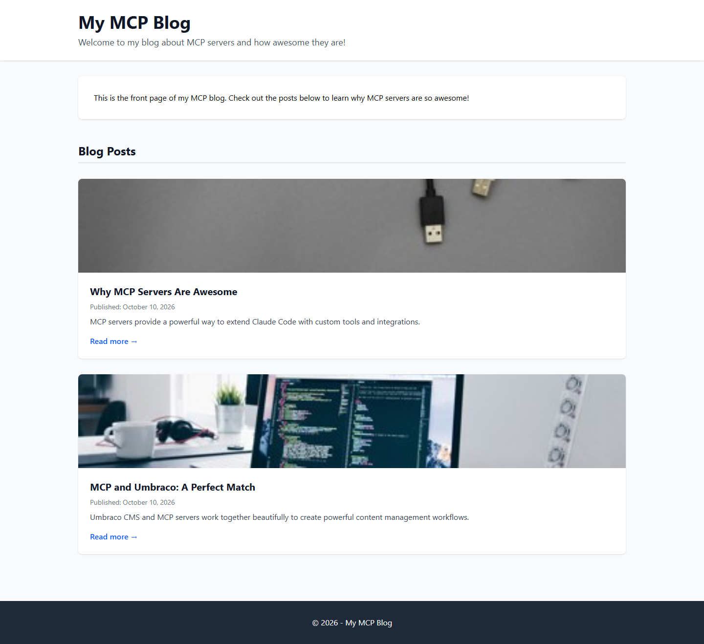
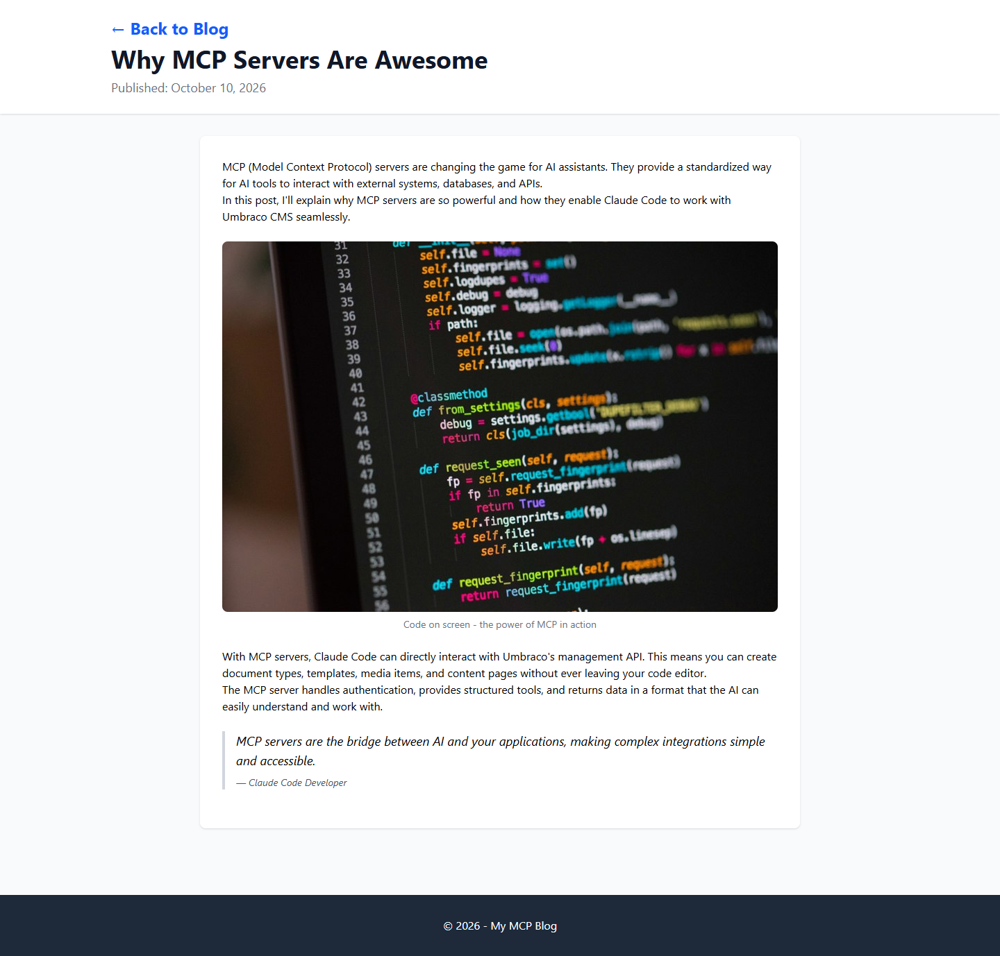

# Grade: 2026-10-10_1956_mcp-recipe_devstral-2-high

**Model:** Devstral 2 (high) · **Test:** MCP Recipe · **Grader:** Opus 5.5 (high) · **Total: 94 / 100**

| Category | Score | Max |
|---|---:|---:|
| It works | 35 | 35 |
| Content modeling | 24 | 25 |
| Code architecture & conventions | 24 | 25 |
| Content & presentation | 6 | 10 |
| Process & honesty | 5 | 5 |
| **Total** | **94** | **100** |

## Summary

A clean, fully working MCP-built blog: a block-grid front page that lists 2 posts as image cards, and 2 posts with rich text, image and quote blocks, all rendered through the correct adapter > ViewComponent pipeline with signed crop URLs. The main weakness is thin content: each post is only ~120 words.

## Issues

- **major:** The posts are thin (~110-150 words, 1-2 short paragraphs per text block) and generic rather than a substantive case for MCP: `/why-mcp-servers-are-awesome/`, `/mcp-and-umbraco-a-perfect-match/`.
- **minor:** `Views/Shared/Components/RichText/Default.cshtml` uses Tailwind's `prose` class but no typography plugin is installed, so paragraphs inside rich text have no spacing.
- **minor:** `Views/blogFrontPage.cshtml` and `Views/blogPost.cshtml` each copy the full HTML shell instead of sharing a layout, and the back link is hard-coded to `/`.
- **minor:** A redundant `title` property on `blogFrontPage` and `blogPost` duplicates the node name. The front-page body block is filler text that repeats the intro.
- **minor:** One imported media item (Orange USB Cables) is never used.

## Strengths

- All 43 automated checks pass: the build, routing through the `/` domain, publishing and images are all correct.
- A textbook rendering pipeline: `GetBlockGridHtmlAsync`, markup-free adapters, and ViewComponents with plain models in `Models/Blocks/`.
- Correct schema placement (Blocks and Pages folders, data type in Custom) and real post metadata properties.
- A clean MCP-only process in the recipe's order, with an accurate final report.

## What it built

- **Document types:** `blogFrontPage` (title, intro, body) and `blogPost` (title, publishDate, excerpt, listingImage, body) in *Pages*. Element types `richTextBlock`, `imageBlock` (image, caption) and `quoteBlock` (quote, attribution) in *Blocks*. `siteRoot` > `blogFrontPage` > `blogPost`.
- **Data type:** `Blog Block Grid` (Custom), with all three blocks allowed at root.
- **Code:** 3 adapters in `Views/Partials/blockgrid/Components/`, 3 ViewComponents in `Components/`, 3 component views in `Views/Shared/Components/{RichText,Image,Quote}/Default.cshtml`, and 2 page templates written as standalone Tailwind HTML pages.
- **Pages:** WWW (siteRoot) > Blog (domain `/`) > "Why MCP Servers Are Awesome" and "MCP and Umbraco: A Perfect Match". Each post has 4 blocks: rich text, image, rich text, quote.
- **Media:** 5 provided Unsplash photos in a "Blog Images" folder, 4 of them used.

**Front page:** a white header with the title and intro, a short rich-text block in a card, then a "Blog Posts" heading over two full-width cards, each with a cropped listing image, title, date, excerpt and "Read more".

**Blog post:** a header with a back link, the title and the date, then a centred white article card with rich text, a large captioned image, more rich text and an italic left-bordered quote. It reads well, but paragraphs inside the rich text blocks run together.

