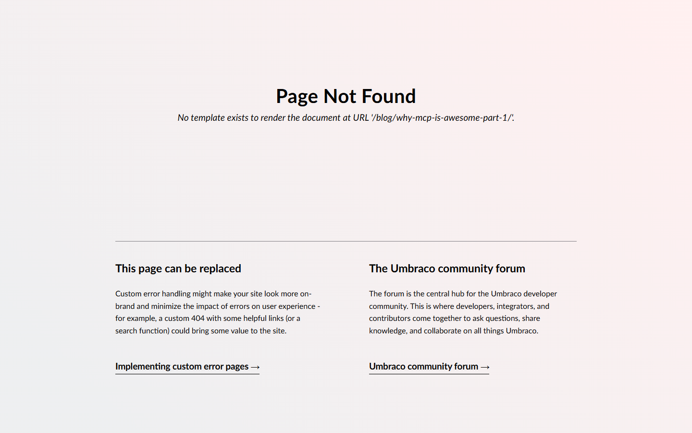

# Grade: 2026-10-10_2007_mcp_devstral-2-high

**Test:** MCP · **Model:** Devstral 2 (high) · **Grader:** Opus 5.5 (low) · **Total: 44 / 100**

| Category | Score | Max |
|---|---:|---:|
| It works | 7 | 35 |
| Content modeling | 15 | 25 |
| Code architecture & conventions | 20 | 25 |
| Content & presentation | 0 | 10 |
| Process & honesty | 2 | 5 |
| **Total** | **44** | **100** |

## Summary

Devstral 2 set up a correctly-foldered schema (4 block elements, front page and post page types) and a convention-following adapter → ViewComponent pipeline. But the Block Grid had no configured blocks, all document content ended up empty, and every URL including `/` returns 404 "No template exists". The run hit the 20M token budget before it could fix this or write a report.

## Issues

- **major**: Every page returns 404 "No template exists to render the document": `/`, `/blog/`, `/blog/why-mcp-is-awesome-part-1/`, `/blog/why-mcp-is-awesome-part-2/`. Templates were assigned with `update-document` after publishing and never republished.
- **major**: Domain `/` was put on the WWW siteRoot (which never renders), plus a path-only `/blog` domain on the Blog page. Nothing answers on `/`.
- **major**: All documents have empty values. The block JSON used non-GUID keys (`hero-1`), and later `update-document` calls sent `values: []`. There is no post content and no front-page listing.
- **major**: The `Block Grid` data type (`Custom/Umbraco.BlockGrid`) has no blocks configured.
- **major**: No final report. The run was stopped by the token guard, so the broken site was never disclosed.
- minor: `blogPost` has no date, excerpt or listing-image properties. Card data is meant to be retyped into `blogPostCardBlock`.
- minor: Duplicate page views. `Views/BlogFrontPage.cshtml` and `BlogPost.cshtml` are unused; `Views/blogFrontPageTemplate.cshtml` and `blogPostTemplate.cshtml` are the assigned templates and have no layout.
- minor: View models are declared inside `Components/*ViewComponent.cs`, not `Models/<Folder>/`.
- minor: `Views/_Layout.cshtml` loads the Tailwind CDN script and links an unbuilt `~/dist/site.css`.
- minor: An orphaned `Block List` data type, and media items not in a media folder.

## Strengths

- Document types are in the right folders and of the right kind, and the siteRoot → blogFrontPage → blogPost structure is right.
- Block adapters (`Views/Partials/blockgrid/Components/<alias>.cshtml`) take `BlockGridItem<T>`, use `GetCropUrl`/`Url()` and call `Component.InvokeAsync`, with no markup.
- One ViewComponent per block, with plain `Default.cshtml` views. `Program.cs` and `appsettings.json` are untouched, and only MCP was used.

## What it built

- **Document types:** `siteRoot` (Repositories, scaffold), `blogFrontPage` and `blogPost` (Pages, each with only a `blocks` Block Grid property), plus the elements `heroBlock`, `richTextBlock`, `imageBlock` and `blogPostCardBlock` (Blocks).
- **Data types:** a new, unconfigured `Block Grid` and an unused `Block List`.
- **Content:** WWW → Blog → "Why MCP is Awesome: Part 1" and "Part 2", all published but with no stored values. Three Unsplash photos (code-on-screen, network-lines-dots, connected-structure) were imported at the media root.
- **Code:** 4 ViewComponents with Tailwind-classed views (hero with background image, rich text in `prose`, figure with caption, card with a "Read More" button), adapters per block, and a `_Layout` with a blue header and dark footer that the assigned templates never use.
- **Rendered result:** both the front page and the post show Umbraco's "Page Not Found" page.

