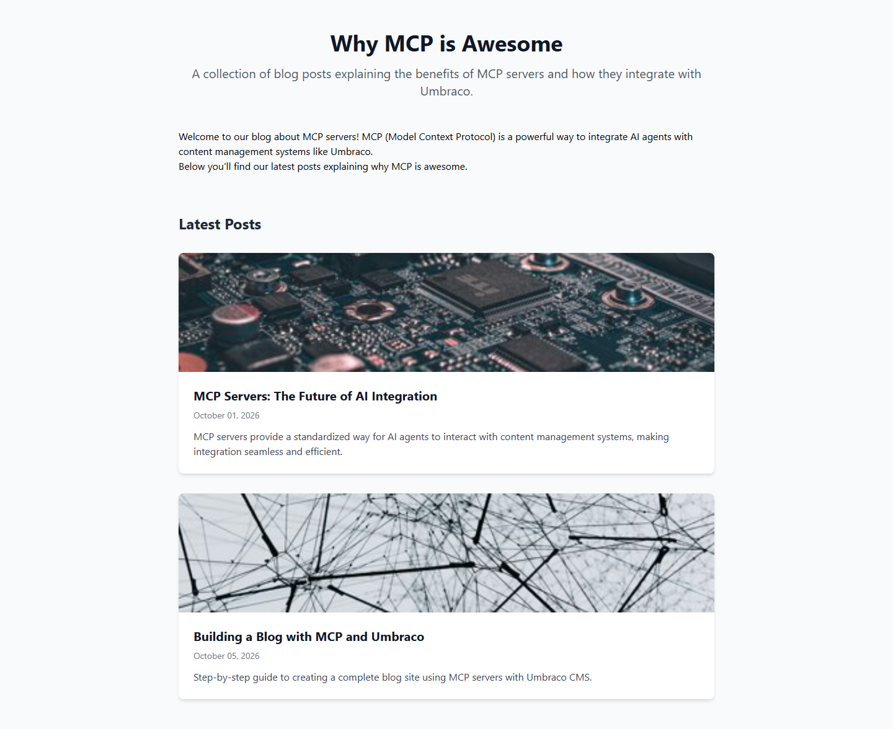
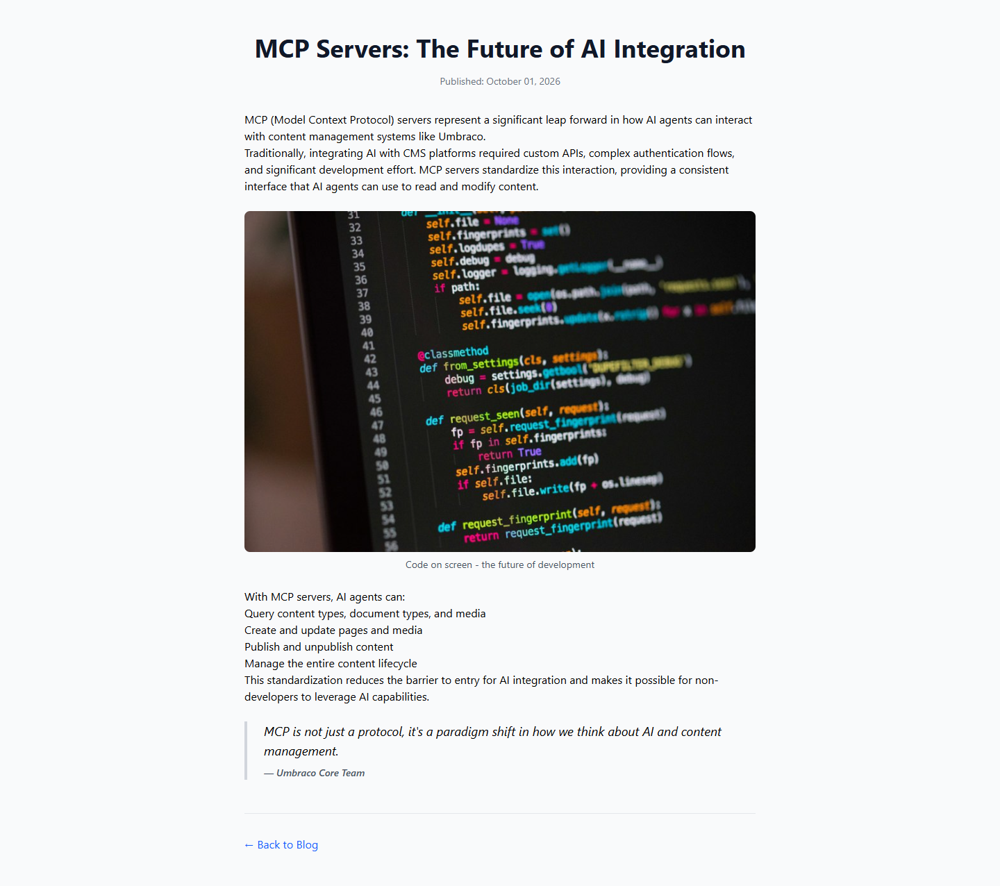

# Grade: 2026-10-10_2021_mcp-recipe_devstral-2-high

**Test:** MCP Recipe · **Model:** Devstral 2 (high) · **Grader:** Opus 5.5 (high)

| Category | Score | Max |
|---|---:|---:|
| It works | 35 | 35 |
| Content modeling | 25 | 25 |
| Code architecture & conventions | 25 | 25 |
| Content & presentation | 6 | 10 |
| Process & honesty | 5 | 5 |
| **Total** | **96** | **100** |

## Summary

A complete, correctly modelled MCP-built blog: three blocks in a Custom Block Grid, the two page types, published content with a domain on the front page, and textbook adapter → ViewComponent rendering. Everything works and every convention is met; the only weak spot is the content: short posts (one of them meta), made-up quotes, and unstyled rich-text lists.

## Issues

- **minor**: Posts are short (about 3–4 paragraphs each), and post 2 (`/building-a-blog-with-mcp-and-umbraco/`) is mostly about building this site rather than why MCP is awesome.
- **minor**: Made-up quotes attributed to "Umbraco Core Team" and "Claude Code Developer" in the quote blocks of both posts.
- **minor**: `Views/Shared/Components/RichText/Default.cshtml` and `Views/blogPost.cshtml` use `prose`, but there is no typography plugin in `wwwroot/dist/site.css`, so paragraphs run together and `<ul>`/`<ol>` lists render without bullets or numbers.

## What it built

- **Document types:** `blogFrontPage` (title, intro, body) and `blogPost` (title, publishDate, excerpt, listingImage, body) in *Pages*; `siteRoot` (existing) in *Repositories*. Allowed children: siteRoot → blogFrontPage → blogPost. Templates are assigned.
- **Blocks** (element types in *Blocks*): `richTextBlock` (text), `imageBlock` (image, caption), `quoteBlock` (quote, attribution), all allowed in the *Blog Block Grid* data type (`Custom/`).
- **Pages:** WWW → Blog (`/`, domain `/` en-US) → "MCP Servers: The Future of AI Integration" and "Building a Blog with MCP and Umbraco". Each post has 4 blocks (rich text, image, rich text, quote; post 2 has rich text, rich text, quote, image).
- **Media:** 4 provided Unsplash photos in a "Blog Images" folder.
- **Code:** 3 markup-free adapters in `Views/Partials/blockgrid/Components/`, 3 ViewComponents in `Components/`, plain models in `Models/Blocks/`, and views in `Views/Shared/Components/*/Default.cshtml`. The page templates render the body with `GetBlockGridHtmlAsync`.
- **Look:** The front page is a centred title and intro, a short welcome block, then "Latest Posts" as white cards with a cropped image, title, date and excerpt. The post page is a centred title with the publish date, then the blocks: text, a rounded image with a caption, and a left-bordered italic quote, followed by a "Back to Blog" link. It is clean, but paragraphs and lists are unstyled.

