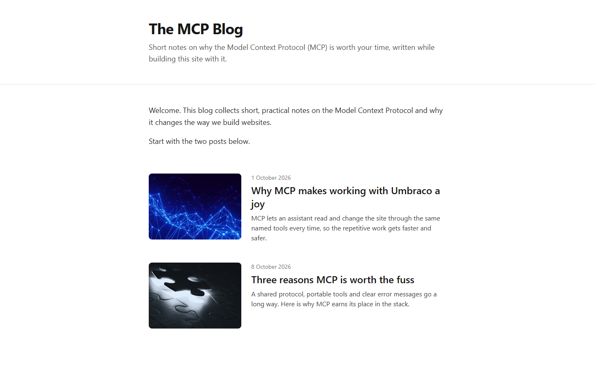
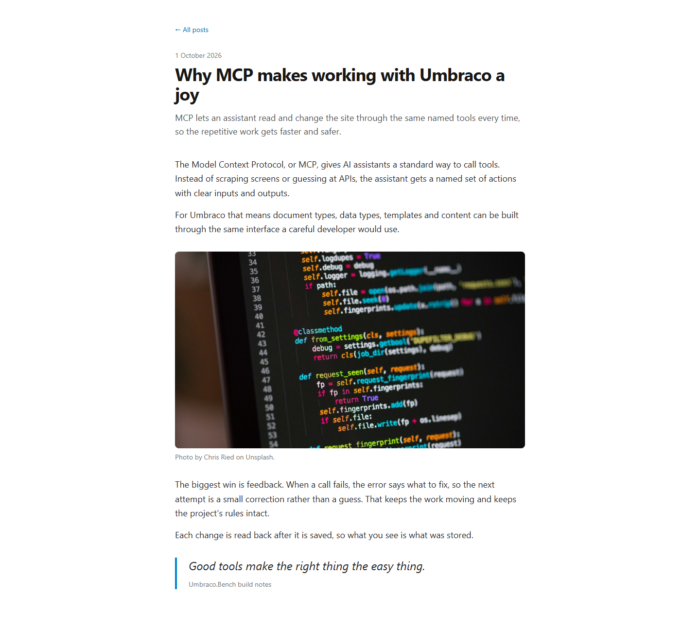

# Grade: 2026-10-10_0630_mcp-recipe_haiku-5.5-high

**Test:** MCP Recipe · **Model:** Haiku 5.5 (high) · **Grader:** Opus 5.5 (high) · **Total: 94.5 / 100**

| Category | Score | Max |
|---|---|---|
| It works | 35 | 35 |
| Content modeling | 24 | 25 |
| Code architecture & conventions | 24.5 | 25 |
| Content & presentation | 6.5 | 10 |
| Process & honesty | 4.5 | 5 |
| **Total** | **94.5** | **100** |

## Summary

A complete, working MCP-built blog: front page with a styled card listing and two block-grid posts, with schema, block pipeline and conventions done by the book. The main weakness is the content itself, which is short, and the "three reasons" post only gives two.

## What it built

- **Document types:** `blogFrontPage` (title, intro, body) and `blogPost` (title, publishDate, excerpt, listingImage, body) in Pages; `richTextBlock`, `imageBlock` (image, caption) and `quoteBlock` (quote, attribution) as elements in Blocks. `siteRoot` → `blogFrontPage` → `blogPost`.
- **Data types:** one custom "Blog Block Grid" (12 columns, the three blocks) in `Custom/Umbraco.BlockGrid`, used by both page types.
- **Pages:** WWW → "Blog" (`/`, domain `/`) → "Why MCP makes working with Umbraco a joy" and "Three reasons MCP is worth the fuss". Each post has rich text, image, rich text, quote. Five provided Unsplash photos in a "Blog Images" media folder.
- **Code:** `Views/blogFrontPage.cshtml` and `Views/blogPost.cshtml` (both `GetBlockGridHtmlAsync`), three adapters in `Views/Partials/blockgrid/Components/`, three ViewComponents with `Views/Shared/Components/<Name>/Default.cshtml`, plain models in `Models/Blocks/`. Tailwind via `wwwroot/dist/site.css`.
- **Look:** a centred, single-column Tailwind layout. The front page has a title and intro header, a welcome block, and cards with a rounded listing image, date, title and excerpt. Posts have a back link, date, big title, excerpt, then the blocks: readable body text, a full-width image with credit caption, and a quote with a blue left rule.

## Strengths

- All 43 automated checks pass; build, routing, domain, publishing and images all correct
- Textbook block pipeline: `GetBlockGridHtmlAsync`, markup-free adapters, ViewComponents with plain models in `Models/Blocks/`
- Correct schema: right folders and kinds, real post metadata properties, custom data type in `/Custom`
- Clean Tailwind layout with listing images, dates and excerpts
- Honest final report that discloses its stray `/tmp` write and what it did not check

## Issues

- **minor:** Post content is thin, about four short paragraphs per post (`/why-mcp-makes-working-with-umbraco-a-joy/`, `/three-reasons-mcp-is-worth-the-fuss/`).
- **minor:** `/three-reasons-mcp-is-worth-the-fuss/` promises three reasons but lists only two, and claims MCP tools always ask for confirmation before publishing or deleting.
- **minor:** `Views/blogFrontPage.cshtml` and `Views/blogPost.cshtml` each duplicate the full HTML shell with `Layout = null`. There is no shared layout and no header/nav on post pages.
- **minor:** The image block uses the caption (a photo credit) as alt text (`Views/Shared/Components/ImageBlock/Default.cshtml`).
- **minor:** A curl command wrote `/tmp/x` outside the project folder (deleted and disclosed).
- **minor:** The block set is minimal (rich text, image, quote) with no block settings, and one of five imported photos is unused.

## Notes

- Build: 0 errors. The 10 warnings are all NU1902/NU1903 advisories on the scaffold's SixLabors.ImageSharp package, so none were introduced by the model.
- Process: 59 Umbraco MCP calls and no Management API, DB, browser or migration use. No order-of-operations warnings.
