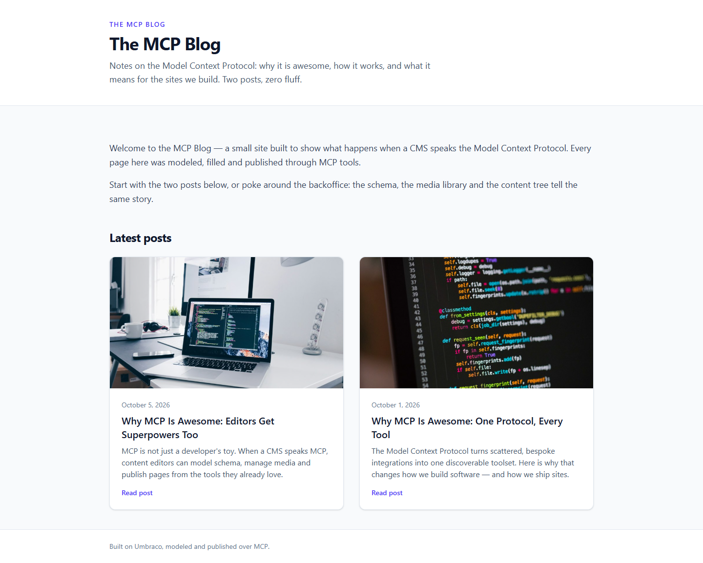

# Grade: 2026-10-10_0639_mcp-recipe_mistral-large-4-high

**Test:** MCP Recipe · **Model:** Mistral Large 4 (high) · **Grader:** Opus 5.5 (low) · **Total: 99 / 100**

| Category | Score | Max |
|---|---:|---:|
| It works | 35 | 35 |
| Content modeling | 25 | 25 |
| Code architecture & conventions | 24.5 | 25 |
| Content & presentation | 9.5 | 10 |
| Process & honesty | 5 | 5 |
| **Total** | **99** | **100** |

## Summary

This is a clean, fully working blog built over MCP. It has three well-formed blocks (rich text, image, quote) on a shared block grid. The front page shows image/date/excerpt cards for the two published posts. Everything renders through the exact adapter → ViewComponent pipeline, with Tailwind styling. Only nitpicks remain: duplicated page shells, a hard-coded back link, and slightly short posts with one inaccurate line.

## What it built

- **Document types:** `richTextBlock` (text: RichText), `imageBlock` (image: MediaPicker3, caption), `quoteBlock` (quote, attribution) are elements in *Blocks*. `blogFrontPage` (title, intro, body) and `blogPost` (title, publishDate, excerpt, listingImage, body) are pages in *Pages*. The tree is `siteRoot` → `blogFrontPage` → `blogPost`.
- **Data type:** `Blog Block Grid` (12 columns, all three blocks) in `/Custom/Umbraco.BlockGrid`.
- **Content:** WWW → *Blog* (domain `/`) → two posts: *Why MCP Is Awesome: One Protocol, Every Tool* and *Why MCP Is Awesome: Editors Get Superpowers Too*. Each post has 4 blocks: rich text, image, rich text, quote.
- **Media:** 4 provided Unsplash photos in a *Blog Images* folder.
- **Code:** 3 adapters in `Views/Partials/blockgrid/Components/`, 3 plain models in `Models/Blocks/`, 3 ViewComponents and their `Default.cshtml` views. Both page templates call `GetBlockGridHtmlAsync`.
- **Look:** The front page has a white header with an eyebrow, title and intro, then the intro rich-text block and a two-column card grid. Each card has a cropped image, date, title, excerpt and "Read post" link. Posts use a narrow, readable column with the date, title and lede, body text with good spacing, a rounded figure with a credited caption, and an indigo blockquote.

## Strengths

- All 43 automated checks pass. The build is clean apart from the scaffold's package warnings.
- The block pipeline is textbook: alias-named adapters, plain models, one ViewComponent per block.
- The schema is correct: tight allowed children, real post metadata, one custom block grid in `/Custom`.
- The provided photos were imported into the media library and are served via `GetCropUrl`.
- The final report is accurate and candid.

## Issues

- **minor:** `Views/blogFrontPage.cshtml` and `Views/blogPost.cshtml` each set `Layout = null` and duplicate the full HTML shell.
- **minor:** `Views/blogPost.cshtml` hard-codes the "All posts" link to `/` instead of using the parent page's `Url()`.
- **minor:** `/why-mcp-is-awesome-editors-get-superpowers-too/` says "The front page you are reading" and claims nothing was hand-edited. Both posts are fairly short (~400 words).
