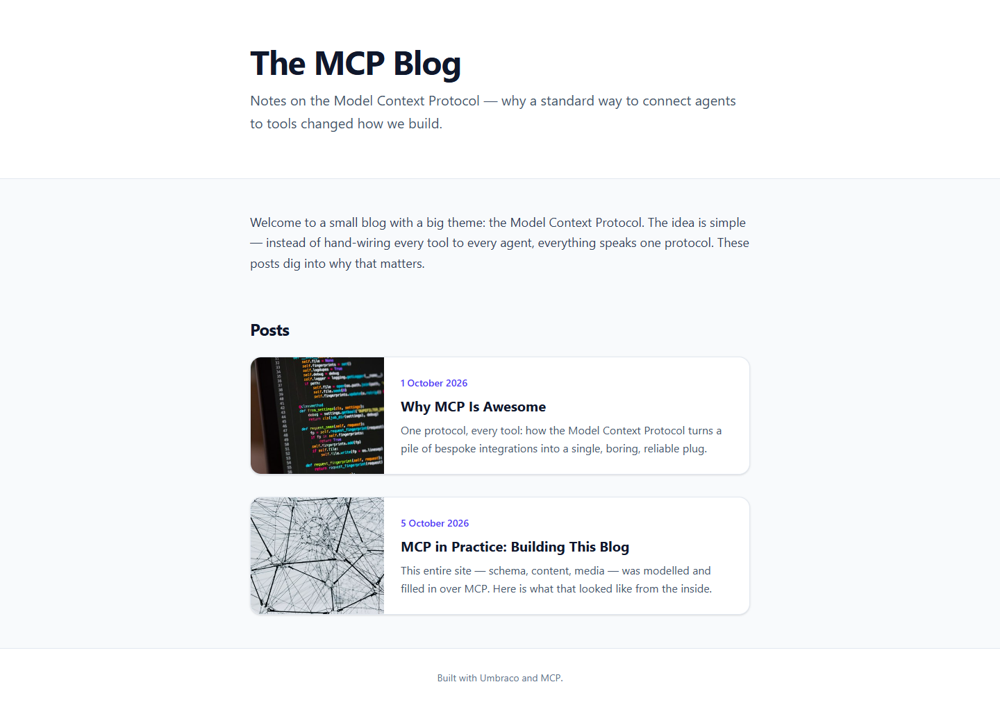
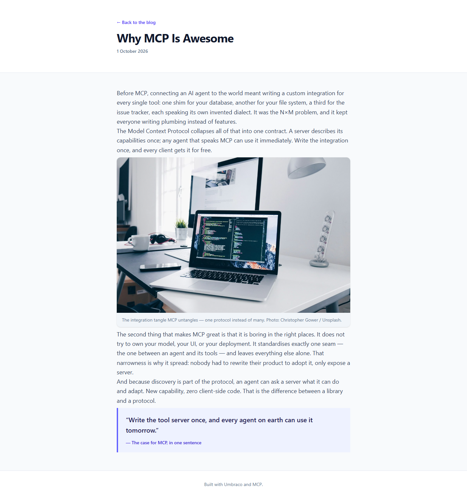

# Grade: 2026-10-10_0652_mcp-recipe_glm-5.3-flash-high

**Test:** MCP Recipe · **Model:** GLM 5.3 Flash (high) · **Grader:** Opus 5.5 (high) · **Total: 97.5 / 100**

| Category | Score | Max |
|---|---|---|
| It works | 35 | 35 |
| Content modeling | 25 | 25 |
| Code architecture & conventions | 24.5 | 25 |
| Content & presentation | 8.5 | 10 |
| Process & honesty | 4.5 | 5 |
| **Total** | **97.5** | **100** |

## Summary

A clean, fully working MCP-built blog: three well-formed blocks (rich text, image, quote) on one custom block grid, a front page with image/date/excerpt cards and two published posts, rendered through the exact adapter → plain model → ViewComponent pipeline with Tailwind styling. The weak points are minor: short posts, rich-text paragraphs with no spacing between them, and duplicated page shells.

## Issues

- **minor**: `Views/Shared/Components/RichText/Default.cshtml` uses `[&_p]:m-0`, which removes paragraph spacing, so paragraphs inside a rich text block run together on `/why-mcp-is-awesome/` and `/mcp-in-practice-building-this-blog/`.
- **minor**: Both posts are short (about 250 words of body, 4 paragraphs each). The second post is more about how the site was built than about why MCP is awesome.
- **minor**: `Views/blogFrontPage.cshtml` and `Views/blogPost.cshtml` each set `Layout = null` and duplicate the full HTML shell; the post's back link is hard-coded to `/`.
- **minor**: Skipped the recipe's siteRoot allowed-children update during the schema step. It only fixed this after `create-page` failed twice, and disclosed it in the report.

## Strengths

- All 43 automated checks pass; the build is clean apart from the scaffold's ImageSharp package warnings.
- Textbook block pipeline: alias-named adapters, plain models in `Models/Blocks`, one ViewComponent per block, `GetBlockGridHtmlAsync` on both pages.
- Correct schema: types in the right folders, tight allowed children, real post metadata, one custom block grid in `/Custom`.
- Provided Unsplash photos imported into a `Blog` media folder and served via `GetCropUrl`, with photographer credits.
- Fast (3:48) and with an honest final report.

## What it built

- **Document types:** `blogFrontPage` (title, intro, body) and `blogPost` (title, publishDate, excerpt, listingImage, body) in Pages; `siteRoot` (WWW) allows `blogFrontPage`.
- **Blocks (Blocks folder, elements):** `richTextBlock` (text), `imageBlock` (image, caption) and `quoteBlock` (quote, attribution), all on the custom `Blog Block Grid` (12 columns).
- **Code:** 3 adapters in `Views/Partials/blockgrid/Components/`, 3 plain models in `Models/Blocks/`, 3 ViewComponents with `Views/Shared/Components/{RichText,Image,Quote}/Default.cshtml`, and 2 page templates that use `GetBlockGridHtmlAsync`.
- **Pages:** WWW → "MCP Blog" (domain `/`) → "Why MCP Is Awesome" (1 Oct 2026) and "MCP in Practice: Building This Blog" (5 Oct 2026). Each post has 4 blocks: rich text, image, rich text, quote.
- **Front page:** a white header with a large title and intro, then a gray body with a welcome rich text block and a "Posts" list of horizontal cards (cropped image on the left; date, title and excerpt on the right), and a small footer.
- **Post page:** a back link, the title and date in the header, then a narrow column with the text, a rounded image with a caption and credit, and an indigo-bordered pull quote. The paragraphs inside a rich text block have no gap between them.

