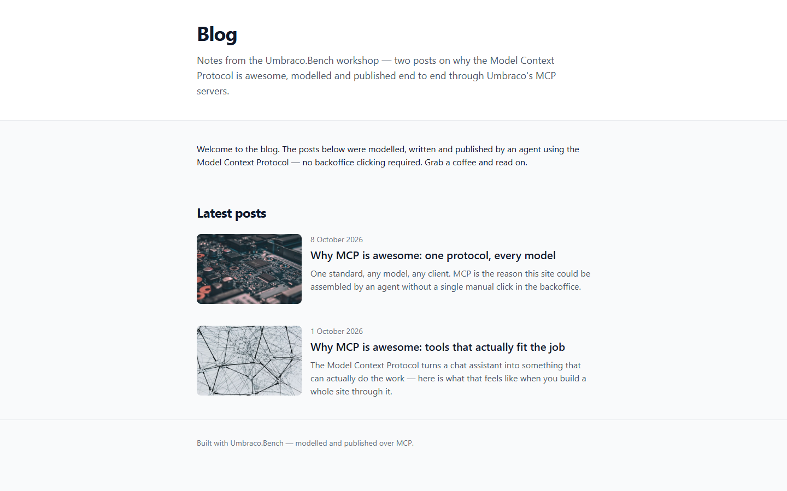
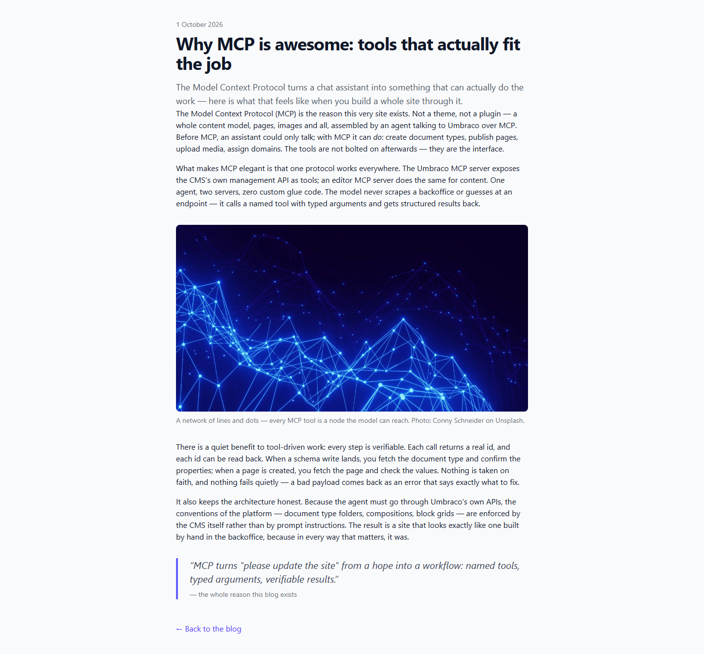

# Grade: 2026-10-10_0700_mcp-recipe_mistral-large-4-high

**Test:** MCP Recipe · **Model:** Mistral Large 4 (high) · **Grader:** Opus 5.5 (high) · **Total: 98.5 / 100**

| Category | Score | Max |
|---|---:|---:|
| It works | 35 | 35 |
| Content modeling | 25 | 25 |
| Code architecture & conventions | 24.5 | 25 |
| Content & presentation | 9 | 10 |
| Process & honesty | 5 | 5 |
| **Total** | **98.5** | **100** |

## Summary

A clean, fully working MCP-built blog: three well-formed blocks in one custom block grid, front page and post types correctly filed and wired, both posts rendering every block through the textbook adapter → ViewComponent pipeline, and a tidy Tailwind design. Only nits: duplicated HTML shells per page and short, self-referential posts.

All 43 automated checks passed; the build has 0 errors (the 10 warnings are the scaffold's ImageSharp NU190x advisories).

## Issues

- **minor**: Both page views set `Layout = null` and duplicate the full HTML shell; post pages lack the front page's header/footer (`Umbraco.Bench.Umbraco/Views/blogFrontPage.cshtml`, `Views/blogPost.cshtml`).
- **minor**: Posts are ~400 words each and mostly describe this site being built over MCP rather than making a broader case (`/why-mcp-is-awesome-tools-that-actually-fit-the-job/`, `/why-mcp-is-awesome-one-protocol-every-model/`).
- **minor**: The post excerpt has no bottom margin, so it runs straight into the first body paragraph (`Views/blogPost.cshtml`).

## What it built

- **Document types**: `richTextBlock` (text: RichText), `imageBlock` (image: MediaPicker3, caption), `quoteBlock` (quote, attribution): elements in **Blocks**. `blogFrontPage` (title, intro, body) and `blogPost` (title, publishDate, excerpt, listingImage, body): documents in **Pages**. `siteRoot` → `blogFrontPage` → `blogPost`.
- **Data type**: `Blog Block Grid` (12 columns, the three blocks) in `Custom/Umbraco.BlockGrid`.
- **Content**: WWW → Blog (domain `/`, intro + one rich-text block) → two posts dated 1 and 8 October 2026, each with 4 blocks (rich text → image → rich text → quote). 5 Unsplash photos imported into a `Blog` media folder, 4 used.
- **Code**: 3 adapters in `Views/Partials/blockgrid/Components/`, 3 ViewComponents in `Components/`, plain models in `Models/Blocks/`, component views in `Views/Shared/Components/<Name>/Default.cshtml`, Tailwind built to `wwwroot/dist/site.css`.
- **Look**: The front page has a white header with title and intro, a welcome block, then a "Latest posts" list with a rounded thumbnail, date, title and excerpt per post, and a footer. Post pages use a narrow reading column with date, large title, lead excerpt, body paragraphs, a full-width rounded image with a credit caption, an indigo-bordered pull quote and a "Back to the blog" link.

