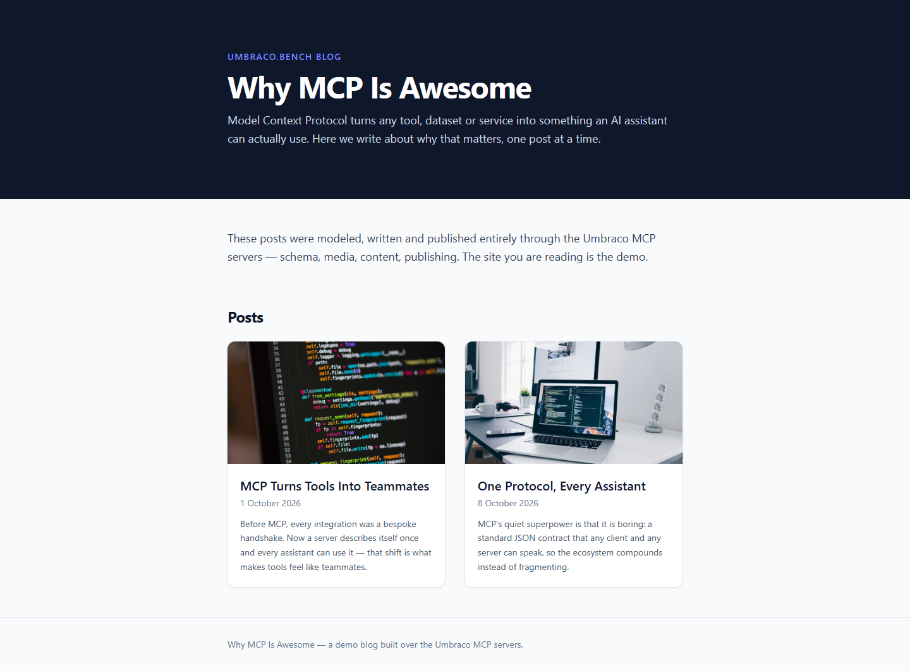
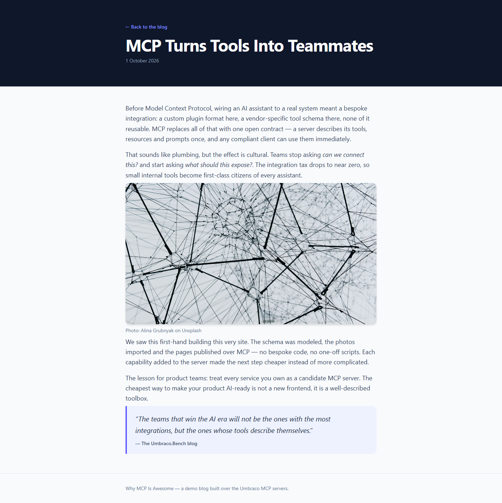

# Grade: 2026-10-10_0730_mcp-recipe_glm-5.3-flash-high

**Test:** MCP Recipe · **Model:** GLM 5.3 Flash (high) · **Grader:** Opus 5.5 (high) · **Total: 98.5 / 100**

| Category | Score | Max |
|---|---|---|
| It works | 35 | 35 |
| Content modeling | 25 | 25 |
| Code architecture & conventions | 25 | 25 |
| Content & presentation | 9 | 10 |
| Process & honesty | 4.5 | 5 |
| **Total** | **98.5** | **100** |

## Summary

A clean, fully working MCP-built blog: three well-formed blocks on one custom block grid, a front page of image/date/excerpt cards and two published posts. Everything renders through the prescribed adapter → plain model → ViewComponent pipeline, with polished Tailwind styling. The only blemishes are fairly short posts and a skipped siteRoot allowed-children step that it fixed only after a failure.

## Issues

- **minor**: The posts are short (about 4 paragraphs and 220 words each). Part of `/mcp-turns-tools-into-teammates/` is about building this site rather than about MCP in general.
- **minor**: Skipped the recipe's `siteRoot` → `blogFrontPage` allowed-children update in step 3. It only made the update after `create-page` failed with "Operation not permitted", and disclosed this in the report.
- **minor**: `Views/blogPost.cshtml` hard-codes the back link to `/`.

## Strengths

- All 43 automated checks pass. The build is clean apart from the scaffold's ImageSharp package advisories.
- Textbook block pipeline: alias-named adapters, records in `Models/Blocks/`, one ViewComponent per block, and `GetBlockGridHtmlAsync` on both pages.
- Correct, tight schema: types in the right folders, correct allowed children, real post metadata, and one custom block grid.
- The provided Unsplash photos are imported into a `Blog` media folder and served through signed `GetCropUrl` URLs, with photographer credits as captions.
- Fast run (4:12) with an honest final report, which also mentions the publish-with-descendants cancellation and the `*ViewComponent` naming fix.

## What it built

- **Document types:** `blogFrontPage` (title, intro, body) and `blogPost` (title, publishDate, excerpt, listingImage, body) in Pages. `siteRoot` (WWW) allows `blogFrontPage`, and `blogFrontPage` allows `blogPost`.
- **Blocks (Blocks folder, elements):** `richTextBlock` (text), `imageBlock` (image, caption) and `quoteBlock` (quote, attribution), all on the custom `Blog Block Grid` (12 columns).
- **Code:** 3 adapters in `Views/Partials/blockgrid/Components/`, 3 records in `Models/Blocks/`, 3 ViewComponents with views in `Views/Shared/Components/{RichText,Image,Quote}/Default.cshtml`, and 2 page templates that use `GetBlockGridHtmlAsync`.
- **Pages:** WWW → "Why MCP Is Awesome" (domain `/`) → "MCP Turns Tools Into Teammates" (1 Oct 2026) and "One Protocol, Every Assistant" (8 Oct 2026). Each post has 4 blocks: rich text, image, rich text, quote. 5 photos imported, 4 used.
- **Front page:** a dark navy header with a kicker, a large title and the intro. Below it come a short rich-text block, a "Posts" heading with a two-column grid of white cards (16:9 cropped image, title, date, excerpt) and a small footer.
- **Post page:** a dark header with a back link, the title and the date, then a readable column with spaced paragraphs, a rounded image with an Unsplash credit caption, and an indigo-bordered pull quote.

