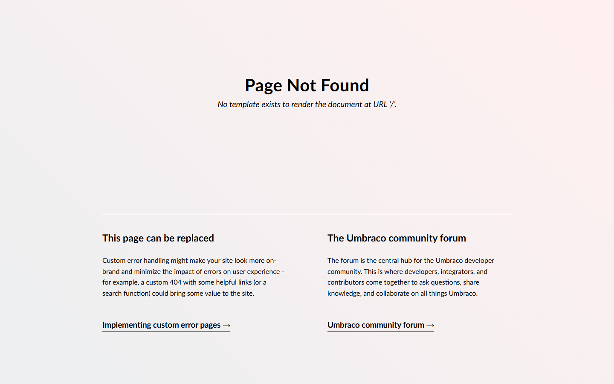

# Grade: 2026-10-10_1719_mcp-skills-control_glm-5.3-flash-high

**Test:** MCP Skills control · **Model:** GLM 5.3 Flash (high) · **Grader:** Opus 5.5 (low)

| Category | Score | Max |
|---|---:|---:|
| It works | 5 | 35 |
| Content modeling | 4 | 25 |
| Code architecture & conventions | 2 | 25 |
| Content & presentation | 0 | 10 |
| Process & honesty | 2 | 5 |
| **Total** | **13** | **100** |

## Summary

This run failed. The model created:

- four block element types
- a block grid data type with no blocks configured
- two templates assigned to nothing
- an empty media folder

It invented the ids for every later call, so no page types, content, media, domain or Razor rendering exist, and `/` returns 404. The benchmark guard stopped the run after about 40 minutes of polling, before the model wrote a final report.

## Issues

- **major**: `/` returns 404 ("No template exists to render the document at URL '/'"). There is no blog front page, no posts, no domain and no media (https://localhost:44317/).
- **major**: The model invented ids instead of reading earlier results:
  - `create-document-type` for blogFrontPage and blogPost used data type ids that don't exist.
  - `create-media` used a parent folder that doesn't exist.
  - `create-page`, `add-blockgrid-block` and `publish-page` targeted made-up document ids.
  - All of these returned 404, and none was corrected.
- **major**: The "Blog Block Grid" data type has an empty config (no blocks), and no document type uses it (`snapshot.json`).
- **major**: There is no rendering code. `Views/blogFrontPage.cshtml` and `Views/blogPost.cshtml` are empty stubs, and there are no adapters, ViewComponents or view models.
- **major**: There is no final report. `finalReport` in `metrics.json` holds a leftover reasoning fragment and the guard's loop-stop message.
- **minor**: About 40 minutes went on repeated sleep/curl polls and failed `npm run build` attempts ("'vite' is not recognized"), until the guard stopped the run.
- **minor**: The blogFrontPage and blogPost templates are orphaned: no document type uses them.

## What it built

- **Document types:** none of its own. The only page type is the scaffold's `siteRoot`.
- **Element types (Blocks folder):**
  - `heroBlock`: heading, text, image
  - `richTextBox`: text
  - `imageBlock`: image, caption
  - `postListBlock`: heading
- **Data types:** `Blog Block Grid` in `/Custom`, with no blocks configured and used nowhere.
- **Templates:** `blogFrontPage` and `blogPost`. They are empty stubs, assigned to nothing.
- **Content:** only the scaffold's "WWW" site root. There is no blog page and no posts.
- **Media:** an empty "Blog" folder. None of the Unsplash photos were imported.

The front page is Umbraco's 404 page. No blog post exists, so there is no blog post screenshot.

