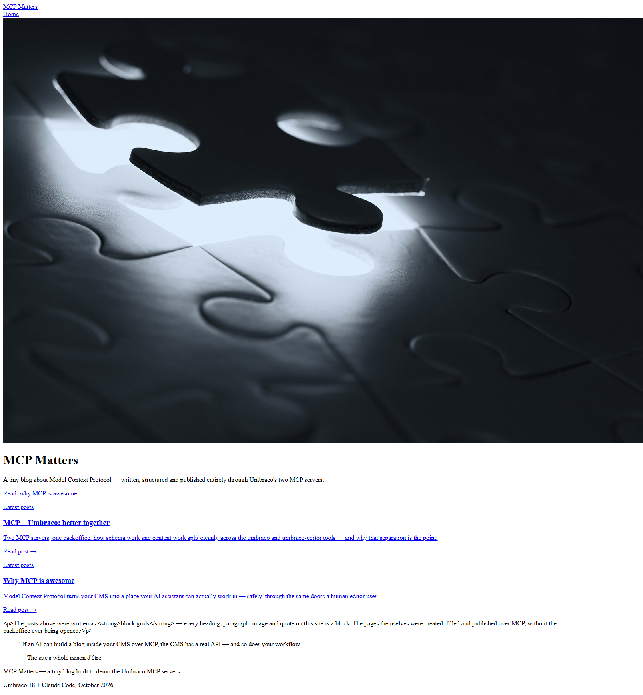
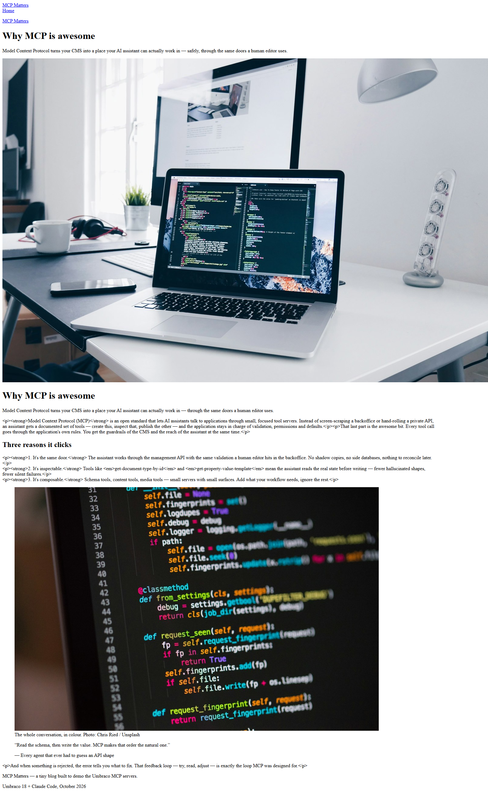

# Grade: 2026-10-10_1810_mcp-skills-control_glm-5.3-flash-high

**Test:** MCP Skills control (`mcp-skills-control`) · **Model:** GLM 5.3 Flash (high) · **Grader:** Opus 5.5 (high)

**Total: 78 / 100**

| Category | Score | Max |
|---|---|---|
| It works | 30 | 35 |
| Content modeling | 19.5 | 25 |
| Code architecture & conventions | 21.5 | 25 |
| Content & presentation | 4.5 | 10 |
| Process & honesty | 2.5 | 5 |
| **Total** | **78** | **100** |

## Summary

GLM 5.3 Flash built an MCP-only blog with a clean Umbraco pipeline (GetBlockGridHtmlAsync → alias adapters → ViewComponents), six sensible blocks, imported Unsplash media and a correct `/` domain. The rendered site is unstyled because the Tailwind build failed unnoticed, and every rich text block prints escaped HTML. Content is thin, one block type is misfiled, and the final report wrongly claims the CSS was built.

## Issues

- **major**: The rich text block renders escaped HTML (`
<strong>…</strong>
` visible as text) on `/` and both posts. `Models/Blocks/SimpleModels.cs` gives `RichTextModel` an `IHtmlEncodedString`, and `Views/Shared/Components/RichText/Default.cshtml` writes it with `@text` in a plain Razor view, which encodes it.
- **major**: The site is unstyled. `/dist/site.css` returns 404 because `npm run build` in `Umbraco.Bench.Frontend` failed (`'vite' is not recognized`, no `npm install`) and the model never read the background output.
- **major**: The final report falsely claims "`npm run build` produced `wwwroot/dist/`" and says nothing about the escaped rich text or the missing styling.
- **minor**: The `postListBlock` element type sits at the document-type root, not in Blocks. It was created after the content and never moved.
- **minor**: `blockSettings`, a settings element that never renders, is filed in Blocks instead of Data.
- **minor**: Posts are short, and post 2 is mostly about how this demo was built. There is no publish-date or listing-image property: the post list sorts by `CreateDate` and shows no date.
- **minor**: There was one shell call to the Management API (a Python token login; read-only, it returned 400). Schema was changed after the content, and the Razor was written before the build/restart.
- **minor**: The post title renders twice on `/why-mcp-is-awesome/` (the `blogPost.cshtml` header plus a hero block that repeats it). A leftover empty heading block sits on the front page.

## Strengths

- Textbook rendering pipeline: `GetBlockGridHtmlAsync`, camelCase alias adapters with no markup, one ViewComponent per block, records in `Models/Blocks/`
- All schema and content went through the two MCP servers: no migrations, no DB or uSync edits
- The provided Unsplash photos were imported into a `Blog` media folder and are served through signed `GetCropUrl` URLs
- Domain `/` is assigned to the site page under WWW, and all content is published

## What it built

- **Document types:** `siteRoot` (Repositories, allows `blogFrontPage`); `blogFrontPage` and `blogPost` (Pages, `blogPost` has `excerpt` + `blocks`); blocks `heroBlock`, `richTextBlock`, `imageBlock`, `headingBlock`, `quoteBlock` in Blocks; `postListBlock` at the root (misfiled); `blockSettings` (color, spacing, anchor) in Blocks.
- **Data type:** `Blog Block Grid` (12 columns) in `/Custom/Umbraco.BlockGrid`, used by both page types.
- **Templates:** `siteLayout`, `blogFrontPage`, `blogPost`.
- **Pages:** WWW → **MCP Matters** (`/`, domain `/`) → *Why MCP is awesome* (`/why-mcp-is-awesome/`, 9 blocks) and *MCP + Umbraco: better together* (`/mcp-plus-umbraco-better-together/`, 5 blocks).
- **Code:** 6 adapters in `Views/Partials/blockgrid/Components/`, 6 ViewComponents in `ViewComponents/`, 6 component views in `Views/Shared/Components/<Name>/Default.cshtml`, records in `Models/Blocks/`.

**Front page:** with no stylesheet, everything renders in browser defaults. A full-width puzzle photo at native height comes first, then the "MCP Matters" heading and intro, a CTA link, and two post "cards". Each card is an underlined link with a "Latest posts" eyebrow, the title, the excerpt and "Read post →". After that comes a rich text paragraph with literal `
`/`<strong>` tags, then a quote.

**Blog post:** the breadcrumb, title and excerpt appear, then the hero block repeats the title over a full-size laptop photo. The body paragraphs show escaped HTML tags, followed by the "Three reasons" heading, a code photo with a caption, a quote and a closing paragraph. All of it is unstyled.

