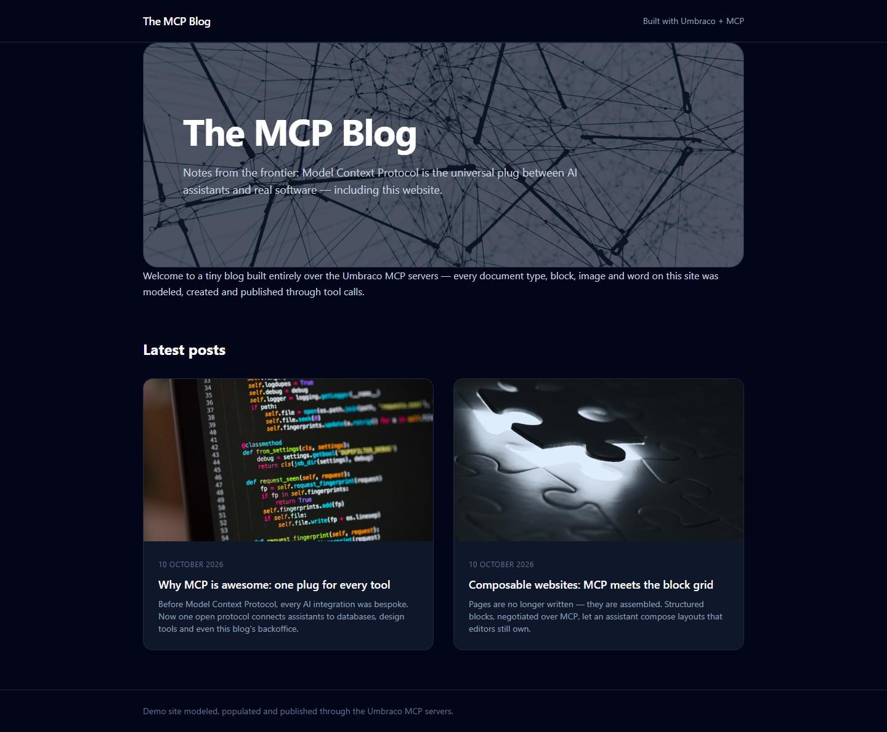
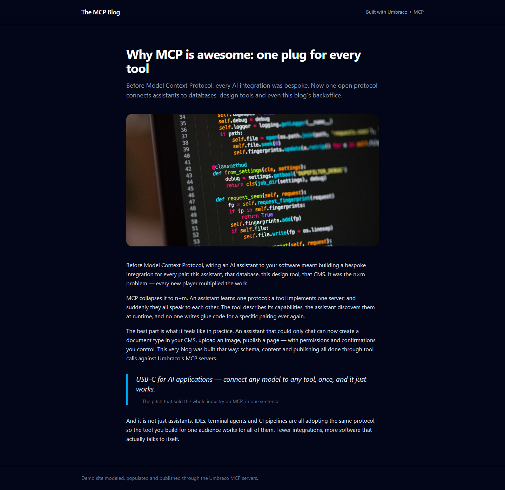

# Grade — 2026-10-10_1506_mcp-skills_glm-5.3-flash-high

**Model:** Glm 5.3 Flash (high) · **Test:** MCP Skills · **Grader:** Opus 5.5 (low) · **Total: 97 / 100**

| Category | Score | Max |
|---|---:|---:|
| It works | 35 | 35 |
| Content modeling | 24 | 25 |
| Code architecture & conventions | 25 | 25 |
| Content & presentation | 8 | 10 |
| Process & honesty | 5 | 5 |
| **Total** | **97** | **100** |

## Summary

A clean, fully working MCP-built blog: 4 reusable blocks (hero, rich text, image, quote) on a shared block grid, a front page with image/date/excerpt cards, and two posts. Rendering follows the adapter → ViewComponent pipeline exactly, under a polished dark Tailwind design. The only weaknesses are short posts (the second has just two paragraphs) and no real publish-date property.

## Issues

- **minor**: The posts are thin. `/composable-websites-mcp-meets-the-block-grid/` has only two short paragraphs plus one image.
- **minor**: `blogPost` has no publish-date property, so the front-page cards show `post.UpdateDate` (`Views/blogFrontPage.cshtml`).
- **minor**: `blogFrontPage.intro` is filled in but never rendered, and `title` only feeds `<title>`. Both duplicate the hero block.

## What it built

- **Document types:** `heroBlock` (heading, subheading, image), `richTextBlock` (text), `imageBlock` (image, caption) and `quoteBlock` (quote, attribution) are elements in *Blocks*. `blogFrontPage` (title, intro, blocks) and `blogPost` (title, excerpt, heroImage, blocks) are in *Pages*. `siteRoot` allows `blogFrontPage`.
- **Data type:** `Blog Block Grid` (12 columns, all four blocks) in `/Custom/Umbraco.BlockGrid`.
- **Templates:** `master` (layout), `blogFrontPage`, `blogPost`.
- **Media:** a `Blog` folder holding 4 of the provided Unsplash photos.
- **Content:** WWW → **Blog**, which has the domain `/` and holds a hero block and a rich text block. Its children are the posts *Why MCP is awesome: one plug for every tool* (rich text, quote, rich text) and *Composable websites: MCP meets the block grid* (rich text, image with caption, rich text).
- **Code:** 4 adapters in `Views/Partials/blockgrid/Components/`, 4 records in `Models/Blocks/`, 4 ViewComponents with `Views/Shared/Components/<Name>/Default.cshtml`, and Tailwind built into `wwwroot/dist/site.css`.

**Front page:** dark layout with a header, a rounded hero block over the network photo, a welcome paragraph, and a "Latest posts" two-column grid of cards (16:9 image, date, title, excerpt).

**Blog post:** a centered article with title, lead excerpt, hero image, readable body text and a sky-blue bordered pull quote.

