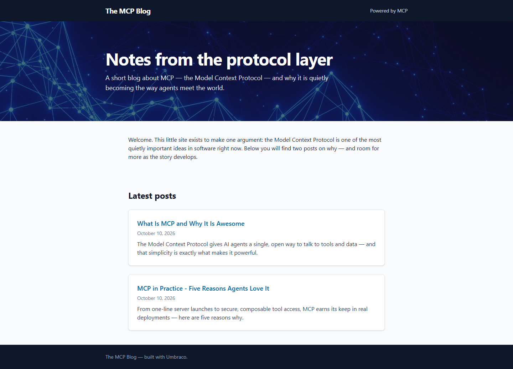
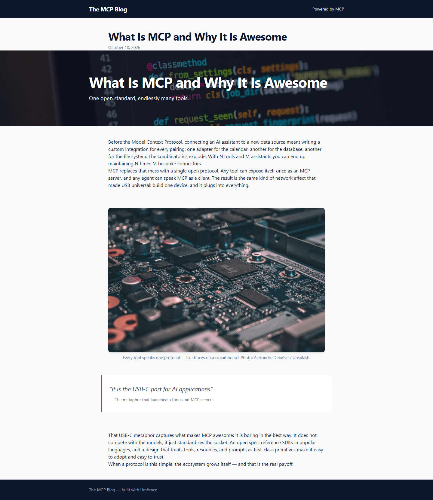

# Grade — 2026-10-10_1540_mcp-skills_glm-5.3-flash-high

**Test:** MCP Skills · **Model:** Glm 5.3 Flash (high) · **Grader:** Opus 5.5 (high) · **Total: 96 / 100**

| Category | Score | Max |
|---|---:|---:|
| It works | 35 | 35 |
| Content modeling | 25 | 25 |
| Code architecture & conventions | 25 | 25 |
| Content & presentation | 7 | 10 |
| Process & honesty | 4 | 5 |
| **Total** | **96** | **100** |

## Summary

A clean MCP-built blog that follows every convention. Five block types render through adapters and ViewComponents, the block-grid front page has a dynamic post list, and two published posts have real date and excerpt properties and use the provided Unsplash photos. It lost points only on thin post copy, small presentation flaws (the post title appears twice, paragraphs have no spacing) and writing the views before the stop/build step.

## Issues

- **minor:** The posts are thin (~200–280 words each). `/mcp-in-practice-five-reasons-agents-love-it/` is one intro sentence plus five one-line reasons.
- **minor:** Post pages show the title twice: `Views/blogPostTemplate.cshtml` renders an `h1`, and then the hero block repeats the same heading in another `h1`.
- **minor:** Rich text paragraphs have no spacing. `Views/Shared/Components/RichText/Default.cshtml` relies on `prose` classes, but the Tailwind typography plugin isn't installed, so `wwwroot/dist/site.css` has no `.prose` rules.
- **minor:** Order of operations: the Razor views, models and ViewComponents were written while Umbraco was still running, before the stop + `dotnet build` step (step 3 before step 2).
- **minor:** The front page's listing cards have no image (date and excerpt only).

## What it built

- **Document types:** Blocks are `heroBlock` (heading, subheading, image), `richTextBlock` (text), `imageBlock` (image, caption, altText), `quoteBlock` (quote, attribution) and `postListBlock` (heading). The composition `pageSeo` (metaTitle, metaDescription) is composed onto both pages. The pages are `blogSite` (blocks; allows `blogPost`) and `blogPost` (excerpt, postDate, blocks). `siteRoot` is now set to allow `blogSite`.
- **Data type:** `Blog Block Grid` (12 columns, all five blocks), filed under `Custom/Umbraco.BlockGrid`.
- **Templates:** `blogSiteTemplate` and `blogPostTemplate`. Both are standalone (`Layout = null`), call `GetBlockGridHtmlAsync`, and use the Tailwind `site.css`.
- **Pages:** WWW → **The MCP Blog** (domain `/`): a hero over the network photo, an intro rich-text block, and a "Latest posts" list block. Under it are two posts. *What Is MCP and Why It Is Awesome* has hero, rich text, image, quote and rich text blocks. *MCP in Practice – Five Reasons Agents Love It* has hero, rich text, image and quote blocks.
- **Media:** five provided Unsplash photos in a `Blog` media folder, served through signed `GetCropUrl` URLs.

**Front page:** a dark header bar, a full-width hero with the network image, an intro paragraph, and white "Latest posts" cards with a linked title, date and excerpt, then a dark footer.

**Blog post:** the title and date in the template, then a hero block that repeats the title over a code photo. Below that are the rich text (its paragraphs have no gap between them), a rounded circuit-board image with a credited caption, a blue-bordered quote card, and a closing rich-text block.

