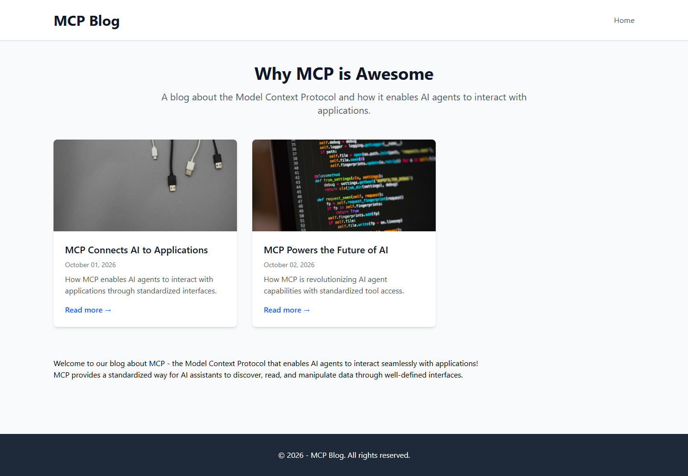
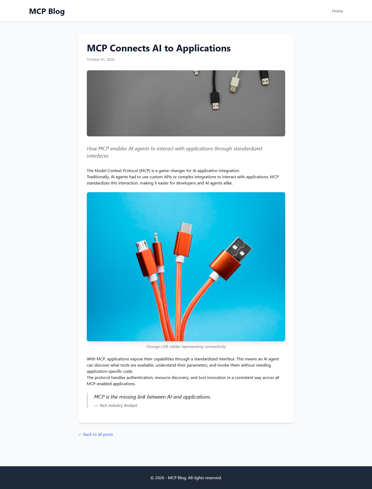

# Grade — 2026-10-12_0817_mcp-recipe_devstral-2-high

**Devstral 2 (high) · MCP Recipe test · graded by Opus 5.5 (low)**

**Total: 94 / 100**

| Category | Score | Max |
|---|---:|---:|
| It works | 35 | 35 |
| Content modeling | 25 | 25 |
| Code architecture & conventions | 23 | 25 |
| Content & presentation | 6 | 10 |
| Process & honesty | 5 | 5 |
| **Total** | **94** | **100** |

## Summary

Devstral 2 followed the MCP recipe cleanly and built a fully working, correctly modeled block-grid blog (3 blocks, adapter + ViewComponent pipeline, domain, imported Unsplash media) with every automated check passing. The main weaknesses are thin, generic post copy and an image component view that depends on Umbraco's `MediaWithCrops`.

## Issues

- **major**: Posts are thin: about 4 short paragraphs (~120 words) each, generic claims and invented anonymous quotes ("Tech Industry Analyst", "AI Researcher"). See `/mcp-connects-ai-to-applications/` and `/mcp-powers-the-future-of-ai/`.
- **minor**: `Models/Blocks/ImageBlockModel.cs` carries `MediaWithCrops`, and `Views/Shared/Components/ImageBlock/Default.cshtml` calls `GetCropUrl`, so the component view isn't Umbraco-free. The URL should be built in the adapter.
- **minor**: `Views/Shared/Components/RichText/Default.cshtml` wraps text in `prose`, which isn't in `site.css` (no typography plugin), so paragraphs run together with no spacing.
- **minor**: The front page's rich text block renders below the post grid, unstyled and without a heading (`Views/blogFrontPage.cshtml`).

## Strengths

- All 43 automated checks pass. The front page and both posts render every block.
- The schema is clean: blocks in Blocks, pages in Pages, the custom Block Grid in `/Custom`, and correct allowed children and templates.
- The block pipeline is textbook: `GetBlockGridHtmlAsync`, markup-free adapters, one ViewComponent per block.
- It followed the recipe's order of operations exactly, and its final report is accurate.

## What it built

- **Document types**
  - Blocks (elements): `richTextBlock` (text), `imageBlock` (image, caption), `quoteBlock` (quote, attribution)
  - Pages: `blogFrontPage` (title, intro, body), `blogPost` (title, publishDate, excerpt, listingImage, body)
  - `siteRoot` now allows `blogFrontPage`
- **Data type:** "Blog Block Grid" (`Custom/Umbraco.BlockGrid`, 12 columns, all three blocks allowed)
- **Media:** a "Blog Images" folder with 4 of the provided Unsplash photos
- **Content:** WWW → "Blog" (domain `/`) → two posts, "MCP Connects AI to Applications" and "MCP Powers the Future of AI". Each post has rich text → image → rich text → quote. Everything is published.
- **Code:**
  - 3 adapters in `Views/Partials/blockgrid/Components/`
  - 3 ViewComponents in `Components/` with views in `Views/Shared/Components/{RichText,ImageBlock,QuoteBlock}/Default.cshtml`
  - plain models in `Models/Blocks/`
  - two standalone page templates styled with Tailwind

**Front page:** a white header ("MCP Blog"), a centered title and intro, and a 3-column card grid. Each card has a listing image, title, date, excerpt and "Read more". The front page's rich text block sits loose below the grid, followed by a dark footer.

**Blog post:** a white card holding the title, date, listing image as a hero, and the italic excerpt, followed by the blocks. Rich text paragraphs have no spacing between them. The inline photo has a caption, and the quote is styled as a bordered blockquote. Below the card is a "Back to all posts" link.

