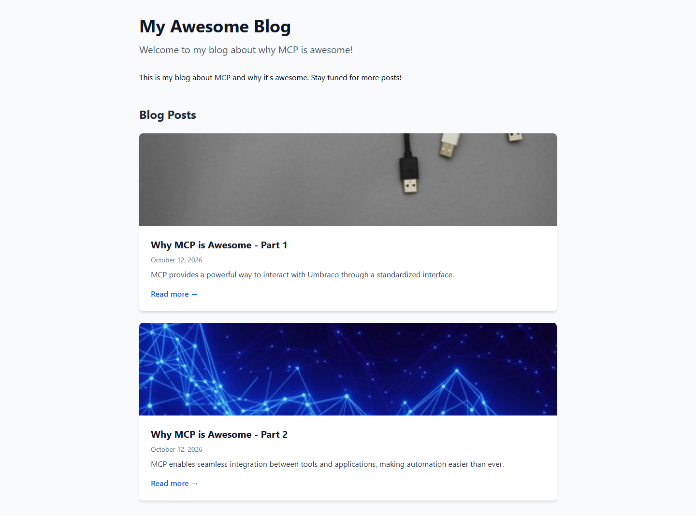
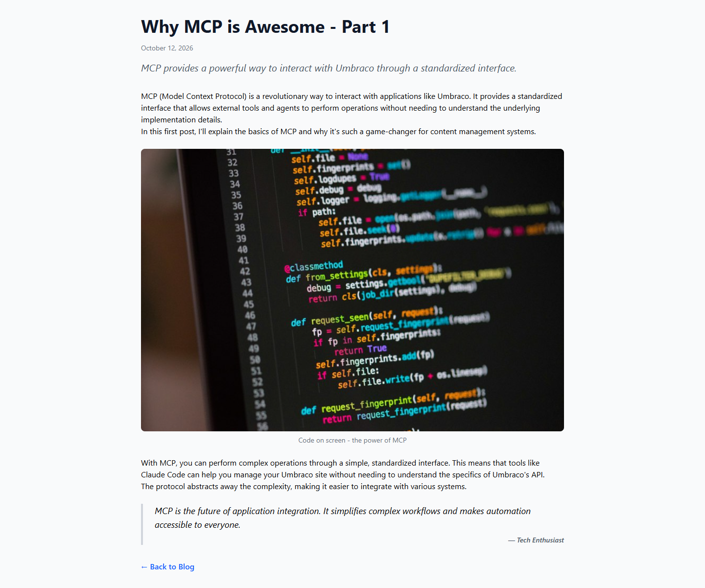

# Grade: 2026-10-12_0831_mcp-recipe_devstral-2-high

**Test:** MCP Recipe · **Model:** Devstral 2 (high) · **Grader:** Opus 5.5 (low)

**Total: 95.5 / 100**

| Category | Score | Max |
|---|---|---|
| It works | 35 | 35 |
| Content modeling | 25 | 25 |
| Code architecture & conventions | 25 | 25 |
| Content & presentation | 5.5 | 10 |
| Process & honesty | 5 | 5 |

## Summary

Devstral 2 followed the MCP recipe cleanly and built a fully working, correctly modeled block-grid blog: 3 blocks, the adapter → ViewComponent pipeline with Umbraco-free component views, a `/` domain, and imported Unsplash media. All 43 automated checks pass. The weak spots are the thin, generic post copy and a plain layout with unspaced rich-text paragraphs.

## Issues

- **minor:** The posts are thin and generic: about 4 short paragraphs (~110 words) each, with invented anonymous quotes ("Tech Enthusiast", "Developer Advocate"). See `/why-mcp-is-awesome-part-1/` and `/why-mcp-is-awesome-part-2/`.
- **minor:** The `prose` class in `Views/Shared/Components/RichText/Default.cshtml` does nothing without the Tailwind typography plugin, so rich-text paragraphs run together with no spacing.
- **minor:** There is no site header, nav or footer, and the front page's block grid body is a single placeholder sentence (`Views/blogFrontPage.cshtml`).
- **minor (not deducted):** Both templates repeat the full HTML shell with `Layout = null`, and the "Back to Blog" link is hard-coded to `/` (`Views/blogPost.cshtml`).

## What it built

- **Document types:**
  - `siteRoot` (Repositories, root only) → `blogFrontPage` (Pages: title, intro, body) → `blogPost` (Pages: title, publishDate, excerpt, listingImage, body).
  - Both page types have templates.
- **Blocks:**
  - Element types in `Blocks`: `richTextBlock` (text), `imageBlock` (image, caption) and `quoteBlock` (quote, attribution).
  - All three are in the "Blog Block Grid" data type (`Custom/Umbraco.BlockGrid`).
- **Code:**
  - Adapters live in `Views/Partials/blockgrid/Components/{richTextBlock,imageBlock,quoteBlock}.cshtml`. They map to `Models/Blocks/{RichText,Image,Quote}Model` and invoke the `RichText`, `Image` and `Quote` ViewComponents.
  - The component views live in `Views/Shared/Components/<Name>/Default.cshtml`.
  - Both page templates use `Html.GetBlockGridHtmlAsync`.
- **Pages:**
  - WWW → Blog (domain `/`) → "Why MCP is Awesome - Part 1" and "Part 2".
  - Each post has 4 blocks: rich text, image, rich text, quote.
  - The 4 provided Unsplash photos are in a "Blog Images" media folder.
- **Look:**
  - The front page is a centered single column: title, intro, a one-line rich text block, then "Blog Posts" as white cards with a cropped listing image, title, date, excerpt and "Read more →".
  - Posts show the title, date and italic excerpt, then the blocks: paragraphs, a rounded image with caption, and a bordered italic quote. A "← Back to Blog" link ends the page.
  - It is clean and readable but sparse.

