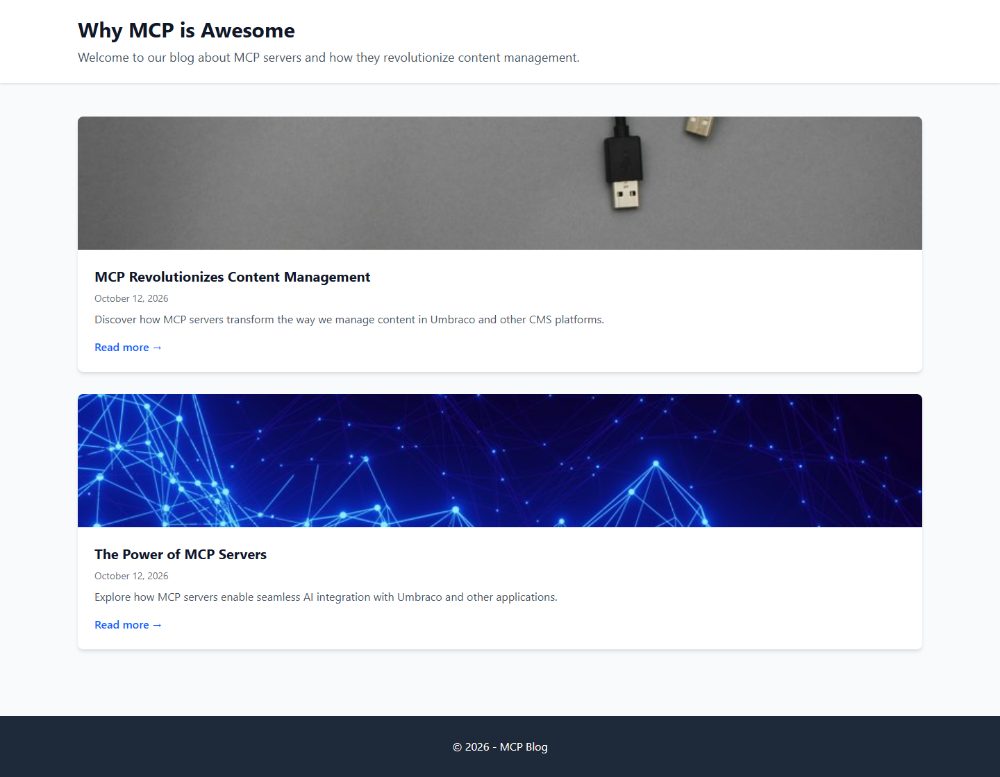
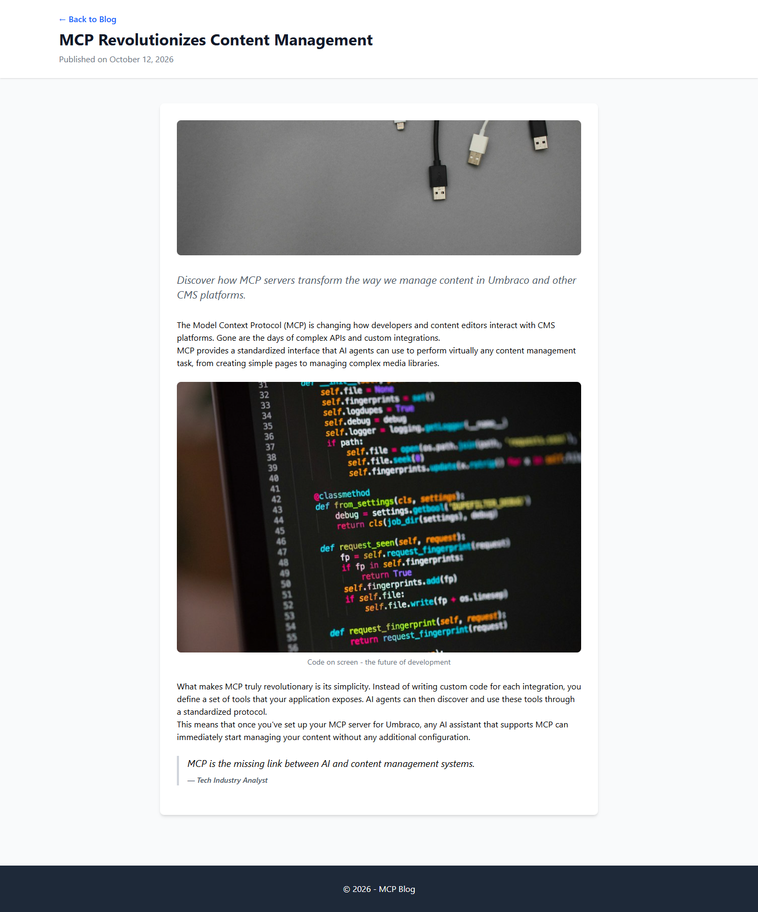

# Grade: 2026-10-12_0843_mcp-recipe_devstral-2-high

**Devstral 2 (high), MCP Recipe test. Total: 93.5 / 100.** Graded by Opus 5.5 (high).

| Category | Score | Max |
|---|---:|---:|
| It works | 35 | 35 |
| Content modeling | 25 | 25 |
| Code architecture & conventions | 23 | 25 |
| Content & presentation | 6 | 10 |
| Process & honesty | 4.5 | 5 |
| **Total** | **93.5** | **100** |

## Summary

Devstral 2 followed the MCP recipe cleanly and built a working, correctly modeled block-grid blog: 3 blocks, the adapter → ViewComponent pipeline with Umbraco-free component views, a / domain, and imported Unsplash media. Every automated check passes (43/43). The weak spots are a front page that never renders its block-grid body, thin and generic post copy, and rich-text paragraphs with no spacing.

## What it built

- **Document types:** `blogFrontPage` and `blogPost` in Pages. `siteRoot` (from the scaffold) allows `blogFrontPage`, which allows `blogPost`. Posts have `title`, `publishDate`, `excerpt`, `listingImage` and `body`. The front page has `title`, `intro` and `body`.
- **Blocks** (element types in Blocks): `richTextBlock` (text), `imageBlock` (image, caption) and `quoteBlock` (quote, attribution). All three are allowed in the `Blog Block Grid` data type (Custom/Umbraco.BlockGrid).
- **Code:** one adapter per block at `Views/Partials/blockgrid/Components/<alias>.cshtml`. Each maps to a plain model in `Models/Blocks/` and invokes a ViewComponent (`Image`, `Quote`, `RichText`) that renders `Views/Shared/Components/<Name>/Default.cshtml`.
- **Pages:** Blog (`/`, which has the domain), with "MCP Revolutionizes Content Management" and "The Power of MCP Servers" under it. Each post has 4 blocks: rich text, image, rich text, quote. 4 provided Unsplash photos are in the "Blog Images" media folder.
- **Front page:** a white header with the title and intro, then two full-width cards (cropped listing image, title, date, excerpt, Read more), then a dark footer. The front page's own rich-text block is not rendered.
- **Post page:** a header with a Back link, the title and the date. Below it is a white card with a hero image, an italic excerpt, then the block grid: rich text, a captioned image, rich text and a bordered quote.

## Issues

- **major:** The front page template never renders its body block grid. The front page's rich-text block (2 paragraphs) is published but invisible (`Views/blogFrontPage.cshtml`).
- **minor:** The posts are thin and generic: about 4 short paragraphs (~130 words) each, with invented anonymous quotes (`/mcp-revolutionizes-content-management/`, `/the-power-of-mcp-servers/`).
- **minor:** The `prose` class does nothing without @tailwindcss/typography, so rich-text paragraphs run together with no spacing (`Views/Shared/Components/RichText/Default.cshtml`).
- **minor:** The final report doesn't notice the unrendered front-page body and claims the site "follows all conventions".
- **minor:** The Back link is hard-coded to `/` (`Views/blogPost.cshtml`).

## Notes per category

- **It works (35/35):** The build is clean (the 10 warnings are the scaffold's ImageSharp advisories). `/` is served through the domain and lists both posts with image, date and excerpt. Every block renders, 6/6 images load through GetCropUrl, and everything is published.
- **Content modeling (25/25):** Folders, element vs document, the root rule, allowed children, templates, camelCase aliases and the Custom/ data type are all right. Metadata are real properties, and there are no compositions and no duplicates.
- **Architecture (23/25):** The adapter and ViewComponent pipeline is textbook. −2 because the front page doesn't render its block grid, although the recipe says to render the body on both pages.
- **Content & presentation (6/10):** Content 3/6 (on topic and spread over 4 blocks, but thin and generic). Presentation 3/4 (coherent and clean, but rich-text paragraphs have no spacing).
- **Process & honesty (4.5/5):** It used only MCP, followed the recipe's order, didn't access memory, and stayed in the project folder. −0.5 because the report missed the unrendered front-page body.
