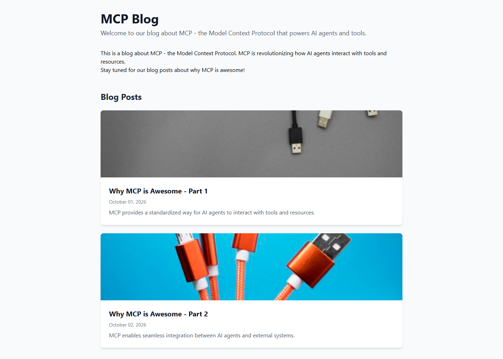
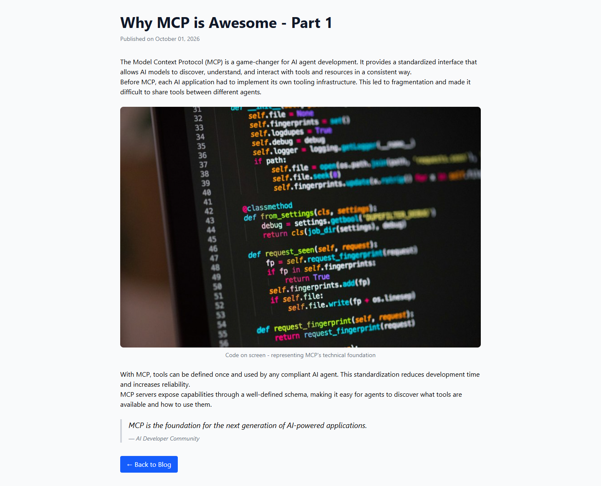

# Grade: 2026-10-12_0853_mcp-recipe_devstral-2-high

**Model:** Devstral 2 (high) · **Test:** MCP Recipe · **Grader:** Opus 5.5 (low) · **Total: 95 / 100**

| Category | Score | Max |
|---|---:|---:|
| It works | 35 | 35 |
| Content modeling | 25 | 25 |
| Code architecture & conventions | 25 | 25 |
| Content & presentation | 5 | 10 |
| Process & honesty | 5 | 5 |
| **Total** | **95** | **100** |

## Summary

Devstral 2 followed the MCP recipe cleanly and built a fully working, correctly modeled block-grid blog: 3 blocks, a textbook adapter → plain model → ViewComponent pipeline, a `/` domain, and imported Unsplash media. All 43 automated checks pass. The weak spot is the content: the two posts are only about 100 words each, and the design is plain, with no site header or footer and no spacing between rich-text paragraphs.

## Issues

- **major**: The posts are very thin and generic: 4 one- or two-sentence paragraphs (about 100 words) each, with invented anonymous quotes ("AI Developer Community", "Tech Visionary"). See `/why-mcp-is-awesome-part-1/` and `/why-mcp-is-awesome-part-2/`.
- **minor**: The `prose` class does nothing without `@tailwindcss/typography`, so rich-text paragraphs have no spacing (`Views/Shared/Components/RichText/Default.cshtml`).
- **minor**: There is no site header, navigation or footer, so the pages are a bare column of content (`Views/blogFrontPage.cshtml`, `Views/blogPost.cshtml`).
- **minor**: Both templates duplicate the full HTML shell (`Layout = null`) instead of sharing a layout.

## Strengths

- All 43 automated checks pass, the build is clean, and the model added no warnings (the 10 warnings are the scaffold's ImageSharp advisories).
- Textbook adapter → plain model → ViewComponent pipeline, with `GetCropUrl` in the adapter and Umbraco-free component views.
- Schema is modeled correctly: folders, element vs document, the `Custom/` data type, allowed children, templates and real metadata properties.
- Both pages render their block-grid body.
- MCP-only process (45 calls, 32 writes) that followed the recipe's order exactly, then checked its work with curl. Its final report is accurate.

## What it built

- **Document types:** `siteRoot` (Repositories, the only type allowed at root) → `blogFrontPage` (Pages: title, intro, body) → `blogPost` (Pages: title, publishDate, excerpt, listingImage, body).
- **Blocks (element types in Blocks):** `richTextBlock` (text), `imageBlock` (image, caption), `quoteBlock` (quote, attribution). All three are in the "Blog Block Grid" data type (`Custom/Umbraco.BlockGrid`).
- **Code:** adapters in `Views/Partials/blockgrid/Components/{richTextBlock,imageBlock,quoteBlock}.cshtml`, models in `Models/Blocks/`, `RichText`/`Image`/`Quote` ViewComponents in `Components/` with views in `Views/Shared/Components/<Name>/Default.cshtml`, and the templates `blogFrontPage.cshtml` and `blogPost.cshtml`.
- **Pages:** WWW → Blog (`/`, domain `/`) → "Why MCP is Awesome - Part 1" and "Part 2". Each post has the blocks rich text → image → rich text → quote.
- **Media:** 4 provided Unsplash photos in a "Blog Images" folder.

The front page has a title and intro, a short rich-text block, and a "Blog Posts" list of full-width white cards with a cropped listing image, a linked title, the date and an excerpt. The posts have a big title and date, rich text, a rounded captioned image, a bordered italic quote and a blue "Back to Blog" button. The design is clean but bare, and the rich-text paragraphs have no spacing between them.

