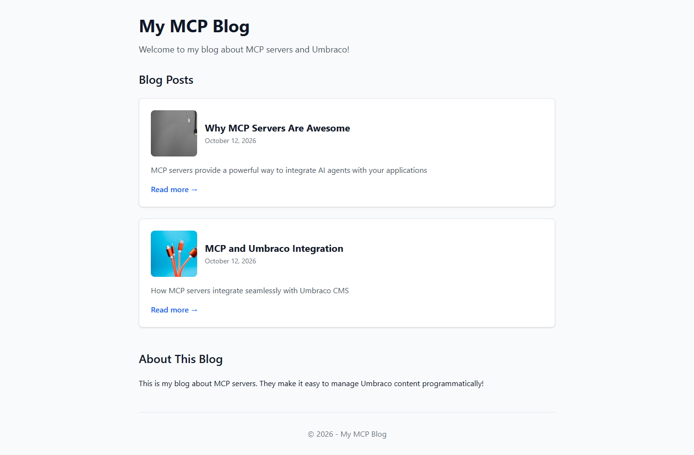
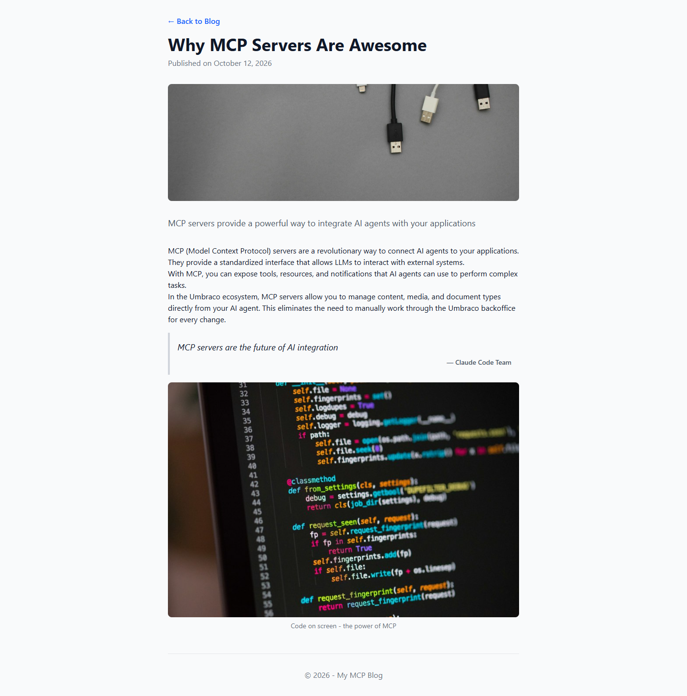

# Grade: 2026-10-12_0904_mcp-recipe_devstral-2-high

**Model:** Devstral 2 (high) · **Test:** MCP Recipe · **Grader:** Opus 5.5 (low) · **Total: 93.5 / 100**

| Category | Score | Max |
|---|---:|---:|
| It works | 35 | 35 |
| Content modeling | 25 | 25 |
| Code architecture & conventions | 24 | 25 |
| Content & presentation | 5 | 10 |
| Process & honesty | 4.5 | 5 |
| **Total** | **93.5** | **100** |

## Summary

Devstral 2 followed the MCP recipe cleanly and built a fully working, correctly modeled block-grid blog. It has 3 blocks, the adapter → plain model → ViewComponent pipeline, a `/` domain and imported Unsplash media. 42 of 43 automated checks pass. The one FAIL (`process.stayedInFolder`) is a false positive: every path it lists is a project file under the `/x/` drive prefix. The weak spots are very thin posts (about 80 words each, with invented quotes), a hacky untyped rich-text adapter, and rich text without paragraph spacing.

## Issues

- **major**: The posts are very thin: about 75–85 words each in 2–3 short paragraphs, with invented quotes attributed to "Claude Code Team" and "Umbraco Team". See `/why-mcp-servers-are-awesome/` and `/mcp-and-umbraco-integration/`.
- **minor**: The `richTextBlock` adapter reads `Value("text")` untyped and parses it as a Newtonsoft `JObject`, with fallbacks, instead of using the typed `Model.Content.Text` (`Views/Partials/blockgrid/Components/richTextBlock.cshtml`).
- **minor**: `prose` does nothing without `@tailwindcss/typography`, so rich-text paragraphs have no spacing between them (`Views/blogPost.cshtml`).
- **minor**: The final report lists post 1's blocks as rich text, image, rich text, quote. The actual order is rich text, rich text, quote, image. The report is also printed twice.
- **minor**: Both templates duplicate the full HTML shell with `Layout = null` instead of sharing a layout.

## Strengths

- The build is clean apart from the scaffold's own warnings, all pages return 200, and every block renders.
- The adapter → plain model → ViewComponent pipeline follows the rules, with `GetCropUrl` in the adapters and Umbraco-free component views.
- The schema is modeled correctly: folders, element vs document, a `Custom/` block grid data type, allowed children, templates and real metadata properties.
- The process used MCP only (42 calls, 35 writes), followed the recipe's order, and checked the output with curl.

## What it built

- **Document types:** `siteRoot` (Repositories, the only type allowed at root) → `blogFrontPage` (Pages: title, intro, body) → `blogPost` (Pages: title, publishDate, excerpt, listingImage, body).
- **Blocks (element types in Blocks):** `richTextBlock` (text), `imageBlock` (image, caption), `quoteBlock` (quote, attribution). All three are in "Blog Block Grid" (`Custom/Umbraco.BlockGrid`).
- **Code:** adapters in `Views/Partials/blockgrid/Components/{richTextBlock,imageBlock,quoteBlock}.cshtml`, models in `Models/Blocks/`, `RichText`/`Image`/`Quote` ViewComponents in `Components/` with views in `Views/Shared/Components/<Name>/Default.cshtml`, and the templates `blogFrontPage.cshtml` and `blogPost.cshtml`.
- **Pages:** WWW → Blog (`/`, domain `/`) → "Why MCP Servers Are Awesome" (blocks: rich text, rich text, quote, image) and "MCP and Umbraco Integration" (blocks: rich text, image, rich text, quote).
- **Media:** 4 provided Unsplash photos in a "Blog Images" folder.

The front page has the title "My MCP Blog" and an intro. Below that is a "Blog Posts" list of white cards, each with a square cropped thumbnail, a linked title, the date, an excerpt and "Read more →". It ends with an "About This Blog" block-grid section and a footer. Each post has a back link, a large title, the date, a 1200×400 header crop and the excerpt, then the blocks: a captioned rounded image and a bordered italic quote with attribution. The rich-text paragraphs run together with no spacing between them.

