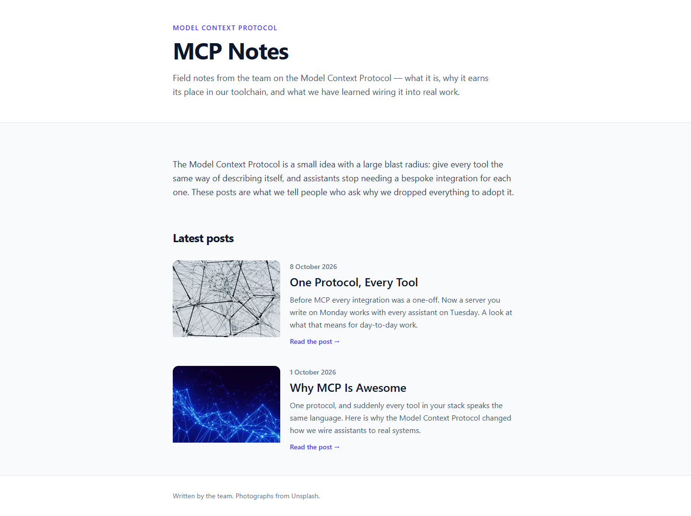
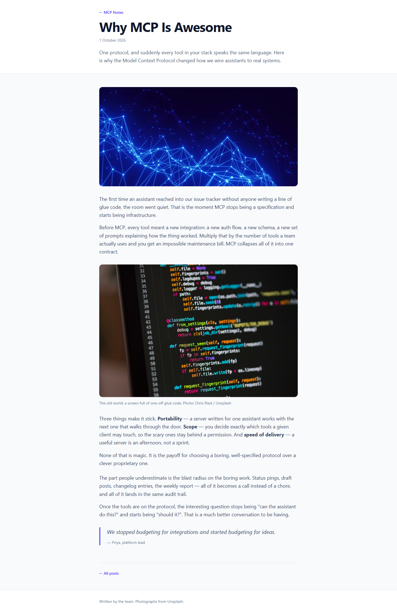

# Grade: 2026-10-12_1046_mcp-recipe_mimo-v2.6-flash-high

**Model:** Mimo V2.6 Flash (high) · **Test:** MCP Recipe · **Grader:** Opus 5.5 (high) · **Total: 95.5 / 100**

| Category | Score | Max |
|---|---|---|
| It works | 35 | 35 |
| Content modeling | 24 | 25 |
| Code architecture & conventions | 23.5 | 25 |
| Content & presentation | 8.5 | 10 |
| Process & honesty | 4.5 | 5 |
| **Total** | **95.5** | **100** |

## Summary

A complete, working blog built over MCP. It has a three-block grid (rich text, image, quote), a front page listing two image cards, and two on-topic posts with 5 blocks each. Blocks render through the exact adapter → ViewComponent pipeline, with a clean Tailwind design. The only flaws are component views that inherit `UmbracoViewPage`, a blogFrontPage template assigned to `siteRoot`, and somewhat generic post copy.

## Issues

- **minor**: Component views use `@inherits UmbracoViewPage<TModel>` instead of `@model`, which keeps an Umbraco dependency (`Views/Shared/Components/{Image,Quote,RichText}/Default.cshtml`; `code.componentViewsArePlain` FAIL).
- **minor**: The `siteRoot` document type got blogFrontPage as its allowed and default template; the WWW container should have none.
- **minor**: The posts are fairly generic (~300 words each). They have no subheadings, put rich text blocks back to back, and invent quote attributions ("Priya, platform lead") (`/why-mcp-is-awesome/`, `/one-protocol-every-tool/`).
- **minor**: A stray `curl -o /tmp_page.html` tried to write outside the project folder. It failed, and the final report disclosed it.

## Strengths

- Everything works: the build is clean, and `/`, both posts and all 6 images return 200, with no render errors.
- Textbook rendering pipeline: `GetBlockGridHtmlAsync`, markup-free alias-named adapters, one ViewComponent per block, and plain models in `Models/Blocks/`.
- `GetCropUrl` runs in the adapter, so the component models carry only strings.
- It followed the recipe's order exactly through `umbraco` and `umbraco-editor`, and the final report is accurate and candid.

## What it built

- **Document types:** `richTextBlock` (text), `imageBlock` (image, caption) and `quoteBlock` (quote, attribution) are elements in *Blocks*. `blogFrontPage` (title, intro, body) and `blogPost` (title, publishDate, excerpt, listingImage, body) are documents in *Pages*.
- **Data type:** *Blog Block Grid* (`Custom/Umbraco.BlockGrid`), 12 columns, allowing all three blocks.
- **Content:** WWW → **Blog** (domain `/`, one intro rich text block) → **Why MCP Is Awesome** (1 Oct 2026) and **One Protocol, Every Tool** (8 Oct 2026). Each post has 5 blocks: rich text, image, rich text, rich text, quote.
- **Media:** 6 of the provided Unsplash photos are in a *Blog Images* folder.
- **Code:** two full-page templates (`Layout = null`), 3 adapters, 3 ViewComponents with `Default.cshtml` views, and 3 plain models.

**Front page:** a white header ("MODEL CONTEXT PROTOCOL" kicker, "MCP Notes" title, intro), then an intro paragraph and a "Latest posts" list. Each post is a horizontal card with a cropped image, date, title, excerpt and "Read the post →" link, and a footer closes the page.

**Blog post:** a back link, a large title, the date and the excerpt in the header. Below that come a rounded hero image (the listing image), the rich text paragraphs, a captioned inline photo, an indigo-bordered blockquote and an "All posts" link.

