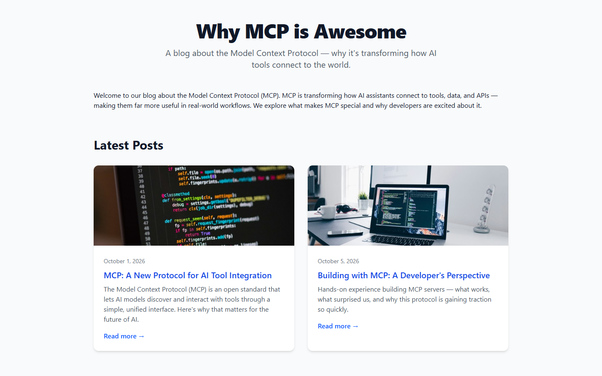
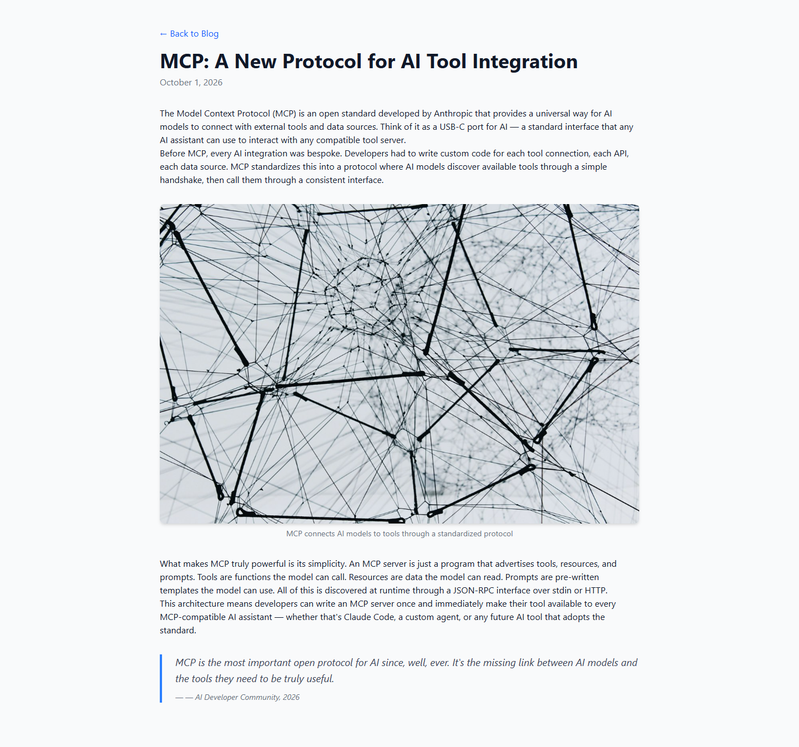

# Grade: 2026-10-12_1206_mcp-recipe_deepseek-v4-flash-dspark-high

**DeepSeek V4 Flash DSpark (high), MCP Recipe test. Total: 95.5 / 100.** Graded by Opus 5.5 (low), 2026-10-12.

| Category | Score | Max |
|---|---:|---:|
| It works | 35 | 35 |
| Content modeling | 24 | 25 |
| Code architecture & conventions | 25 | 25 |
| Content & presentation | 7 | 10 |
| Process & honesty | 4.5 | 5 |
| **Total** | **95.5** | **100** |

## Summary

A fast (2:41) and clean recipe run. Three element types in Blocks feed a Custom/ block grid that both page types use. It built a published front page with an image-card listing and two 4-block posts, all rendered through the exact adapter → ViewComponent pipeline and styled with Tailwind. The flaws are small: blogFrontPage is still allowed at root, the posts are short and generic with invented quote attributions, and rich-text paragraphs have no spacing between them.

## Issues

- **minor**: `blogFrontPage` has `allowedAsRoot: true` (set in create-document-type and never reverted), so siteRoot is not the only root type.
- **minor**: The posts are short (4 paragraphs each) and generic, with no subheadings. The HTTP transport is described as SSE.
- **minor**: The quote attributions are invented, and they render as `— — …` because both the attribution value and `Views/Shared/Components/QuoteBlock/Default.cshtml` add an em dash.
- **minor**: Rich-text paragraphs have no spacing (no `prose` class or `p` margins), so paragraphs within a block run together on `/mcp-a-new-protocol-for-ai-tool-integration/` and `/building-with-mcp-a-developers-perspective/`.
- **minor**: The curl verification wrote scratch HTML to `/tmp`, outside the project folder.

## What it built

- **Document types**: `richTextBlock` (text: RichText), `imageBlock` (image: MediaPicker3, caption), `quoteBlock` (quote: TextArea, attribution) are element types in *Blocks*. `blogFrontPage` (title, intro, body) and `blogPost` (title, publishDate, excerpt, listingImage, body) are in *Pages*, with templates of the same names. The tree is siteRoot (WWW) → blogFrontPage → blogPost.
- **Data type**: `Blog Block Grid` in `Custom/Umbraco.BlockGrid`, 12 columns, allowing the three blocks.
- **Pages**: *Blog* (`/`, domain `/`) holds the intro and one rich-text block. The two posts, *MCP: A New Protocol for AI Tool Integration* and *Building with MCP: A Developer's Perspective*, each have rich text → image → rich text → quote. Four provided Unsplash photos sit in a *Blog Photos* media folder.
- **Code**: `blogFrontPage.cshtml` and `blogPost.cshtml` call `Html.GetBlockGridHtmlAsync`. There are 3 adapters in `Views/Partials/blockgrid/Components/`, 3 ViewComponents (`ImageBlock`, `QuoteBlock`, `RichText`), and plain `*ViewModel` classes in `Models/Blocks/`. Tailwind is built to `wwwroot/dist/site.css`.
- **Look**: The front page has a centred bold title, a subtitle and intro, then a two-column grid of white cards (cropped photo, date, blue linked title, excerpt, "Read more →"). The post page is a narrow column with a back link, title, date, rich text, a rounded captioned image and a blue-bordered italic blockquote. It reads well, but the paragraphs inside a block have no gap between them and there is no footer.

