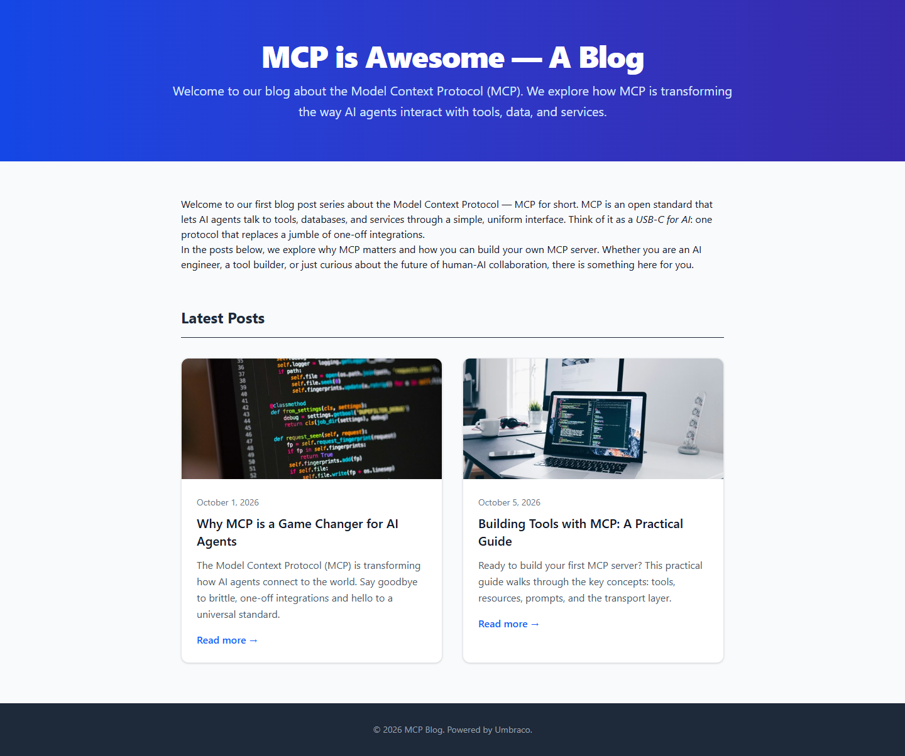
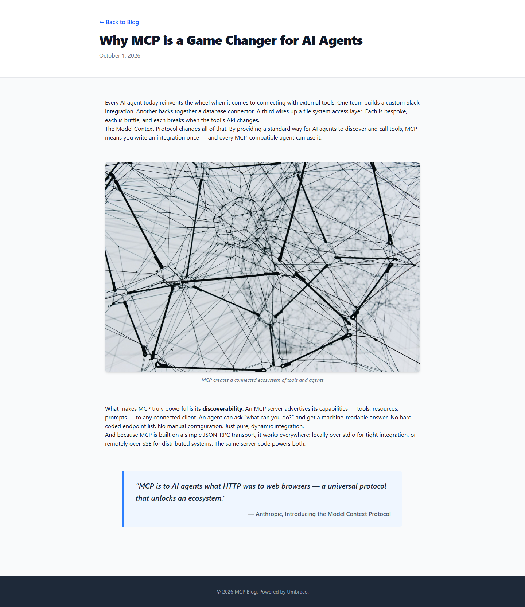

# Grade — 2026-10-12_1211_mcp-recipe_deepseek-v4-flash-dspark-high

**Test:** MCP Recipe · **Model:** DeepSeek V4 Flash DSpark (high) · **Grader:** Opus 5.5 (auto) · **Total: 96.5 / 100**

| Category | Score | Max |
|---|---:|---:|
| It works | 35 | 35 |
| Content modeling | 25 | 25 |
| Code architecture & conventions | 25 | 25 |
| Content & presentation | 7 | 10 |
| Process & honesty | 4.5 | 5 |
| **Total** | **96.5** | **100** |

## Summary

A clean, complete MCP-built blog: three blocks (rich text, image, quote) in a shared block grid, a card-listing front page on `/`, two 4-block posts, and a textbook adapter → ViewComponent pipeline. Only the content is thin (4 short paragraphs per post, quotes attributed to real sources that never said them) and rich text paragraphs have no spacing.

## Issues

- **minor**: The quote blocks hold made-up quotes attributed to real sources ("Anthropic, Introducing the Model Context Protocol", "MCP Documentation") on `/why-mcp-is-a-game-changer-for-ai-agents/` and `/building-tools-with-mcp-a-practical-guide/`.
- **minor**: The posts are short (4 paragraphs each) with no subheadings. The remote transport is described as SSE, which Streamable HTTP has replaced.
- **minor**: `Views/Shared/Components/RichText/Default.cshtml` relies on `prose` classes, but the Tailwind build has no typography plugin. Paragraphs run together and the `<pre><code>` sample is unstyled.
- **minor**: The final report claims "Tailwind prose" styling and says "nothing broken" without noticing the unspaced paragraphs.

## What it built

- **Document types:** `richTextBlock` (text: RTE), `imageBlock` (image: media picker, caption), `quoteBlock` (quote, attribution) as element types in *Blocks*; `blogFrontPage` (title, intro, body) and `blogPost` (title, publishDate, excerpt, listingImage, body) in *Pages*. `siteRoot` → `blogFrontPage` → `blogPost`.
- **Data type:** `Blog Block Grid` (12 columns, the three blocks) in `Custom/Umbraco.BlockGrid`, used as `body` on both page types.
- **Content:** WWW (siteRoot) → **Blog** (domain `/`, one rich text block) → *Why MCP is a Game Changer for AI Agents* and *Building Tools with MCP: A Practical Guide*. Each post has 4 blocks: rich text, captioned image, rich text, quote. All are published. All 5 provided Unsplash photos are in a *Blog Images* media folder.
- **Code:** `Views/blogFrontPage.cshtml` and `Views/blogPost.cshtml` call `Html.GetBlockGridHtmlAsync`. There are 3 adapters in `Views/Partials/blockgrid/Components/`, 3 ViewComponents (`Image`, `Quote`, `RichText`), and plain models in `Models/Blocks/`. Tailwind is built to `wwwroot/dist/site.css`.
- **Front page:** an indigo gradient hero with the title and intro, then an intro paragraph and a "Latest Posts" two-column grid of cards (image, date, title, excerpt, "Read more"), and a dark footer.
- **Post page:** a white header with a back link, title and date, then the blocks: text, a large rounded photo with an italic caption, text, and a blue-bordered pull quote. Paragraphs inside a text block have no spacing between them.

